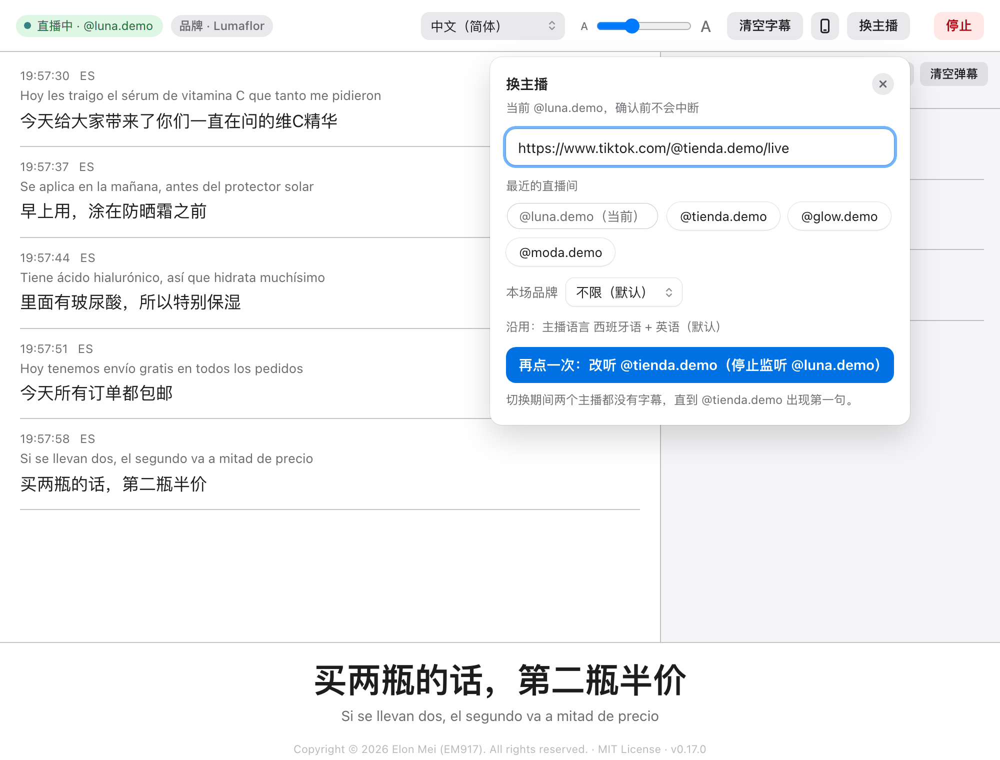
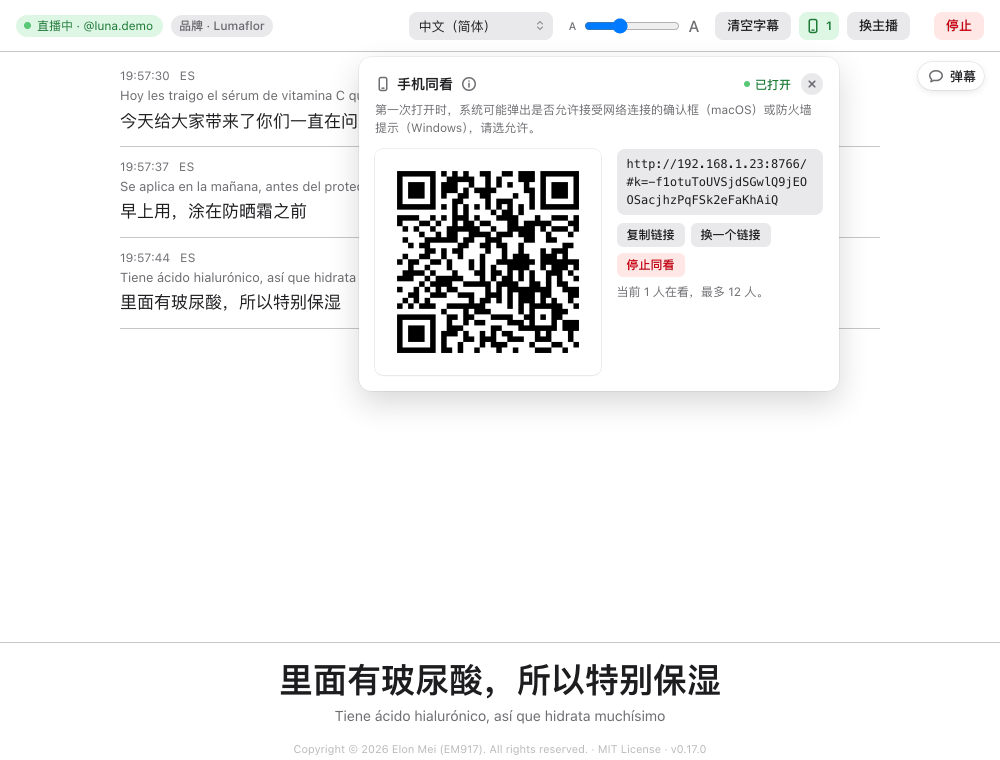
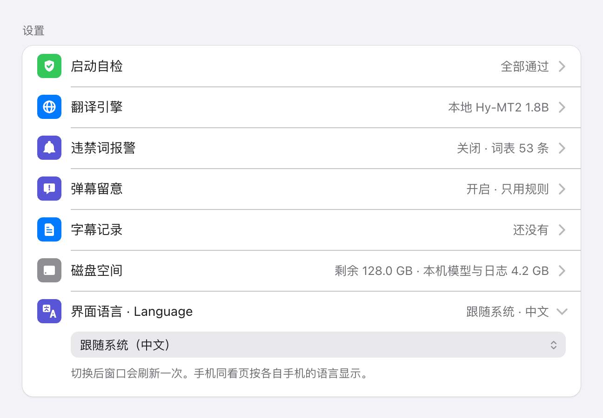

<a id="en"></a>

# TikTok Live Translator

<p align="center"></p>

<p align="center">
  <a href="https://github.com/EM917/tiktok-live-translator/releases/latest"></a>
  <a href="https://github.com/EM917/tiktok-live-translator/actions/workflows/ci.yml"></a>
  
  <a href="LICENSE"></a>
</p>

<p align="center"></p>

**Language / 语言：English | [中文](#zh)**

---

Live captions for Spanish TikTok streams, with the translation under each line. Viewer comments are translated too. Paste a live link and click Start.

It is for teams who follow Spanish live selling without speaking Spanish. One person runs the app on a computer and colleagues watch on their phones. A caption never waits for its translation: the Spanish appears as soon as it is recognized, and the translation fills in a moment later. Recognition runs on your computer. Translation does too once Ollama is installed, so there is no account and no API key.

<a id="en-features"></a>

## Features

<sub>[中文](#zh-features)</sub>

- Captions in real time: the Spanish line appears as soon as it is recognized, with the translation underneath.
- Viewer comments are translated too, in a panel beside the captions.
- Translation runs on your computer with a local model. DeepL, Google, Claude and OpenAI-compatible APIs are optional.
- Glossaries for each streamer and each brand keep product names consistent.
- Switch Streamer moves to another live stream without stopping first.
- Phone Viewing: colleagues on the same Wi-Fi scan a QR code and follow along on their phones. View only.
- Comment Review marks insults and threats, fake-product claims, flooding and redirects in viewer comments. It only reads.
- If the stream drops, the app reconnects. Audio that recognition has not caught up with waits in a queue.
- Banned-term alerts are available and off by default.

<a id="en-screenshots"></a>

## Screenshots

<sub>[中文](#zh-screenshots)</sub>

<table>
  <tr>
    <td width="50%"><br><sub>Home: paste a live link and click Start. Settings are below, one line each.</sub></td>
    <td width="50%"><br><sub>Live: the original first, the translation under it, comments beside.</sub></td>
  </tr>
  <tr>
    <td colspan="2" align="center"><br><sub>Phone page: view only, in the phone's own language.</sub></td>
  </tr>
</table>

<sub>The screenshots and the demo show made-up streams.</sub>

<a id="en-quick-start"></a>

## Quick start

<sub>[中文](#zh-quick-start)</sub>

You need macOS 12.3 or later, or Windows, and about 6 GB of free disk space. The first launch downloads software and models from PyPI, Hugging Face and ollama.com. A work network that cannot reach those sites stops the install.

1. Download `TikTok-Live-Translator-vX.Y.Z.zip` from the [latest release](https://github.com/EM917/tiktok-live-translator/releases/latest) and unzip it anywhere.

2. Install Python 3.9 or newer from [python.org](https://www.python.org/downloads/) with the default options. If it is missing, the launcher opens the download page.

3. Install [Ollama](https://ollama.com/download) and open it once. On Windows the installer is about 1.5 GB and needs administrator rights. When the app starts, it downloads the Hy-MT2 1.8B translation model (about 1 GB). Without Ollama, the app translates with Google's free endpoint, which sends caption text to Google.

4. Start the app. On macOS, double-click `TikTok Live Translator.app` and keep it inside its folder. On Windows, double-click `Start.bat`.

5. Paste a live link or `@username`, check Spoken language (Spanish + English by default), and click Start.

The first launch takes a few minutes. The speech model (up to 3 GB) downloads the first time you click Start, and the page shows the progress.

If macOS says the app cannot be opened, go to System Settings → Privacy & Security and click Open Anyway. On macOS 14 and earlier, right-click the app and choose Open instead.

On Windows, if a warning names an unknown publisher, click Run. The black text window that opens next to the app is the app itself, so keep it open.

Choose the language to translate into from the menu in the top bar. A new install with an English interface starts on English. The interface follows your system language, English or Chinese, and Settings → App Language changes it.

During a session, Switch Streamer moves to another streamer. Stop returns to the home page and keeps that session's captions under Previous Session.

### From a terminal

```bash
git clone https://github.com/EM917/tiktok-live-translator.git
cd tiktok-live-translator && python3 main.py     # python main.py on Windows
```

```bash
python3 main.py --demo        # preview the window without a stream
python3 main.py --doctor      # print the hardware check
python3 main.py --ui-lang en  # English interface for this launch only
```

Add `--browser` to use a browser tab instead of the app window. More: [all flags](docs/command-line.md), [disk space and hardware](docs/hardware.md), [interface language](docs/interface-language.md).

### Updating

The app checks GitHub for a new version when it starts. A banner at the top of the window then shows an Update Now button if you installed with git, or a download link if you installed from the zip.

<a id="en-translation-engines"></a>

## Translation engines

<sub>[中文](#zh-translation-engines)</sub>

Choose the engine in Settings → Translation Engine on the home page. API keys go there too and are saved in `settings.json` on your computer.

| Engine | Runs | Key |
|---|---|---|
| Automatic (default) | On your computer if a local model is installed, otherwise on Google's servers | No |
| Local Hy-MT2 1.8B | On your computer, through Ollama | No |
| Local Hy-MT2 7B | On your computer, through Ollama. Needs a separate download and about 16 GB of RAM | No |
| DeepL | DeepL's servers | Yes |
| Claude | Anthropic's servers | Yes |
| OpenAI-compatible API | The provider's servers, or your own such as LM Studio | Yes |
| Google (free) | Google's servers | No |
| Don't Translate | Nothing runs: captions show the original only | No |

Automatic uses Hy-MT2 1.8B if it is installed, then TranslateGemma, then Google's free endpoint. It never picks the 7B model.

Glossaries keep product names right. Put one streamer's wording in `profiles/<username>.txt`, one brand's products in `brands/<brand>.txt` (pick the brand in the Brand menu), and shared terms in `glossary.txt`. Changes apply after Stop and Start. These files stay on your computer. With DeepL, the app also keeps a glossary in your DeepL account.

To redo one caption with the strongest model you have, hover it and click Retranslate. A graded comparison of four engines is in [docs/engine-benchmarks.md](docs/engine-benchmarks.md). Glossaries, DeepL and Retranslate are covered in [docs/translation-engines.md](docs/translation-engines.md).

<a id="en-phone-viewing"></a>

## Phone Viewing

<sub>[中文](#zh-phone-viewing)</sub>

Colleagues can follow the captions on their phones. Click the phone icon in the top bar, then Start Sharing. A phone on the same Wi-Fi scans the QR code or types the address shown. Allow incoming connections if macOS or Windows asks.

A phone shows captions and alerts. It can ask for one line to be retranslated, and it cannot start, stop or change anything. Each page uses the phone's own language, and up to 12 phones can watch at once.

The link contains a key, so treat it like a password. New Link disconnects every phone. Sharing is off until you turn it on, and it works on the same network only.

<a id="en-comment-review"></a>

## Comment Review

<sub>[中文](#zh-comment-review)</sub>

The app marks viewer comments that:

- insult or threaten
- call products fake or a scam, or call for reports or for people not to buy
- flood the chat
- pull people to another stream or shop

During a session, a line at the top of the window sums up what is waiting.

A red bar means a rule matched clearly. Amber means the rules are unsure. Entries you have not confirmed show amber even on a match. Most shipped threat and report entries are confirmed. The others are not, so insults, for example, show amber until you confirm them.

Comment Review only reads. It cannot delete comments or mute anyone, and phones do not show it. It is on by default and uses rules only, which run on your computer with no model. Turn it off in Settings → Comment Review. Marked viewers, the optional Claude review and the rules folder are in [docs/comment-review.md](docs/comment-review.md).

<a id="en-banned-term-alerts"></a>

## Banned-Term Alerts

<sub>[中文](#zh-banned-term-alerts)</sub>

Alerts are off by default. Turn them on in Settings → Banned-Term Alerts with Show alert on match.

Matching runs on the recognized Spanish text, so an alert does not wait for the translation. A match opens a red Possible Banned Terms panel at the top of the window. The list is `banned_terms.txt` in the app folder, one word or phrase per line. Save it, then click Stop and Start. With alerts off, matches are still written to the audit log. The shipped list is a starting point: review it before you rely on it. More in [docs/banned-terms.md](docs/banned-terms.md).

<a id="en-when-something-goes-wrong"></a>

## When something goes wrong

<sub>[中文](#zh-when-something-goes-wrong)</sub>

**The app says TikTok didn't provide a stream URL (code 4003110).** TikTok's interface did not return a stream URL for this live link, and it gives no reason. Click Start again a little later, or paste the live link and a `.flv` URL copied from your browser together, separated by a space. To see this room's history on your computer, run `python3 tools/diagnose_room.py @streamer --history-only`. It sends no requests.

**A Startup Check row is red.** Open Settings → Startup Check. Each row shows its fix underneath. A failing check also stays in a banner at the top of the window until a later check passes, and the checks run again at every launch. An incomplete noise-reduction model is a common cause: delete `models/bd.rnnn` and start again.

**Browser Login says macOS did not allow access.** Add the Python interpreter to Full Disk Access, not the app. The Browser Login row shows the path to add.

1. Open System Settings → Privacy & Security → Full Disk Access and click +.

2. In the file window press ⌘⇧G, paste the path, press Return, click Open, and turn the entry on. It is listed as `python3.x`, not under the app's name.

3. Repeat for each path shown, then quit the app completely and reopen it.

Add Terminal too if you start with `Start.command`. Only streams where TikTok gives the stream URL only to signed-in viewers need this. If the audit log shows `cannot_decrypt`, click Start again. When a Keychain dialog asks for "Chrome Safe Storage", enter your Mac login password and choose Always Allow.

**Update Now does not start or finish.** The message says why and shows a command with a Copy button. Run it in Terminal. If the message lists changed app files, the command discards those changes, so do not run it if you changed them on purpose.

**Captions fall behind and the window warns about a backlog.** Run `ollama ps`. If more than one model is loaded, unload the extra one with `ollama stop <model>`. If that does not help, use a smaller speech model, for example `python3 main.py --model small`. On a Mac with 8 GB of RAM, `--model large-v3-turbo` or `--model small` fits better than the default.

**The status says Live but no captions appear.** Silent or low-confidence audio is skipped on purpose, for example while the streamer plays music or is not speaking. If someone is clearly speaking and nothing appears, try `python3 main.py --denoise off` or a different model size.

**The Comments panel is empty or shows only the original text.** Comments are translated only while the engine is a local model (Hy-MT2 1.8B or TranslateGemma) or Claude. They need Python 3.10 or newer, and a stream URL pasted on its own has no comments, so use the live link or `@username`.

**A phone cannot open the Phone Viewing link.** The app only knows that no connection came in. Check, in order: the phone is on the same Wi-Fi as the computer, another address from the list in the panel works, and the same link opens in a browser on the computer. If WeChat shows a warning, open the link in a browser from its top-right menu.

**The app quit when the black window on Windows closed.** That window is the app itself. Start it again with `Start.bat` and keep the window open.

Other problems, such as a stuck download or a busy port, are in [docs/faq.md](docs/faq.md).

<a id="en-limits"></a>

## Limits

<sub>[中文](#zh-limits)</sub>

- TikTok's interfaces are unofficial and may change. For some live streams TikTok does not provide a stream URL, and the app cannot get one.
- Translations can be wrong, most often on product names and slang.
- On a computer without Apple Silicon or an NVIDIA GPU, recognition can fall behind. Only audio more than 60 seconds behind is dropped, and the window counts it.
- Viewer comments are translated only with a local model or Claude.
- Phone Viewing works on the same network only. It uses plain http, so phones get no system notifications, and sound may stop when a phone locks.
- There is no export. Select and copy text from the window; it keeps the last 300 lines.
- The terminal, the logs and the audit log are always in Chinese, whatever the interface language.

<a id="en-privacy"></a>

## Privacy

<sub>[中文](#zh-privacy)</sub>

Speech recognition always runs on your computer. The local engines (Hy-MT2 and TranslateGemma) and Don't Translate send nothing out.

With DeepL, Google or Claude, caption text goes to that provider. With an OpenAI-compatible API it goes to the server you set up, which can be your own. With Claude, translated comments and Retranslate requests go to Anthropic too.

Viewer comments come from TikTok through TikTokLive, which signs its connection through the third-party Euler Stream service. The app also contacts TikTok for the stream, GitHub to check for updates, and Hugging Face, PyPI and ollama.com to download software and models.

Comment Review uses rules only, on your computer. If you choose the Claude review, one comment at a time goes to Anthropic, with phone numbers, links, emails and `@handles` masked first.

Phone Viewing opens a port on your network only while it is on. Phones see captions, not settings, file paths, cookies or the stream address. The control page itself can be opened from this computer only.

Use the app for personal learning and language help. Follow TikTok's Terms of Service and local laws, and do not rebroadcast or redistribute other people's content.

<a id="en-how-it-works"></a>

## How it works

<sub>[中文](#zh-how-it-works)</sub>

<p align="center">
  
</p>

The app finds the stream URL, pulls the audio with ffmpeg, quiets background music, and cuts it into short segments. Whisper turns each segment into text. The text goes to the window at once. Translation and banned-term matching start from the same text and never hold it up.

When the app starts, Startup Check runs each part once (noise reduction, translation, the audit log) and shows a fix next to anything that fails. A readout at the bottom of the window shows how long a spoken word takes to be recognized and how much the translation adds.

Each session also writes an audit log in `logs/`, one record per segment: the accepted text, the candidates the quality filter rejected, banned-term matches and the translation. [Explore the diagram](https://em917.github.io/tiktok-live-translator/architecture/audio-chain.en.html).

<a id="en-credits-and-license"></a>

## Credits and license

<sub>[中文](#zh-credits-and-license)</sub>

- [faster-whisper](https://github.com/SYSTRAN/faster-whisper) and [mlx-whisper](https://github.com/ml-explore/mlx-examples): speech recognition
- [yt-dlp](https://github.com/yt-dlp/yt-dlp): stream lookup
- [FFmpeg](https://ffmpeg.org/): audio processing, including its RNNoise filter
- [rnnoise-models](https://github.com/GregorR/rnnoise-models): the noise-reduction model (beguiling-drafter)
- [Ollama](https://github.com/ollama/ollama), [Hy-MT2](https://github.com/Tencent-Hunyuan/Hy-MT2) and [TranslateGemma](https://ollama.com/library/translategemma): local translation

Copyright © 2026 [Elon Mei (EM917)](https://github.com/EM917). Released under the [MIT License](LICENSE).

---

<a id="zh"></a>

# TikTok 直播同传

<p align="center"></p>

<p align="center"></p>

**Language / 语言：[English](#en) | 中文**

---

TikTok 直播的实时双语字幕工具，为西语带货直播而做。粘贴直播间地址，程序就把主播说的话
实时转写：每句识别出来立刻上屏，译文稍后在它下方补上。观众弹幕同时翻译。

给不懂西语、又要跟西语带货直播的团队用：中控在电脑上看，同事用手机跟着看。上手见
[快速开始](#快速开始)。

字幕从不等译文：原文先上屏。识别跟不上时音频在队列里排着，窗口上会说明。语音识别
永远在本机完成，用本地模型时翻译也在本机——不需要 API Key，没有使用费用。

界面有中文和英文两种。新装的程序跟随系统语言，「设置 → 界面语言 · Language」可以切换，
见[界面语言](docs/interface-language.zh-CN.md)。

<a id="zh-features"></a>

## 特性

<sub>[English](#en-features)</sub>

- 🎙️ **实时字幕，原文先出** —— OpenAI Whisper 双后端（faster-whisper / MLX），支持 90+ 语言，默认只在西语和英语之间识别。每句识别出来立刻上屏，译文随后补在它下方；最新一句还会以大字显示在窗口底部
- 🌐 **本地优先的翻译** —— Hy-MT2（Apache 2.0，离线免费）经 Ollama 提供两档，另可选 TranslateGemma、DeepL（带原生术语表）、Google 免费接口、Claude API 和任意 OpenAI 兼容接口。默认用 Hy-MT2 1.8B，其次 TranslateGemma，两个都没装时用 Google 免费接口；7B 不会被自动选用。见[翻译引擎](#翻译引擎)
- 🏷️ **按品牌、按主播的词表** —— 全局词表、主播词表、品牌词表（在「本场品牌」下拉里按场选择）共同决定商品名怎么识别、怎么翻译，对所有引擎都生效。见[词表](docs/translation-engines.zh-CN.md#词表)
- 💬 **观众弹幕翻译** —— 评论通过 TikTokLive 从直播间获取，当前引擎是本地模型（Hy-MT2 1.8B 或 TranslateGemma）或 Claude 时翻译；用 Google、DeepL、OpenAI 或 7B 时「观众弹幕」面板只显示原文。可用 `--no-comments` 关闭，见[常见问题](docs/faq.zh-CN.md#zh-viewer-comments)
- 🔁 **直播中换主播** —— 点顶栏「换主播」，不用先点「停止」就能改听另一个主播：从「最近的直播间」里选或粘贴直播间地址，选好本场品牌，再点一次确认。主播语言沿用当前设置，字幕历史里会插一条分隔线标出新主播从哪里开始
- 📱 **手机同看** —— 同一 Wi-Fi 下的同事扫二维码，就能在手机上看字幕和报警，页面按各自手机的语言显示；只看，不能操作；默认关闭。见[常见问题](docs/faq.zh-CN.md#zh-phone-viewing)
- 🌍 **中英文界面** —— 新装跟随系统语言，也可以在「设置」里切换。见[界面语言](docs/interface-language.zh-CN.md)
- ✅ **启动自检** —— 每项能力实际执行而非检查配置：降噪实跑 RNNoise，翻译实际请求引擎，审计日志实际写入。有项目未生效时，首页上那一行自动展开并附处理步骤，页面顶部还会出现一条提示，待机和直播中都在，直到之后的自检通过
- 🔄 **抗故障** —— 最多七种办法找流地址；重连时分得清断网和下播；识别跟不上时音频排队而不是丢掉。见[抗故障](docs/fault-tolerance.zh-CN.md)
- 🎵 **人声降噪** —— RNNoise 抑制背景音乐，针对持续 BGM 的直播间调校
- ⚡ **硬件自动配置** —— 检测可用加速器（Apple Silicon GPU / NVIDIA CUDA / CPU），选择仍能实时运行的最大模型
- 📊 **延迟可观测** —— 窗口底部实时显示：一个词说出口后最多要等多久才被识别并检查完（中位数与 P95），拆成切段与识别两部分，另加译文再等多久。审计日志逐段记录：采纳的文本、被质量过滤丢弃的候选、命中的违禁词，以及随后到达的译文
- 🚨 **违禁词报警（默认关闭）** —— 用于带货直播的合规监听：在识别出的原文上做三级匹配（命中 / 变体 / 疑似），不依赖翻译，短语跨字幕边界同样可命中。开关在「设置 → 违禁词报警」。见[违禁词报警](#违禁词报警)
- 👀 **弹幕留意（默认开，只用规则）** —— 在观众弹幕里发现辱骂和威胁、说假货或号召举报、刷屏、引流：规则明确命中标红，拿不准标琥珀，窗口顶部有一行提示，关注名单里的人每条弹幕都高亮。只读，不能删弹幕或禁言；手机同看上没有。可选 Claude Haiku 5.5 复核，只加不减。「设置 → 弹幕留意」里可以关。见[弹幕留意](#弹幕留意)

<a id="zh-screenshots"></a>

## 界面截图

<sub>[English](#en-screenshots)</sub>

<table>
  <tr>
    <td width="50%"><br><sub>首页：粘贴直播间地址，点「开始翻译」。「设置」在下方，每项一行，点开才展开。</sub></td>
    <td width="50%"><br><sub>直播中：原文先出，译文在下，弹幕在旁。</sub></td>
  </tr>
  <tr>
    <td width="50%"><br><sub>换主播：选好下一个主播，再点一次确认。</sub></td>
    <td width="50%"><br><sub>手机同看：同一 Wi-Fi 下的手机扫码或打开链接观看。</sub></td>
  </tr>
  <tr>
    <td width="50%" align="center"><br><sub>手机页：只看，按手机自己的语言显示。</sub></td>
    <td width="50%"><br><sub>设置 → 界面语言 · Language：跟随系统、中文或 English。</sub></td>
  </tr>
</table>

<sub>上面的截图和演示动图都是虚构的直播，由 <code>tools/readme_shots.py</code> 生成。</sub>

<a id="zh-quick-start"></a>

## 快速开始

<sub>[English](#en-quick-start)</sub>

### 无需终端的安装方式（推荐）

1. **下载**：到[最新 Release](https://github.com/EM917/tiktok-live-translator/releases/latest) 的 Assets 里下载 **TikTok-Live-Translator-vX.Y.Z.zip**，解压到任意位置（例如桌面）——下载「Source code (zip)」也一样能用。也可以点仓库页绿色 **Code** 按钮 → **Download ZIP**（取的是最新开发版）。
2. **装 Python**（免费，只装一次）：到 [python.org/downloads](https://www.python.org/downloads/) 下载安装包，按默认选项装完即可。忘了装也没关系——启动器发现没有 Python 时会自动打开下载页提示你。
3. **启动**：
   - **macOS**：双击文件夹里的 **`TikTok Live Translator.app`**。首次打开如提示「无法打开」：旧系统右键 → 打开；**macOS 15 及以后**要到 **系统设置 → 隐私与安全性**，拉到页面底部点 **「仍要打开」**（只需一次）。可以把它拖到 Dock 常驻，但**不要把它拖出这个文件夹**。
   - **Windows**：双击 **`Start.bat`**。若弹出「发布者未知」的安全警告，点「运行」即可（本工具完全开源，代码就在这个文件夹里）。运行期间会有一个黑色文字窗口——**它就是程序本身，请保持打开**，字幕显示在另外弹出的应用窗口里。

系统要求与窗口内核：[docs/hardware.zh-CN.md](docs/hardware.zh-CN.md#最低系统要求与窗口内核)。

首次启动会自动安装全部组件（需要几分钟，屏幕上有提示；首次识别还会自动下载语音模型，页面上能看到进度），之后每次秒开。窗口打开后：**粘贴直播间地址（或只输入主播用户名）→ 确认「主播语言」（默认西班牙语 + 英语）和顶栏里要译成的语言 → 点「开始翻译」**。直播中点「**换主播**」可以改听另一个主播；点「**停止**」回到首页，这一场的字幕留在下方「上一场字幕」里。

### 命令行方式

装好 [Python 3.9+](https://www.python.org/downloads/) 后两条命令：

```bash
git clone https://github.com/EM917/tiktok-live-translator.git
cd tiktok-live-translator && python3 main.py
```

（Windows 用 `python main.py`）其余全自动：首次运行自动创建虚拟环境、安装全部依赖（含内置 ffmpeg 和降噪模型）。也可以直接传参：

```bash
python3 main.py "https://www.tiktok.com/@主播用户名/live" --source es
python3 main.py --demo      # 不连直播，预览界面
python3 main.py --doctor    # 打印硬件检测结果和推荐配置
python3 main.py --ui-lang zh   # 只这一次用中文界面
```

手动安装与更新克隆：[docs/command-line.zh-CN.md](docs/command-line.zh-CN.md#克隆安装与更新)。

### 启动方式

- **macOS**：双击 **`TikTok Live Translator.app`**（或 `Start.command`）；
- **Windows**：双击 **`Start.bat`**；
- 命令行：`cd ~/tiktok-live-translator && python3 main.py`。

界面在**独立应用窗口**中打开（不占浏览器标签页），上次填过的直播间地址、选过的主播语言和目标语言都会记住，点「开始翻译」即可；输入框下方的「**最近的直播间**」列着最近打开过的主播，点一下就直接开始。关掉窗口就是退出，直播中会先问一句。想改回浏览器界面加 `--browser`。

更多：

- 磁盘空间：[docs/hardware.zh-CN.md](docs/hardware.zh-CN.md#磁盘空间)。
- 硬件自动配置：[docs/hardware.zh-CN.md](docs/hardware.zh-CN.md#硬件自动配置)。
- 命令行参数：[docs/command-line.zh-CN.md](docs/command-line.zh-CN.md#命令行参数)。
- 界面语言：[docs/interface-language.zh-CN.md](docs/interface-language.zh-CN.md)。

### 自动更新

每次启动时会静默检查 GitHub 上的最新版本（网络失败一律无声跳过）。有新版本时页面顶部会出现横幅：

- **git 安装**（`git clone` 的）→ 点「一键更新」自动 `git pull --ff-only` 并重启程序。本地有未提交修改时会拒绝更新以免覆盖你的改动；
- **ZIP 安装** → 横幅提供下载页链接，手动替换即可。

界面底部会显示当前版本号。

<a id="zh-translation-engines"></a>

## 翻译引擎

<sub>[English](#en-translation-engines)</sub>

已移到 [docs/translation-engines.zh-CN.md](docs/translation-engines.zh-CN.md)。

<a id="zh-phone-viewing"></a>

## 手机同看

<sub>[English](#en-phone-viewing)</sub>

已移到 [docs/faq.zh-CN.md](docs/faq.zh-CN.md#zh-phone-viewing)。

<a id="zh-comment-review"></a>

## 弹幕留意

<sub>[English](#en-comment-review)</sub>

已移到 [docs/comment-review.zh-CN.md](docs/comment-review.zh-CN.md)。

<a id="zh-banned-term-alerts"></a>

## 违禁词报警

<sub>[English](#en-banned-term-alerts)</sub>

已移到 [docs/banned-terms.zh-CN.md](docs/banned-terms.zh-CN.md)。

<a id="zh-when-something-goes-wrong"></a>

## 出问题时

<sub>[English](#en-when-something-goes-wrong)</sub>

- 常见问题：[docs/faq.zh-CN.md](docs/faq.zh-CN.md)。
- 抗故障：[docs/fault-tolerance.zh-CN.md](docs/fault-tolerance.zh-CN.md)。

<a id="zh-limits"></a>

## 做不到的

<sub>[English](#en-limits)</sub>

这一节还没有中文版，英文见 [Limits](#en-limits)。

<a id="zh-privacy"></a>

## 隐私

<sub>[English](#en-privacy)</sub>

- 识别永远在本地；翻译用 `hymt2`、`hymt2-7b`、`gemma` 或 `none` 时不出本机，用 `deepl`、`google`、`claude` 或 `openai` 时字幕文本会发给对应服务商（`openai` 的 `OPENAI_BASE_URL` 指向 LM Studio 这类本机服务时除外）。用 `claude` 时，翻译后的观众弹幕和「重译」的请求也会发给 Anthropic。观众弹幕经 TikTokLive 从 TikTok 获取，连接签名经第三方 Euler Stream 服务。
- 弹幕留意默认只用规则，全部在本机完成。选了 Claude Haiku 5.5 复核之后，需要复核的那一条弹幕（加上同一人 2 分钟内的前一条）会发给 Anthropic：电话、数字串、链接、邮箱和 `@账号` 先打码，昵称、账号 id、主播名、时间和字幕不发。见[弹幕留意](#弹幕留意)。
- 本工具仅供个人学习、语言辅助用途；请遵守 TikTok 服务条款与当地法律，不要用于转播、录制分发他人内容。
- 手机同看只在打开期间才监听 `0.0.0.0`，关闭即停；控制面始终只在 `127.0.0.1`。手机端拿到的是白名单过滤后的字段，看不到设置、文件路径、Cookie、直播流地址；链接里的钥匙存在本机 `settings.json`（已在 `.gitignore` 里）；数据不出局域网。

<a id="zh-how-it-works"></a>

## 工作原理

<sub>[English](#en-how-it-works)</sub>

<p align="center">
  
</p>

**[打开可探索版本 ↗](https://em917.github.io/tiktok-live-translator/architecture/audio-chain.zh.html)** —— 搜索节点、聚焦某个组件看它的上下游、追踪有向路径、播放引导章节。

同一份拓扑的 Mermaid 版本和图的出处：[docs/architecture/mermaid.zh-CN.md](docs/architecture/mermaid.zh-CN.md)。

<a id="zh-credits-and-license"></a>

## 致谢与许可

<sub>[English](#en-credits-and-license)</sub>

- [faster-whisper](https://github.com/SYSTRAN/faster-whisper) / [mlx-whisper](https://github.com/ml-explore/mlx-examples) —— 语音识别
- [yt-dlp](https://github.com/yt-dlp/yt-dlp) —— 直播流解析
- [FFmpeg](https://ffmpeg.org/) —— 音频处理（内置 RNNoise `arnndn` 滤镜）
- [rnnoise-models](https://github.com/GregorR/rnnoise-models) —— 降噪模型（beguiling-drafter）
- [Ollama](https://github.com/ollama/ollama) + [Hy-MT2](https://github.com/Tencent-Hunyuan/Hy-MT2) / [TranslateGemma](https://ollama.com/library/translategemma) —— 本地翻译

Copyright © 2026 [Elon Mei (EM917)](https://github.com/EM917)，以 [MIT 许可](LICENSE) 发布。
