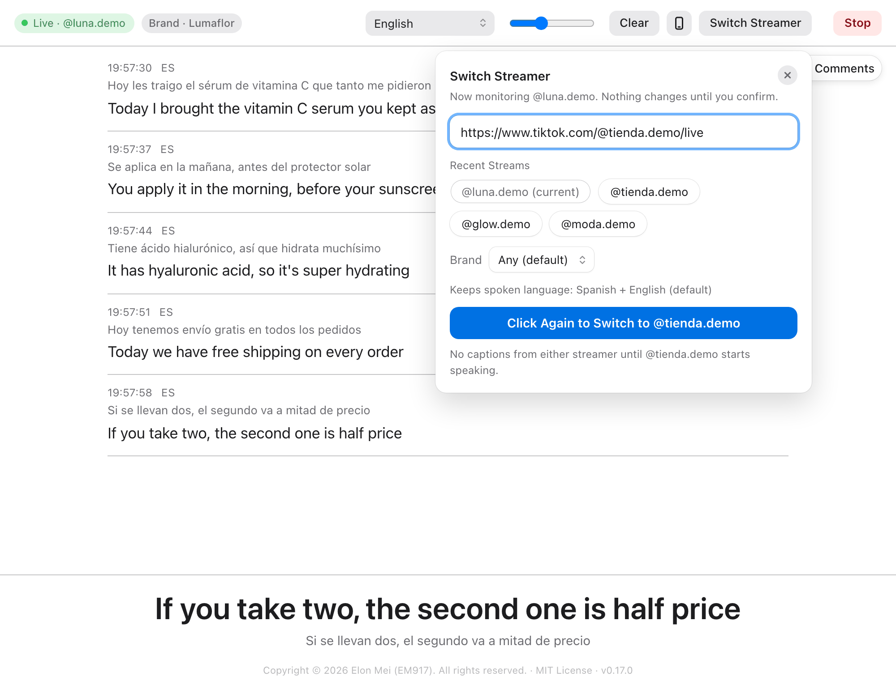
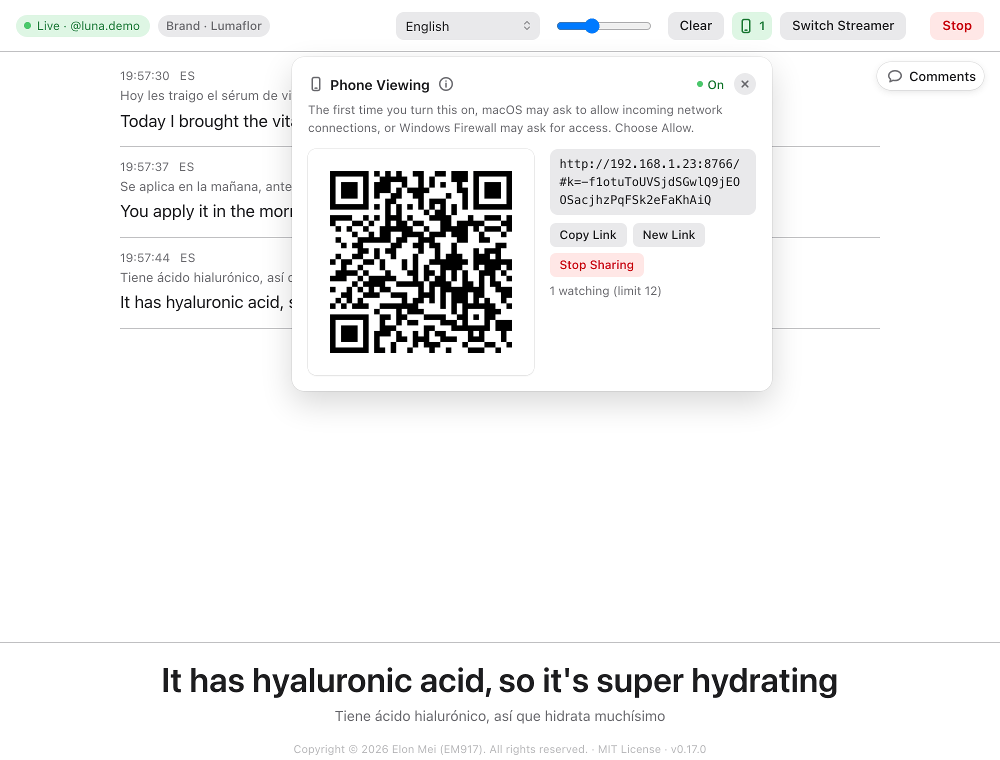
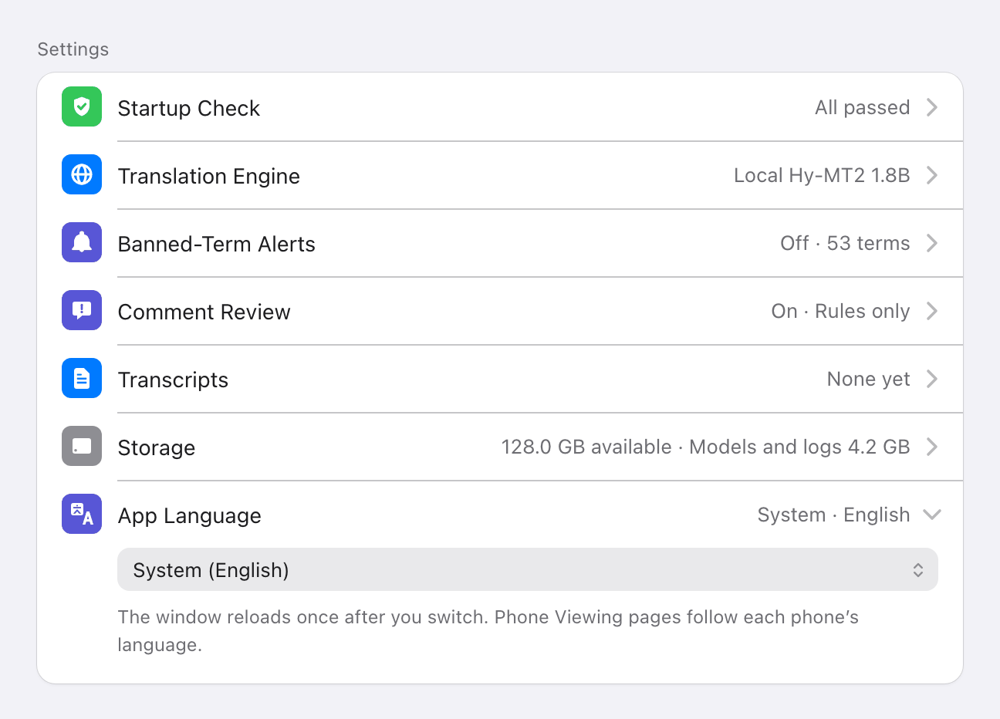
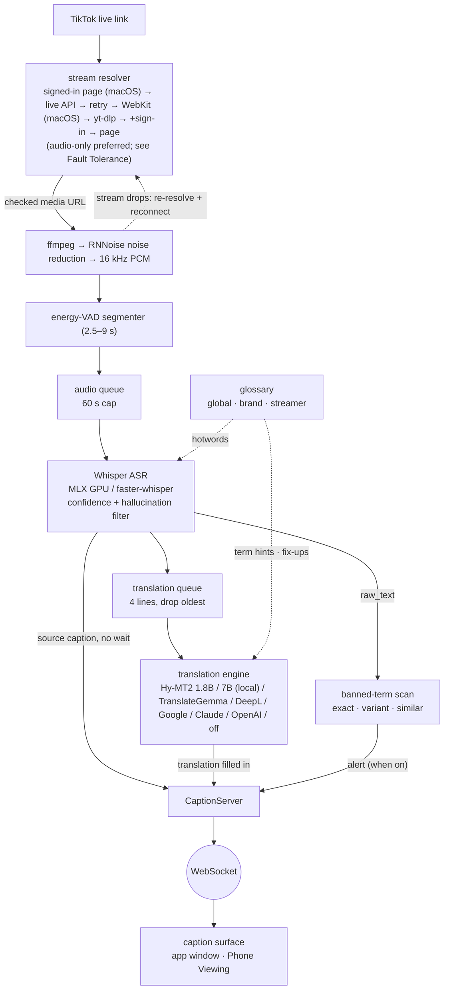
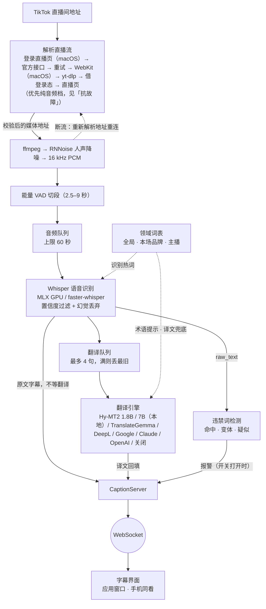

<a id="en"></a>

# TikTok Live Translator

<p align="center"></p>

<p align="center">
  <a href="https://github.com/EM917/tiktok-live-translator/releases/latest"></a>
  <a href="https://github.com/EM917/tiktok-live-translator/actions/workflows/ci.yml"></a>
  
  
  
  <a href="LICENSE"></a>
</p>

<p align="center"></p>

**Language / 语言：English | [中文](#zh)**

---

Real-time bilingual captions for TikTok live streams, built for Spanish-language
live selling. Paste a live link and the app transcribes what the streamer says,
shows each line as soon as it is recognised, and fills in the translation
beneath it a moment later. Viewer comments are translated alongside.

It is for teams who follow Spanish-language live selling without speaking
Spanish: the operator watches on the computer, and colleagues follow on their
phones. To get started, see [Quick Start](#quick-start).

A caption never waits for its translation: the original goes on screen first.
When recognition falls behind, audio waits in a queue and the window says so.
Speech recognition always runs on your computer, and with a local model so does
translation — no API key and no fees.

The interface is in English or Chinese. A new install follows the system
language, and Settings → App Language switches it; see
[Interface Language](#interface-language).

<a id="en-features"></a>

## Features

<sub>[中文](#zh-features)</sub>

- 🎙️ **Live captions, original first** — OpenAI Whisper with two backends (faster-whisper / MLX), 90+ languages, limited to Spanish + English by default. Each line appears as soon as it is recognised and its translation fills in beneath it; the latest line is also shown large at the bottom of the window
- 🌐 **Local-first translation** — Hy-MT2 (Apache 2.0, offline, free) in two sizes through Ollama, with TranslateGemma, DeepL (with a native glossary), Google's free endpoint, the Claude API and any OpenAI-compatible API as alternatives. By default Hy-MT2 1.8B is used, then TranslateGemma, and Google's free endpoint when neither is installed; 7B is never picked automatically. See [Translation Engines](#translation-engines)
- 🏷️ **Glossaries per brand and streamer** — a global glossary, one per streamer and one per brand (picked in the Brand menu for the session) steer how product names are recognised and translated, with every engine. See [Glossaries](#glossaries)
- 💬 **Viewer comment translation** — comments are fetched from the live stream through TikTokLive and translated while a local engine (Hy-MT2 1.8B or TranslateGemma) or Claude is active; with Google, DeepL, OpenAI or 7B the Comments panel shows the original text. Disable with `--no-comments`; see [the FAQ](#viewer-comments)
- 🔁 **Switch Streamer during a session** — Switch Streamer in the top bar moves to another streamer without clicking Stop first: pick from Recent Streams or paste a live link, choose the brand, then click again to confirm. The spoken language carries over, and a divider in the caption history marks where the new streamer begins
- 📱 **Phone Viewing** — colleagues on the same Wi-Fi scan a QR code and follow captions and alerts on their phones, each page in its phone's own language; view only, no control; off by default. See [the FAQ](#phone-viewing)
- 🌍 **English and Chinese interface** — follows the system language on a new install, switchable in Settings. See [Interface Language](#interface-language)
- ✅ **Startup Check** — each capability is executed rather than inspected: noise reduction processes a sample through RNNoise, translation queries the engine, the audit log performs a write. A failing check opens its row on the home page with a remediation step, and stays in a banner at the top of the window, idle or live, until a later check passes
- 🔄 **Fault tolerance** — up to seven ways to find the stream URL, reconnects that tell a network drop from the end of the stream, and audio queued rather than lost when recognition falls behind. See [Fault Tolerance](#fault-tolerance)
- 🎵 **Voice-focused noise reduction** — RNNoise suppresses background music, tuned for streams with continuous BGM
- ⚡ **Automatic hardware configuration** — detects the available accelerator (Apple Silicon GPU / NVIDIA CUDA / CPU) and selects the largest model that still runs in real time
- 📊 **Observable latency** — a live readout at the bottom of the window: the longest a spoken word waits before it is recognised and checked (median and P95), split into segmentation and recognition, plus the time the translation adds. An audit log records each segment: accepted text, candidates rejected by the quality filter, banned-term matches, and the translation that followed
- 🚨 **Banned-term alerts, off by default** — for compliance monitoring of live selling: three-tier matching (exact / variant / similar) against the recognised source text, independent of translation and across caption boundaries. The switch is in Settings → Banned-Term Alerts. See [Banned-Term Alerts](#banned-term-alerts)
- 👀 **Comment Review, on by default with rules only** — spots insults and threats, claims of fakes or calls to report, flooding and redirects among viewer comments: a clear rule match is marked red, an unsure one amber, a line at the top of the window sums it up, and marked viewers are highlighted on every comment. Read-only — it cannot delete comments or mute anyone — and absent from Phone Viewing. Optional Claude Haiku 5.5 review only ever adds. Switch it off in Settings → Comment Review. See [Comment Review](#comment-review)

<a id="en-screenshots"></a>

## Screenshots

<sub>[中文](#zh-screenshots)</sub>

<table>
  <tr>
    <td width="50%"><br><sub>Home: paste a live link and click Start. Settings sits below, one line per setting until opened.</sub></td>
    <td width="50%"><br><sub>Live: the original first, the translation beneath it, comments alongside.</sub></td>
  </tr>
  <tr>
    <td width="50%"><br><sub>Switch Streamer: pick the next streamer, then click again to confirm.</sub></td>
    <td width="50%"><br><sub>Phone Viewing: a QR code and link for phones on the same Wi-Fi.</sub></td>
  </tr>
  <tr>
    <td width="50%" align="center"><br><sub>The phone page: view only, in the phone's own language.</sub></td>
    <td width="50%"><br><sub>Settings → App Language: System, 中文 or English.</sub></td>
  </tr>
</table>

<sub>The screenshots and the demo above show made-up streams and are generated by <code>tools/readme_shots.py</code>.</sub>

<a id="en-disk-space"></a>

## Disk Space

<sub>[中文](#zh-disk-space)</sub>

Everything runs locally, so the models live on your machine. The figures below come
from a reference installation; exact sizes vary with platform and package
versions.

| Component | Size | When |
|---|---|---|
| Runtime environment (`.venv`) | 1.4 GB | First launch |
| Speech model — `large-v3` (Apple Silicon GPU / CUDA) | 2.9 GB | First recognition |
| Speech model — `large-v3-turbo` (CPU path) | 1.5 GB | First recognition |
| Ollama application | 0.2 GB | Manual, once |
| Translation model — Hy-MT2 1.8B | 1.1 GB | Automatic on first launch after Ollama |
| Translation model — Hy-MT2 7B (optional) | 4.6 GB | Only if you pull it |
| Denoising model | 0.3 MB | First stream |

**Reserve about 6 GB** for a typical installation: runtime, `large-v3` and the
1.8B translation model. Add 4.6 GB if you also want the 7B tier. Machines on
the CPU path need roughly 4.5 GB, since `large-v3-turbo` is smaller.

Downloads are one-time. Models are shared with any other tool using the same
caches, and are not duplicated per project.

Where they are stored, if you need to reclaim space:

```
~/.cache/huggingface/hub     speech models
~/.ollama/models             translation models
<project>/.venv              runtime environment
<project>/logs               audit logs
```

Audit logs grow by roughly **0.3 MB per hour** of monitoring — about 2 MB for
an eight-hour day, or 0.1 GB a month. They are plain JSONL and safe to delete
once a session has been reviewed.

<a id="en-quick-start"></a>

## Quick Start

<sub>[中文](#zh-quick-start)</sub>

### Installation without a terminal (recommended)

1. **Download**: grab **TikTok-Live-Translator-vX.Y.Z.zip** from the [latest release](https://github.com/EM917/tiktok-live-translator/releases/latest)'s Assets and unzip it anywhere (e.g. your Desktop) — "Source code (zip)" works too. The green **Code** button → **Download ZIP** also works (latest dev snapshot).
2. **Install Python** (free, one time only): grab the installer from [python.org/downloads](https://www.python.org/downloads/) and install with the default options. Forgot? No problem — the launcher will detect it and open the download page for you.
3. **Launch**:
   - **macOS**: double-click **`TikTok Live Translator.app`** in the folder. If the first launch is blocked ("cannot be opened"): on older systems right-click → Open; on **macOS 15 and later** go to **System Settings → Privacy & Security**, scroll to the bottom and click **"Open Anyway"** (one time only). Feel free to drag it to the Dock — but **don't move it out of this folder**.
   - **Windows**: double-click **`Start.bat`**. If a "publisher unknown" security warning pops up, click "Run" (this tool is fully open source — the code is right there in the folder). A black text window stays open while running — **that window is the app itself; keep it open**. Captions appear in the separate app window.

The interface window itself is rendered by the system's built-in browser engine
(WKWebView on macOS, WebView2 on Windows), not a bundled one. On macOS the
highest-requirement CSS feature currently used is `:focus-visible`, which needs
**Safari 15.4 / macOS 12.3 (Monterey) or later**, based on reading the CSS this
project ships rather than testing on that exact OS build — Apple has
historically also shipped point releases of Safari to the two prior major
macOS versions, so some older systems may already have it too. Below that, the
app still runs and shows captions; only the keyboard-focus outline on a few
controls falls back to the system default. WebView2 on Windows auto-updates independently of Windows
itself, so there is no practical minimum version there — see the "publisher
unknown" note above if Windows Defender SmartScreen has not seen WebView2 on
this machine before.

The first launch installs everything automatically (a few minutes, with on-screen progress; the first recognition also downloads the speech model, with progress shown on the page). Every launch after that is instant. Once the window opens: **paste the live link (or just the streamer's username) → check Spoken language (Spanish + English by default) and, in the top bar, the language to translate into → click Start**. During a session, **Switch Streamer** moves to another streamer, and **Stop** takes the window back to the home page, with that session's captions kept below under Previous Session.

### Command line

With [Python 3.9+](https://www.python.org/downloads/) installed, two commands:

```bash
git clone https://github.com/EM917/tiktok-live-translator.git
cd tiktok-live-translator && python3 main.py
```

(On Windows use `python main.py`.) Everything else is automatic: the first run creates a virtual environment and installs all dependencies (including a bundled static ffmpeg and the denoising model). CLI flags work too:

```bash
python3 main.py "https://www.tiktok.com/@streamer_username/live" --source es
python3 main.py --demo      # preview the UI without connecting to a stream
python3 main.py --doctor    # print the hardware check and recommended config
python3 main.py --ui-lang en   # English interface for this launch only
```

> Prefer to control the install yourself? `bash setup.sh` (macOS/Linux) or `powershell -ExecutionPolicy Bypass -File setup.ps1` (Windows) does the same steps explicitly.

> **Cloned an older version before?** Don't re-clone (it fails with `destination path already exists`) — just `cd` into the folder, run `git pull`, and start it; from v0.2.0 on you can update with one click from the page itself.

### Starting the app

- **macOS**: double-click **`TikTok Live Translator.app`** (or `Start.command`);
- **Windows**: double-click **`Start.bat`**;
- CLI: `cd ~/tiktok-live-translator && python3 main.py`.

The UI opens in its **own app window** (no browser tab), remembering the last live link, spoken language and target language — just click Start. **Recent Streams** under the input box lists the streamers you opened recently; one click starts one. Closing the window quits the app, and asks first during a session. Pass `--browser` if you prefer the browser UI.

<a id="en-interface-language"></a>

## Interface Language

<sub>[中文](#zh-interface-language)</sub>

The interface — the app window, its dialogs and notifications, and the phone
page — is in English or Chinese.

- A new install follows the system language: on macOS, the language set for
  this app in System Settings, otherwise the preferred language; on Windows,
  the display language. A Chinese system language (Simplified or Traditional)
  gives the Chinese interface, anything else English, and Chinese if it
  cannot be detected.
- An install that was already in use before the English interface existed
  stays in Chinese after updating.
- To switch, open **Settings → App Language** on the home page and choose
  System, 中文 or English. The window reloads once. Settings is hidden during
  a session, so switch between sessions.
- `python3 main.py --ui-lang en` (or `zh`) sets the language for one launch
  and saves nothing.
- On a new install with an English interface, captions are translated into
  English until you choose another language in the top bar.
- Phone Viewing pages follow each phone's own language, with a toggle at the
  bottom of the page.
- The app name in the Dock, the menu bar and ⌘Tab follows the macOS system
  language (TikTok 直播同传 on a Chinese system). The file is always
  `TikTok Live Translator.app`.
- Terminal output, logs and the audit log are always in Chinese, as is the
  text `Start.command` and `Start.bat` print in their terminal window. The
  launchers' error dialogs, which appear before the app can read the
  language setting, show Chinese and English together. Streamer names,
  glossaries, captions and comments are data; the interface language never
  changes them.

Notes for maintainers: [docs/i18n.md](docs/i18n.md) (in Chinese).

<a id="en-automatic-hardware-configuration"></a>

## Automatic Hardware Configuration

<sub>[中文](#zh-automatic-hardware-configuration)</sub>

`python main.py --doctor` reports the hardware detection results. Any flag not set explicitly at startup is filled in according to the table below:

| Hardware | Selected configuration | Result |
|---|---|---|
| Apple Silicon (M1 or later) | MLX GPU backend + `large-v3` | Most accurate model, runs ~5x faster than real time |
| NVIDIA GPU | CUDA + `large-v3` (float16) | Most accurate model, plenty of speed headroom |
| CPU (≥8 cores, ≥8 GB RAM) | CPU + `small` (int8) | Real-time capable, moderate accuracy |
| Lower-specification CPU | CPU + `base` (int8) | Prioritises keeping pace over accuracy |

Benchmark reference (M3 Pro, 90 seconds of recorded livestream audio; RTF = recognition time / audio duration, which must remain below 1 to avoid dropping segments):

| Config | RTF |
|---|---|
| MLX GPU + large-v3 | **0.21** ✅ |
| CPU + large-v3-turbo | 0.99 ⚠️ borderline |
| CPU + large-v3 | 1.22 ❌ drops segments |

Every selected value can be overridden with a command-line flag.

<a id="en-command-line-flags"></a>

## Command-Line Flags

<sub>[中文](#zh-command-line-flags)</sub>

| Flag | Description | Default |
|------|------|------|
| `--target` | Target language (`zh-CN`/`en`/`ja`/`ko`/…; can also be switched anytime in the top bar) | last choice in the UI; otherwise `zh-CN` (`en` on a new install with an English interface) |
| `--source` | Streamer's language(s): a single code (`es`/`en`/`ja`/…), or a comma list to auto-detect within just those (e.g. `es,en`, max 4, first = primary; a detected language outside the list triggers one forced re-run) | last choice in the UI; otherwise `es,en` |
| `--backend` | Recognition backend: `mlx` (Apple GPU) / `ct2` (faster-whisper) / `auto` | `auto` |
| `--model` | Whisper model: `tiny`/`base`/`small`/`medium`/`large-v3`/`large-v3-turbo` | auto by hardware |
| `--device` | `auto`/`cpu`/`cuda` | auto by hardware |
| `--compute-type` | ct2 precision (`int8`/`float16`/…) | auto by hardware |
| `--beam` | Beam search width (larger = more accurate but slower; `1` = greedy; ct2 backend only) | `5` |
| `--context` | Enable rolling context. **Off by default**: measured to trigger repetition loops that badly hurt recall | off |
| `--asr-temperature` | Decoding temperature. **Defaults to 0 (single pass)**: Whisper otherwise re-decodes a segment at up to six temperatures when quality checks fail, which measured 25s on music-heavy audio | `0` |
| `--translator` | Translation engine: `auto`/`hymt2`/`hymt2-7b`/`gemma`/`deepl`/`google`/`claude`/`openai`/`none`; see [Translation Engines](#translation-engines) | last choice in the UI; otherwise `auto` |
| `--denoise` | RNNoise voice denoising: `auto`/`on`/`off` | `auto` (on) |
| `--port` | Local UI port | `8765` |
| `--cookies` | Path to a yt-dlp cookies.txt file (use it when yt-dlp reports that the stream needs a login) | none |
| `--glossary` | Glossary file; see [Glossaries](#glossaries) | `glossary.txt` in the project folder, created from `glossary.example.txt` on first run |
| `--banned-terms` | Banned-term list; see [Banned-Term Alerts](#banned-term-alerts) | `banned_terms.txt` in the project folder, created from `banned_terms.example.txt` on first run |
| `--demo` | Demo mode — drives only the UI | off |
| `--doctor` | Print the hardware check and recommended config, then exit | off |
| `--no-open` | Don't open the app window or browser on startup | off |
| `--ui-lang` | Interface language for this launch only: `zh`/`en`. Not saved; see [Interface Language](#interface-language) | the App Language setting |

<a id="en-translation-engines"></a>

## Translation Engines

<sub>[中文](#zh-translation-engines)</sub>

Installing [Ollama](https://ollama.com/download) completes the setup. On the
next launch the app starts it if required, downloads the 1.1 GB Hy-MT2
1.8B model through Ollama's API with on-screen progress, and switches to it. No
terminal commands are involved; the Whisper model is provisioned the same way.

Pulling the larger tier makes it available for strong re-translation and for an
explicit `--translator hymt2-7b`. It is never selected automatically; see
[Choosing an engine](#choosing-an-engine).

```bash
ollama pull hf.co/tencent/Hy-MT2-7B-GGUF:Q4_K_M     # 4.6 GB, ~16 GB RAM
```

| Value | Engine |
|---|---|
| `auto` (default) | Selects the best engine present: `hymt2` → `gemma` → `google`. 7B is never selected automatically |
| `hymt2` | Hy-MT2 1.8B (Tencent, Apache 2.0). Recommended for most machines |
| `hymt2-7b` | Hy-MT2 7B, the larger local tier. Opt-in only; see [Choosing an engine](#choosing-an-engine) |
| `gemma` | TranslateGemma 4B. `OLLAMA_TRANSLATE_MODEL` selects `translategemma:12b`/`27b`. Not in the Translation Engine menu; pass `--translator gemma` |
| `deepl` | Key entered in Settings → Translation Engine (or `DEEPL_API_KEY`). A key ending in `:fx` is routed to the free endpoint automatically. Builds and maintains a native DeepL glossary from your [glossaries](#glossaries); see below. Caption text is sent to DeepL |
| `google` | Google Translate's free endpoint, no key required. Caption text is sent to Google; rate-limited per IP |
| `claude` | Key entered in Settings → Translation Engine (or `ANTHROPIC_API_KEY`). Default model Claude Haiku 5.5 (`claude-haiku-5-5`), with thinking turned off to keep each caption fast; `CLAUDE_TRANSLATE_MODEL` selects another model. Caption text is sent to Anthropic. A caption Claude declines to translate shows the original text and is recorded in the audit log; a declined Retranslate is recorded there too, with the trigger. With this engine, viewer comments are translated by Claude Haiku 5.5 on its own connection (a pause there never pauses captions), and Retranslate and the alert-context translation use Claude Sonnet 5.5 instead of a local model, so no local model is needed for them |
| `openai` | Key entered in Settings → Translation Engine (or `OPENAI_API_KEY`); optional `OPENAI_BASE_URL`, `OPENAI_MODEL`. Compatible with any OpenAI-style API including local LM Studio / vLLM |
| `none` | Transcription only, no translation |

The engine is chosen in Settings → Translation Engine on the home page, where API
keys are entered too — no terminal and no environment variables. Keys are stored
in `settings.json`, which is git-ignored, and are never sent back to the page;
only the last four characters are shown so you can tell which key is in place.

When the chosen engine cannot be used and the app falls back to another, the
Translation Engine row says Fallback and opens by itself, so a switch to a
network engine is visible rather than silent.

Three lines from real streams where Google's free endpoint took colloquial
Spanish literally and the local model did not (Spanish → Chinese):

| Source | Google | Local model |
|---|---|---|
| *Se mueren lo rico* (extremely good) | ❌ 有钱人死 (the rich die) | ✅ 味道非常好 |
| *tengo un sueño* (I am sleepy) | ❌ 我做了一个梦 (I had a dream) | ✅ 现在感觉很困 |
| *Es vegano* (it is vegan) | ❌ 它是素食主义者 (he is a vegetarian) | ✅ 纯素的 |

### Choosing an engine

Hy-MT2 1.8B is the default: it keeps pace with the stream without slowing
recognition, which matters because every caption waits for recognition before
it appears.

Four engines — Hy-MT2 1.8B and 7B, TranslateGemma 12B and DeepL — were graded
blind on 259 captions from one live session. After correcting for the twelve
pairwise comparisons, the differences that held were all in readability: 7B
read more easily than both 12B and 1.8B, and DeepL more easily than 1.8B. No
engine, DeepL included, made measurably fewer meaning-changing errors than
another. That means no difference was measured, not that they are equivalent.

7B is never selected automatically. In a 92-caption live run with 7B resident,
recognition took about 3.2 s per segment against 1.4 s with the smaller models.
It is still used for [strong re-translation](#re-translating-with-the-strongest-model),
which loads it for one line and unloads it straight after.

The measurements, tables and caveats are in
[docs/engine-benchmarks.md](docs/engine-benchmarks.md).

### Glossaries

Product names are where a general-purpose model goes wrong most often, and a
short list of them is the most direct fix. The glossary is one set of entries
used in three places: the first entries are given to speech recognition as a
hint; entries that occur in a line are passed with that line to a local
translation model (DeepL uses a native glossary instead, see below, while
Google's free endpoint, Claude's caption and comment translation and
OpenAI-compatible APIs take no hints, so only the fix-up applies to them; the
exception is Retranslate and alert-context translation with Claude Sonnet 5.5,
which get the hints in their prompt like the local model does); and a rule-based
fix-up replaces any glossary entry the translation left untranslated.

It is merged from three files, most specific first:

- `profiles/<streamer-username>.txt` — one streamer's own wording and
  translations, loaded automatically from the live link
- `brands/<brand-id>.txt` — one brand's products, loaded only when the Brand
  menu on the home page (or in Switch Streamer) selects it; for a stream that
  sells a single brand. The menu remembers each streamer's last choice, the
  folder button next to it opens `brands/`, and the menu rescans that folder
  when clicked, with no restart. The file format is in
  [`brands/README.md`](brands/README.md) (in Chinese)
- `glossary.txt` — the global list (`--glossary` points elsewhere)

Where the same wording appears in more than one file, the streamer's profile
wins over the brand list, which wins over the global list. Edits take effect
after Stop → Start. These files hold your own product data and stay on your
computer: git ignores `glossary.txt`, `profiles/*.txt` and `brands/*.txt`, so
editing them never blocks an update.

### DeepL: the native glossary decides everything

DeepL accepts no prompt, so per-sentence glossary injection does nothing for it —
only a **native glossary** held in the account applies. The app builds one
from the glossary in effect for the session (the global, brand and streamer lists
merged). The glossary name carries a fingerprint of its contents, so an edit, or
a different streamer or brand, rebuilds it with no manual step.

Measured on the same 60 lines of real captions:

| | Glossary compliance | Median latency |
|---|---|---|
| DeepL, no glossary | 26.5% | 388 ms |
| DeepL + native glossary | 91.8% | 542 ms |

Nearly all of those 65 points are product names. With no glossary in place DeepL
still returns fluent Chinese, so nothing looks wrong on screen — which is why the
Startup Check actually builds the glossary and reports its entry count instead of
merely checking that a key is present.

The following constraints are measured, not assumed:

- **The free tier permits exactly one glossary** (creating a second returns 456).
  Only glossaries the app created are deleted — their names start with
  `tlt-`. Glossaries you created in the DeepL dashboard are left alone.
- **A glossary is a hint, not a substitution.** `las gotas → 维生素滴剂` applies,
  while `la limpieza → 排毒粉` does not fire inside `me paso a la limpieza`. The
  post-translation rule-based replacement is therefore retained.
- **Traditional Chinese gets no native glossary.** DeepL offers a single `zh`
  glossary target and `glossary.txt` is written in Simplified Chinese; attaching
  it pushes Simplified terms into Traditional output.
- **The source language must be explicit.** When transcription reports no
  language, no glossary is attached rather than guessing — a wrong guess forces
  the whole line through the wrong language.

Quota is billed on source length, and the burn rate depends heavily on how
densely the streamer talks — two measured sessions differ by 2.3×:

| Session, every caption through DeepL | Burn rate | 1,000,000 characters covers |
|---|---|---|
| Dense (38.4 min, 567 lines) | 95,824 chars/hour | ~10 hours |
| Sparser (4.4 h, 2,041 lines) | 41,363 chars/hour | ~24 hours |

Read your own remaining budget in Settings → Translation Engine, which shows how
much of the free quota your key has used (from the `used / limit` DeepL returns),
rather than from this table; DeepL's allowance size and renewal terms are theirs
to change, so check their current pricing before planning around a number here.

**Caption text is sent to DeepL.** Local engines never leave the machine; this
one does. The stream being monitored belongs to someone else, and whether that is
acceptable is a business decision.

### Re-translating with the strongest model

The strongest model available is applied per sentence rather than for a period
of time. With any engine other than Claude (a local model, Google, DeepL or an
OpenAI-compatible API) that is the strongest local model installed (Hy-MT2 7B if
you pulled it, otherwise 1.8B), which needs Ollama. With Claude as the engine it
is Claude Sonnet 5.5, so no local model has to be installed for it. What justifies
it is specific content — prices, promotional conditions, health claims — which
is episodic, and only the operator or the detector knows which sentence that
is. Measured cost: loading the model takes 1.9 s and a complete one-shot call
2.3 s, after which it is unloaded, leaving recognition unaffected. Keeping it
resident instead would raise recognition from 1.4 s to 3.2 s and alert latency
from 6.8 s to 10.6 s. Those figures are for the local models; Claude Sonnet 5.5
runs on Anthropic's servers, so it adds no memory load on this computer.

Three ways to invoke it:

- **Per caption** — hover a caption and click Retranslate. The line is
  re-translated and marked in the margin. If the click cannot start a
  retranslation or it does not produce one, a short note appears right under
  that caption for a few seconds and the existing translation stays. Phones on
  [Phone Viewing](#phone-viewing) have the same button
- **On a banned-term match** — with [alerts](#banned-term-alerts) on, the
  matched sentence is re-translated automatically. The fast translation appears
  first so nothing is delayed; the accurate one replaces it about two seconds
  later
- **After the session** — `python3 tools/retranslate_audit.py` re-translates a
  session's audit log, appending `translation_strong` records without altering
  any existing line, and prints the segments whose translation changed rather
  than replacing anything silently

Measured on the same 259 captions, re-translation with 7B reads more easily
than 1.8B — that difference survived the correction — but it was not shown to
be more correct. Details are in
[docs/engine-benchmarks.md](docs/engine-benchmarks.md#re-translating-with-the-strongest-model).

### Finding translation errors without reading everything

Scanning a session's captions by eye to find mistranslations is slow and will
miss things. `tools/retranslate_audit.py` re-translates a session with the
strongest model and ranks the segments by how much the two models disagree —
the greater the disagreement, the more likely one of them is wrong. It needs no
judge and makes no semantic call of its own.

```bash
python3 tools/retranslate_audit.py
```

On its first run this surfaced `es una orden de 30` being rendered as "30
units" rather than a $30 threshold — a glossary gap nobody had noticed.

Two approaches that were measured and rejected, recorded so they are not
retried: comparing word overlap against a back-translation scores correct and
incorrect translations identically, because Spanish paraphrases legitimately
change words; and asking a local model to judge agreement fails outright —
the 1.8B model called every pair inconsistent, and the 7B model was right four
times in ten.

<a id="en-fault-tolerance"></a>

## Fault Tolerance

<sub>[中文](#zh-fault-tolerance)</sub>

A live session can fail quietly in three places:
finding the stream URL, keeping the stream, and keeping up with it. Each is
handled explicitly.

### Finding the stream URL

Up to seven layers are tried in order, each isolated so a bug in one cannot
take down the rest. Resolution stops at the first layer that returns an
address, and each address is checked before the session starts. Every layer
prefers TikTok's audio-only track when one is offered.

1. **Signed-in live page** (macOS) — uses a TikTok sign-in already in the browser
2. **Official live API** — independent of yt-dlp
3. **Signed-in retry** — only when the first signed-in fetch read a usable
   sign-in but the page carried no address, and the live API did not report
   the stream as ended
4. **System WebKit engine loading the live page** (macOS) — measured at 2 s;
   it has returned the stream URL for rooms where the layers before it got none
5. **yt-dlp, anonymous**
6. **yt-dlp with a browser's sign-in**
7. **Live-page fallback** — also tries the sign-in first, anonymous last

yt-dlp can answer "not currently live" for a stream that plays in a browser, so
its answer alone never ends a session: the app reports a stream as ended only
when TikTok says so.

How the sign-in is used:

- Unless a browser is named (`--cookies-browser`, or `cookies_browser_only` in
  `settings.json`), the signed-in step reads Safari only. Other browsers are
  read only by the later sign-in layers, after the anonymous ones have failed,
  and once Safari shows a sign-in no other browser's data is read.
- The signed-in retry waits 3 s, or the rest of the 8 s gap below when an
  anonymous request went out in between, then makes the identical fetch once
  more, before the slower layers. Measured: some rooms serve their stream URL
  only to signed-in viewers, and a signed-in request made within 3 s of an
  anonymous one came back without it, so the app leaves 8 s between them.
  One reconnect on 2026-09-17, for a room whose every earlier resolution that
  day had taken 0.6–1.4 s: the signed-in page carried no address at 0.5 s,
  WebKit timed out after 25 s, both yt-dlp calls reported the stream as not
  live, and the same signed-in fetch returned the address at 31 s, 37.6 s in
  total. Why the first fetch carried no address is not known.
- An `http://` TikTok link is resolved as `https://`, so the sign-in is never
  sent in clear text.
- The comment connection starts only after the first resolution returns:
  it opens with an anonymous request for the same page.
- Reading Safari's cookies needs Full Disk Access for the app (see the
  [Browser Login FAQ](#browser-login)). Without a readable sign-in, monitoring
  still starts, resolution stays anonymous, and a persistent notice says what
  to do.

When TikTok's live API withholds the stream URL (code 4003110) and no later
layer finds one, the app tries three times, 20 s apart, and then says so on
screen; other failures are reported right away. When the stream plays in your
browser but the app cannot find its address, you can paste **the live link and
a .flv address from your browser together**, separated by a space: the link
drives comments and the glossary, and the .flv address is used as given for
the audio, skipping every layer above. Measured: these signed addresses stay
valid for about two weeks, so one capture covers a whole stream. See also
[code 4003110](#code-4003110) in the FAQ.

### Keeping the stream

- A dropped stream reconnects with a freshly resolved URL, telling a network
  interruption from the end of the stream. Before resolving again the app
  checks that it can reach TikTok; while it cannot, it waits without spending
  reconnect attempts, for up to 30 minutes.
- If TikTok hasn't reported the stream as ended, the app waits up to 10
  minutes for it to resume.
- The app gives up once six connection attempts in a row bring no audio at
  all (two for a pasted stream URL); an attempt that played any audio resets
  the count. A pasted stream URL that stops serving data after playing for
  30 s or more ends the session instead of reconnecting.
- The comment connection can go half-open: the Comments panel still shows
  Connected, but no comments arrive. After 15 minutes of silence while
  connected, the app reconnects it and records that in the session audit.
- yt-dlp is kept current in the background.
- While monitoring, the computer is kept from going to sleep on its own, and a
  gap where the app did not run at all is recorded and shown on screen.

### Keeping up

- When recognition falls behind, audio waits in a queue: a notice appears once
  it is 10 s behind, detection is marked degraded at 30 s, and only audio more
  than 60 s behind is dropped, with the count shown on screen and written to
  the audit log.
- Translation never slows recognition. Its queue holds four lines and drops
  the oldest when full; a line whose translation was skipped keeps its
  original text.

<a id="en-banned-term-alerts"></a>

## Banned-Term Alerts

<sub>[中文](#zh-banned-term-alerts)</sub>

For compliance monitoring of live selling, the app can raise an alert when the
streamer says something on a banned-term list. Matching runs on the recognised
source text, never on the translation, so an alert does not wait for a
translation engine. It has three tiers — exact; variant (plural, gender,
diminutive); similar (a letter or two misheard, in words of five letters or
more) — ignores case and accents, and catches a phrase split across two
captions.

**Alerts are off by default.** The switch is under **Settings → Banned-Term
Alerts**, a collapsed row on the home page whose summary shows whether alerts
are on and how many terms are active. Open it and turn on **Show alert on
match**; the choice is remembered for the next session.

- With the switch off, detection still runs and every match is still written
  to the audit log (tagged `suppressed: "alerts_off"`); nothing pops up and no
  strong-model re-translation is spent.
- With it on, a match opens a red Possible Banned Terms panel at the top of the
  window, which stays until you clear it. During a session the top bar shows
  Alerts on, the window title counts unseen alerts while the window is in the
  background, the matched sentence is
  [re-translated with the strongest model](#re-translating-with-the-strongest-model),
  and phones on [Phone Viewing](#phone-viewing) see the alert too.
- A system notification, without the term and without sound, is sent only if
  `"alert_os_notify": true` is set in `settings.json`.
- A problem with the list itself — empty, unreadable, or no entry able to
  match — fails the Banned-Term List row of the Startup Check. That row opens
  by itself and a banner stays at the top of the window until it passes.

The list is `banned_terms.txt` in the app folder, one word or phrase per line;
entries starting with `re:` are regular expressions. Save, then click Stop and
Start. It is created from `banned_terms.example.txt` on first run, and updates
never change your copy: compare the two after an update to see what the shipped
list gained.

### Validating your banned-term list against a recorded session

A banned-term list that never fires looks identical to a clean stream. It is worth
proving which of the two you have, because the failure is silent — and it is a
failure of the list, not of the matcher.

The shipped list is a starting point derived from one company's category guide
for supplement and weight-management streams. It misses when a streamer
phrases a claim differently from the list: `eliminar grasa` is listed, but
"eliminar **toda la** grasa" puts words between the two anchors and does not
match. The same gap let "eliminando el exceso de grasa" through in the case
below, which is why `exceso de grasa` has been an entry of its own since
2026-09-02.

Replay a recorded session against your list before trusting it:

```bash
python3 tools/replay_alerts.py                   # re-run a session's audit log through the current list
python3 tools/collision_audit.py --term <word>   # check a new term for false-positive collisions
```

**A historical case, from late August 2026.** The list then shipped with 40
active entries and a *pending business review* section of 7 real phrases
deliberately left commented out. Replayed over a 4.4-hour supplement stream
(2,041 segments):

| Term list at the time | Segments alerted |
|---|---|
| As shipped, 40 active entries | **0** |
| With the 7 commented-out *pending review* entries enabled | 62 |

The stream contained `derretir toda la manteca` ("melt away all the fat"),
`acelerar el metabolismo`, and `desinflamarse y quitar la barriga` — the exact
family the guide banned "all variants" of. The matcher was working the whole
time (its fuzzy tier caught the ASR misspelling `derritir`); the entries that
would have fired were switched off.

A separate pass over the same transcript flagged 126 utterances as worth
alerting on, of which 99 matched neither the active nor the pending entries —
appetite suppression, body shape, organ fat, fatty liver, cholesterol, and one
cancer claim.

On 2026-09-02 the 7 pending entries were enabled, together with 6 from that
audit whose evidence was unambiguous (fatty liver, a cancer claim, excess fat,
a flat stomach, appetite, cravings), each checked with the collision audit and
a replay across 36 recorded sessions. The shipped list has had no pending
section since; a `banned_terms.txt` created before that date still has those
entries commented out.

Treat output like that audit as **candidate terms for human review**, never as
an automatic list update: what counts as a violation is a business judgement,
and a list padded with false positives buries the operator in noise.

<a id="en-comment-review"></a>

## Comment Review

<sub>[中文](#zh-comment-review)</sub>

When a viewer insults the streamer, calls the products fake or a scam, calls for reports, floods the chat, or
pulls people somewhere else, the app marks that comment in the Comments panel and adds a line at the top of the
window, so the operator sees it at a glance. It reads the same comment feed that
[viewer comment translation](#viewer-comments) uses, and looks at the text only.
**The app is read-only toward TikTok: it cannot delete comments, mute or block anyone.** What to do about a flagged
comment is up to the operator.

**Comment Review is on by default, using rules only.** The rules run on your computer, make no network calls and
use no model. The switch is the **Comment Review** row in the Settings group on the home page: collapsed by default,
never opened by itself, with a summary of whether it is on, how it reviews, and how many viewers are marked. With no
comments there is nothing to review (`--no-comments`, or the comment component not installed).
`python3 main.py --demo` runs without a stream and plays fictional comments, to see what the marks look like.

### What it flags

- **Insults and threats** — insults aimed at the streamer or other viewers, threats of harm, sexual remarks.
- **Calling products fake or a scam, calling for reports or for people not to buy** — claims that something is
  fake or a scam, calls not to buy or to report the shop, threats to report.
- **Flooding** — one viewer posting in quick bursts (by default 6 comments in 10 seconds or 12 in 60 seconds), or the
  same sentence 5 times in 60 seconds; several accounts posting the same sentence within 20 seconds (from 5 accounts)
  is reported as one "same comment from several accounts" event. The thresholds can be changed in
  `comment_guard/local/thresholds.txt` on your machine.
- **Redirects** — links, phone numbers or WhatsApp, email addresses, an `@handle` offered with a "follow me" line,
  pulling people to another stream or shop, and fake official prizes or scam offers.

### Red and amber

- **Red** — a rule matched clearly. A red bar sits on the left of the comment, with the category beside it:
  Possible insult, Possible threat of harm, Possible call to report or not buy, and so on. Categories always say
  "Possible", because the app sees text only and does not conclude anything until a person has confirmed it. Links,
  phone numbers and one viewer's flooding are structural signals and also come out red.
- **Amber** — the rules themselves are unsure. The reason beside it states what was observed and does not guess a
  cause: "Short, with no question mark", "Describes the viewer's own experience", "Reads like a quote",
  "Second time from this viewer in 10 min". Several accounts posting one sentence produce one amber event, never red
  on its own.
- **Entries you have not confirmed show amber, even on a match.** In the shipped rules only most entries for threats
  and for calls to report or not buy are confirmed. For the rest (insults, sexual remarks, claims of fakes, threats
  to report, pulling people elsewhere, scam offers) a match comes out amber until you confirm the entry one by one: it
  is not marked red and not added to Marked Viewers automatically. What counts as a violation is a business call, so
  the app does not switch an entry on for you. The procedure is in
  [`comment_guard/README.md`](comment_guard/README.md).
- Under Settings you can tick **Also show weak signals (light)** to show the faint hints that are otherwise only
  counted. Off by default.

A line at the top of the window appears during a session when there is something unseen, for example
"2 items to review · 1 unclear · 3 from marked viewers · Possible threat of harm 1". It counts **events**: one flood,
or one sentence posted by several accounts, is 1 item however many comments it holds. Click it to open a drawer
under it listing recent events (time, nickname, category, original and translation, reason). From there you can
**Show in Comments** to jump to the comment in the panel, **Dismiss** the event, or **Mark** the viewer; **All Seen** clears the unread count.
With the Comments panel collapsed, the floating button shows the number of unseen red items. There is no system
notification and no sound.

### Marked Viewers

- Hover a comment and click the ☆ in its top-right corner to mark the viewer; click the ★ to unmark.
- A viewer who triggers a red comment is **added automatically**, but only when all three hold: the match is a
  confirmed entry, the account id is stable (the numeric id or sec_uid TikTok provides — a viewer known only by
  nickname or handle does not count), and nothing about the match is flagged uncertain. Links, phone numbers,
  flooding and red items the model promoted never add anyone automatically.
- Every later comment from a marked viewer is highlighted (a ★ and an indigo edge), and the top line counts "from
  marked viewers" separately.
- The list is kept per streamer and is still there next session. An automatically added viewer who does not
  comment for 30 days is removed at the start of the next session; one you added by hand is not. Each streamer holds
  at most 500 viewers; when full, the automatically added viewer who has been silent longest goes first. Under
  Settings → Comment Review you can view the list, **Unmark** a viewer, or **Clear Auto-Added**.

### Optional: Claude Haiku 5.5 review

Under **Settings → Comment Review → Model review**, choose **Claude Haiku 5.5 (cloud)**. The default is **None
(rules only)**. It runs on Anthropic's servers, so it uses none of this computer's GPU memory, and no local model is
loaded during a session.

- **It adds an opinion on the grey zone only.** Clear red items, flooding, links and phone numbers, and the
  streamer and moderators are not sent.
- **Shadow mode: it only adds, never removes.** It can promote an amber comment to red or a weak hint to amber, with
  "Model: agrees with rules" or "Flagged by the model" beside it. When it finds no attack the amber stays, labelled
  "question", "complaint", "friendly" or "no attack found". **It cannot take a red away or lower a level**, and a
  model saying "fine" never hides what the rules flagged. A red promoted by the model is not added to Marked Viewers
  automatically, and an amber caused by an unconfirmed entry only gets the model's opinion and is never promoted. The
  interface shows the category name and a snippet cut from the original comment; sentences the model wrote itself
  never appear.
- **Only that one comment leaves your computer**, plus the same viewer's previous comment from within 2 minutes.
  Phone numbers, strings of 7 or more digits, links, email addresses and `@handles` are masked first, and the text is
  cut to 280 characters. Nicknames, account ids, the streamer's name, timestamps and captions are never sent. With
  None selected, nothing is sent at all.
- **Cost.** Billed by Anthropic API usage, separate from a Claude subscription. One call (a batch of up to 8 comments)
  cost about $0.0004 in a small smoke test of 4 calls. The app makes at most 10 calls a minute and 600 per session, so
  a session costs about $0.25 at the very most. At the current pace of the stream the estimate is 1 to 20 calls an
  hour, under a cent; a whole session has not been measured yet, so go by the token counts in the audit log.
- **Key.** It shares the translation engine's Claude API key: the `ANTHROPIC_API_KEY` environment variable first,
  otherwise the key entered under Settings → Translation Engine. If you choose Claude and have no key yet, the row
  shows a key field; saving a key there does not switch the translation engine. The key is stored in `settings.json`
  (already gitignored) and never goes into the audit log.
- **It stops by itself.** Review pauses while recognition is 10 seconds or more behind and resumes on its own. With
  no key, a rejected key, no network or a rate limit, only the rules run, and the status beside the Comments panel title
  says which one. The rules always keep running.

### Phones, and where the files live

- **Phone Viewing has none of this.** Red, amber, the top line, Marked Viewers and the model's opinions go only to
  the operator's page. Phones still see the comments, with no marks, and their page does not load this code.
- **Turning it off.** Switch it off in Settings (changed while idle, effective from the next session). The
  environment variable `TLT_COMMENT_GUARD=off` is an emergency master switch: it turns the whole feature off no
  matter what Settings says, and comments keep showing.

| Where | What |
|---|---|
| `comment_guard/defaults/` | The shipped rules and thresholds, updated with the app |
| `comment_guard/local/` | Your own additions and exemptions, competitor shop names and accounts, your own numbers and links, the streamer's and moderators' accounts. Created only when you click **Open Rules Folder**; gitignored |
| `comment_guard/marked/<streamer>.json` | Marked Viewers, one file per streamer, without comment text; gitignored |
| `logs/` | The audit log records counts and codes only; comment text, nicknames and accounts never go in |
| `settings.json` | The switch, the review mode and the Claude key |

How rules are written, the thresholds and the confirmation procedure are in
[`comment_guard/README.md`](comment_guard/README.md).

<a id="en-architecture"></a>

## Architecture

<sub>[中文](#zh-architecture)</sub>

<p align="center">
  
</p>

**[Open the explorable version ↗](https://em917.github.io/tiktok-live-translator/architecture/audio-chain.en.html)** — search nodes, focus a component to see its authored upstream and downstream, trace a directed route, play the guided chapters.

Drawn from the source at [`430fe06`](https://github.com/EM917/tiktok-live-translator/tree/430fe06c139bb3cadc423221b6f4091702a4d51b), with every component checked against where it lives in the code. The typed source and regeneration steps are in [`docs/architecture/`](docs/architecture/).

<details>
<summary>The same topology as Mermaid — editable without any tooling</summary>



</details>

<a id="en-auto-update"></a>

## Auto-update

<sub>[中文](#zh-auto-update)</sub>

On every launch the app silently checks GitHub for the latest release (network failures are silently ignored). When a new version exists, a banner appears at the top of the page:

- **git install** (cloned via `git clone`) → click **Update Now** to run `git pull --ff-only` and restart automatically. If you have uncommitted local changes, the update is refused to avoid overwriting them;
- **ZIP install** → the banner links to the download page instead.

The current version is shown in the page footer.

<a id="en-faq"></a>

## FAQ

<sub>[中文](#zh-faq)</sub>

**A Startup Check row is failing.** Each row carries its remediation step
directly beneath it, and a failing check also stays in a banner at the top of
the window, idle or live, until a later check passes. The most frequent causes
are an empty `banned_terms.txt` (no alerts can be raised at all) and an
incompletely downloaded noise-reduction model (delete `models/bd.rnnn` and
start again; it re-downloads). The checks run again on every start, so a
resolved issue clears on the next run. A passing row indicates the capability
was executed, not merely configured.

**The update button reports that something is blocking it.** The message names
the affected files and provides a complete command with your project path and a
Copy button. On builds older than v0.10.4 the machine cannot repair itself, as
the fix is delivered by the update that is being blocked — run
`git pull --ff-only` once in the project directory.

**Performance degrades and audio begins backing up.** Check `ollama ps`. Ollama
retains a model in VRAM for 30 minutes after last use, so switching translation
tiers previously left the earlier model resident; combined with Whisper
large-v3 this can exhaust a 16–18 GB machine and cause paging, presenting as
slower recognition and a growing backlog. Unused tiers are now unloaded at
startup. On older builds, `ollama stop <model>` releases it immediately.

**The stream URL isn't found, although the stream plays in a browser.** yt-dlp
can answer "not currently live" for such a stream, so the app does not stop
there: it tries the layers listed under [Fault Tolerance](#fault-tolerance), in
order, and reports a stream as ended only when TikTok says so. Being signed in
to TikTok in Safari or Chrome helps for some rooms but is usually not required,
and no file needs exporting; cookies stay between your computer and TikTok. A
browser can be pinned with `--cookies-browser safari`, or cookies supplied via
`--cookies cookies.txt`. To have the app read only one browser from now on, set
`"cookies_browser_only": "safari"` in `settings.json`; an explicit
`--cookies-browser` takes precedence over it.

<a id="browser-login"></a>**The Browser Login row of the Startup Check says macOS didn't allow access.** macOS does
not let other apps read a browser's data directory unless the reading app has
Full Disk Access. The entry to add is **not** this .app: the app is a launcher
script that hands over to a Python interpreter, and macOS records the permission
against the interpreter file's path (measured 2026-09-17 on macOS 27: the TCC
log shows `identifier_type=Path` with a `python3.x` path and never mentions the
bundle). The Browser Login row and the error message print the exact path(s) for
your machine. Open System Settings → Privacy & Security → Full Disk Access,
press "+", press ⌘⇧G in the file picker, paste the path, press Return, click
Open, and switch the new entry on; repeat for each path shown. The list shows
the entry as `python3.x`, not under the app's name. Add Terminal too if you
launch with Start.command. Then quit the app completely and reopen it. The path
changes when Python is upgraded or the environment is rebuilt; the row then
shows the new one. This only matters for rooms whose stream address TikTok
serves to signed-in viewers. The check looks only at whether the cookie
store can be read and at login cookie names, across every browser profile; it
never decrypts and never raises a Keychain prompt. Failed resolutions record one
of these codes in the audit log: `blocked_by_system`, `no_browser_data`,
`no_tiktok_cookie`, `not_logged_in`, `cannot_decrypt`, `keychain_wait`.
`cannot_decrypt` means the store holds TikTok cookie names but their values did
not come out of decryption; start again and, if a Keychain dialog asks for
"Chrome Safe Storage", enter the Mac login password and choose Always Allow.

<a id="code-4003110"></a>**"TikTok didn't provide a stream URL for this live stream (code 4003110)."**
That code is TikTok's generic refusal; the response carries no reason, and the
app does not invent one. Before concluding anything, run the built-in check:

```bash
python3 tools/diagnose_room.py @streamer --history-only   # your own logs only, no requests
python3 tools/diagnose_room.py @streamer                  # then the same-minute paired check
```

It first aggregates your own `logs/session-*.jsonl` by streamer with zero
requests — whether this room has ever produced captions on this machine, and
which rooms did — then probes the target and a recently-working control room
through the same API in the same minute (four requests in total, no browser).
The verdict distinguishes "this room is refused while others answer" from "this
machine gets nothing" and never labels a cause. In the meantime, paste the room
link together with the `.flv` address from your browser (see
[Fault Tolerance](#fault-tolerance) above); one capture stays valid for about
two weeks.

**The first start appears stuck downloading the recognition model.** The model
is being retrieved from Hugging Face (large-v3 is approximately 3 GB). Progress
is displayed on the page and this occurs only once.

**All translations fail and captions show only the source language.** Google's
free endpoint, which `auto` uses when no local model is installed,
rate-limits per IP and returns 429 under sustained use. The app pauses
requests for two minutes and recovers automatically, with a banner on the page.
Speech recognition is unaffected. For extended sessions, install a local Hy-MT2
model or choose another engine in Settings → Translation Engine. No network
connection, or a stopped Ollama, produces the same symptom.

**The status reads Live but no captions appear for some time.** This is normally
expected: while the streamer plays music or is not speaking, silent and
low-confidence segments are discarded deliberately. If the streamer is clearly
speaking and nothing appears, try `--denoise off` or a different model size.

**Captions stop after closing the laptop lid or switching networks.** When the
stream drops, the app re-resolves the stream URL and reconnects by itself,
waiting longer between attempts each time (2 s, then 4, 8, 16 and at most
30 s). While the computer cannot reach TikTok it waits without spending
attempts, for up to 30 minutes. It gives up only after six connection attempts
in a row bring no audio at all (two for a pasted stream URL); a connection that
played any audio resets that count, so a patchy connection keeps reconnecting. If the
window says the stream was interrupted several times and couldn't reconnect,
click Start again. Details: [Keeping the stream](#keeping-the-stream).

**Switching to another streamer during a session.** Click **Switch Streamer**
in the top bar, paste the new live link or @username, or pick one from Recent
Streams (the current streamer is marked and can't be picked), and choose the
brand. The button then reads **Click Again to Switch to @name**; click it
within 6 seconds to confirm. The current session stops and a new one starts
with the same spoken language, re-reading the glossaries and the banned-term
list. Neither streamer has captions until the new one starts speaking, and a
divider in the caption history marks the change. **Stop**, by contrast, ends
monitoring and returns to the home page.

**Recognition cannot keep pace with the stream.** Use a smaller model
(`--model small`) or `--beam 1`. On Apple Silicon, confirm the Startup Check
reports the `mlx` backend rather than `ct2` — the CPU path runs at
approximately real time and accumulates backlog.

**Performance is poor on a Mac with 8 GB of RAM.** Apple Silicon defaults to
`large-v3` (~3 GB). Where memory is constrained, use `--model large-v3-turbo`
or `--model small`.

**Limiting the memory MLX keeps for buffer reuse (Apple Silicon).** Measured on
2026-09-17 on an 18 GB M3 Pro (macOS 27, mlx 0.32.1, Whisper large-v3, fp16,
process up 28 minutes): `footprint` reported the monitor at 7.5 GB, of which
6948 MB was "IOAccelerator (graphics)", that is, Metal buffers, and everything
else was under 0.5 GB; the model weights are about 3.1 GB. These buffers are
wired unified memory and can be neither compressed nor swapped. The machine was
10 GB into swap at the time, which coincided with the on-demand 7B translation
model taking 42–60 s to load. MLX keeps freed buffers in a cache for reuse, and without a limit that cache
grows with the number of distinct segment lengths. The app sets the
limit to 256 MB by default. The value comes from a measurement made the same
day with monitoring stopped (`tools/bench_mlx_cache.py`, the same audio paired
segment by segment): against no limit, recognition time changed by −0.5% with
a 95% confidence interval of −2.2% to +1.0%, the same size as the difference
between two no-limit runs, while graphics memory fell from 4305 MB to 3220 MB.
Keeping no cache at all made recognition about 6% slower. Change it with the
environment variable `TLT_MLX_CACHE_MB`, or with `"mlx_cache_limit_mb"` in
`settings.json` (the environment variable takes precedence); the value is a
non-negative integer in MB, `0` keeps no cache, and `off` sets no limit. The
setting applies to the `mlx` backend only and is read when the recognition
model loads, so restart the app after changing it. The value in effect
is written to the session log's `asr_config` record, and `asr_memory` records
(one when the model is ready, then one every 5 minutes) carry MLX's active,
cache and peak memory figures.

**Sung vocals in background music are transcribed as speech.** RNNoise
suppresses instrumental music effectively but can only partially suppress sung
vocals. Confidence filtering removes most such segments; occasional
false positives are expected.

**The interface is not on port 8765.** If 8765 is occupied, the app
moves to the next free port in 8766–8774 and says so in the terminal. That's
the control page only; Phone Viewing uses a port of its own and reuses the
same one across restarts when it is free, so a printed QR code keeps working —
see the next entry.

<a id="phone-viewing"></a>**Can colleagues watch from their phones?** Yes. Click the phone icon in
the top bar (labelled **Phone Viewing** once the window is at least 1,200 px
wide; there whether idle or live) and click **Start Sharing** in the panel that
opens. The first time, macOS may ask to allow incoming network connections, or
Windows Firewall may ask for access; choose Allow. A phone on the same Wi-Fi as this computer can
scan the QR code or type in the address shown in the panel, and can only view
captions and alerts — it cannot control the app in any way (no start/stop,
engine switch, or settings changes). Each phone page is in that phone's own
language, with a toggle at the bottom. Up to 12 phones can watch at once. The
link carries a key and should be treated like a password: whoever has it can
see captions and alerts; clicking **New Link** disconnects every phone
currently watching, and they need to rescan. When a phone can't connect, the
only thing the app knows is that no connection came in; try, in order:
confirming the phone is on the same Wi-Fi; typing in another address from the
panel's list; opening the same link in a browser on this computer to confirm
the service itself is running. The address is plain `http://` on the LAN, not
a secure context, so there are no system notifications and no screen
wake-lock, and the alert sound may stop once the page is backgrounded or the
phone is locked. v1 only works within the same local network — not across
networks. Each caption also has a **Retranslate** button that asks the
operator's computer to redo that one line with the strongest model (Claude
Sonnet 5.5 when the engine is Claude, otherwise the strongest local model); it's
rate-limited per phone (at least 3 seconds between taps, at most 10 a minute)
so one phone tapping repeatedly can't queue up work or slow down the
operator's computer. Each alert has a ✕ to hide it, plus a **Clear Seen**
button to hide everything currently shown — both act only on that one phone:
the operator's alert panel and the audit log are unaffected, and nothing is
sent to the server.

<a id="viewer-comments"></a>**Viewer comments.** The app fetches comments itself through TikTokLive,
which needs Python 3.10 or later; the component installs itself on the first
start. It usually works signed out, and retries once with the browser's TikTok
sign-in when TikTok asks for one. Comments are translated only while the active
engine is a local model (Hy-MT2 1.8B or TranslateGemma) or Claude; with Google,
DeepL, OpenAI or 7B the panel shows the original text. With Claude, comments
are translated by Claude Haiku 5.5 through a connection of their own and wait
for caption translation first, so a pause on that connection never delays
captions. Comment translation is for display
only and never part of the alert path. The connection is signed through a
third-party service; see [Privacy](#privacy-and-usage-boundaries).

**Exporting captions.** There is no export function; select and copy the text
from the page. The page retains the most recent 300 lines, and the server
replays the last 100 after a reload or reconnection.

**Closing the console window.** On Windows that console window is the app
itself, so closing it quits the app. On macOS, closing the app window quits it
(during a session it asks first); if launched via `Start.command`, close the
Terminal window or press Ctrl-C.

**Installation fails on a managed computer, or space is insufficient.** The
initial installation requires about 6 GB and access to PyPI, Hugging Face and
ollama.com; see "Disk Space" for the breakdown. Corporate security policies
frequently block these.

<a id="en-privacy-and-usage-boundaries"></a>

## Privacy and Usage Boundaries

<sub>[中文](#zh-privacy-and-usage-boundaries)</sub>

- Recognition always runs locally. Translation stays on your computer with `hymt2`, `hymt2-7b`, `gemma` or `none`; with `deepl`, `google`, `claude` or `openai`, caption text is sent to that provider (for `openai`, unless `OPENAI_BASE_URL` points at a local server such as LM Studio). With `claude`, translated viewer comments and Retranslate requests are sent to Anthropic as well. Viewer comments come from TikTok through TikTokLive, whose connection signing goes through the third-party Euler Stream service.
- Comment Review uses rules only by default, entirely on your computer. If you choose Claude Haiku 5.5 review, the one comment to review (plus the same viewer's previous comment from the last 2 minutes) is sent to Anthropic, with phone numbers, digit strings, links, emails and `@handles` masked first; nicknames, account ids, the streamer's name, timestamps and captions are not sent. See [Comment Review](#comment-review).
- This tool is for personal learning and language-assistance use only. Please comply with TikTok's Terms of Service and local laws — don't use it to rebroadcast or redistribute recordings of other people's content.
- Phone Viewing binds `0.0.0.0` only while it's turned on, and stops as soon as it's turned off; the control page always stays on `127.0.0.1` only. What a phone receives is filtered through an allowlist — it never sees settings, file paths, cookies, or the stream address. The share link's key lives in the local `settings.json` (already gitignored); no data leaves the local network.

<a id="en-acknowledgments"></a>

## Acknowledgments

<sub>[中文](#zh-acknowledgments)</sub>

- [faster-whisper](https://github.com/SYSTRAN/faster-whisper) / [mlx-whisper](https://github.com/ml-explore/mlx-examples) — speech recognition
- [yt-dlp](https://github.com/yt-dlp/yt-dlp) — livestream resolution
- [FFmpeg](https://ffmpeg.org/) — audio processing (built-in RNNoise `arnndn` filter)
- [rnnoise-models](https://github.com/GregorR/rnnoise-models) — denoising model (beguiling-drafter)
- [Ollama](https://github.com/ollama/ollama) + [Hy-MT2](https://github.com/Tencent-Hunyuan/Hy-MT2) / [TranslateGemma](https://ollama.com/library/translategemma) — local translation

<a id="en-author-license"></a>

## Author & License

<sub>[中文](#zh-author-license)</sub>

Copyright © 2026 [Elon Mei (EM917)](https://github.com/EM917). Released under the [MIT License](LICENSE).

---

<a id="zh"></a>

# TikTok 直播同传

<p align="center"></p>

<p align="center"></p>

**Language / 语言：[English](#en) | 中文**

---

TikTok 直播的实时双语字幕工具，为西语带货直播而做。粘贴直播间地址，程序就把主播说的话
实时转写：每句识别出来立刻上屏，译文稍后在它下方补上。观众弹幕同时翻译。

给不懂西语、又要跟西语带货直播的团队用：中控在电脑上看，同事用手机跟着看。上手见
[快速开始](#快速开始)。

字幕从不等译文：原文先上屏。识别跟不上时音频在队列里排着，窗口上会说明。语音识别
永远在本机完成，用本地模型时翻译也在本机——不需要 API Key，没有使用费用。

界面有中文和英文两种。新装的程序跟随系统语言，「设置 → 界面语言 · Language」可以切换，
见[界面语言](#界面语言)。

<a id="zh-features"></a>

## 特性

<sub>[English](#en-features)</sub>

- 🎙️ **实时字幕，原文先出** —— OpenAI Whisper 双后端（faster-whisper / MLX），支持 90+ 语言，默认只在西语和英语之间识别。每句识别出来立刻上屏，译文随后补在它下方；最新一句还会以大字显示在窗口底部
- 🌐 **本地优先的翻译** —— Hy-MT2（Apache 2.0，离线免费）经 Ollama 提供两档，另可选 TranslateGemma、DeepL（带原生术语表）、Google 免费接口、Claude API 和任意 OpenAI 兼容接口。默认用 Hy-MT2 1.8B，其次 TranslateGemma，两个都没装时用 Google 免费接口；7B 不会被自动选用。见[翻译引擎](#翻译引擎)
- 🏷️ **按品牌、按主播的词表** —— 全局词表、主播词表、品牌词表（在「本场品牌」下拉里按场选择）共同决定商品名怎么识别、怎么翻译，对所有引擎都生效。见[词表](#词表)
- 💬 **观众弹幕翻译** —— 评论通过 TikTokLive 从直播间获取，当前引擎是本地模型（Hy-MT2 1.8B 或 TranslateGemma）或 Claude 时翻译；用 Google、DeepL、OpenAI 或 7B 时「观众弹幕」面板只显示原文。可用 `--no-comments` 关闭，见[常见问题](#zh-viewer-comments)
- 🔁 **直播中换主播** —— 点顶栏「换主播」，不用先点「停止」就能改听另一个主播：从「最近的直播间」里选或粘贴直播间地址，选好本场品牌，再点一次确认。主播语言沿用当前设置，字幕历史里会插一条分隔线标出新主播从哪里开始
- 📱 **手机同看** —— 同一 Wi-Fi 下的同事扫二维码，就能在手机上看字幕和报警，页面按各自手机的语言显示；只看，不能操作；默认关闭。见[常见问题](#zh-phone-viewing)
- 🌍 **中英文界面** —— 新装跟随系统语言，也可以在「设置」里切换。见[界面语言](#界面语言)
- ✅ **启动自检** —— 每项能力实际执行而非检查配置：降噪实跑 RNNoise，翻译实际请求引擎，审计日志实际写入。有项目未生效时，首页上那一行自动展开并附处理步骤，页面顶部还会出现一条提示，待机和直播中都在，直到之后的自检通过
- 🔄 **抗故障** —— 最多七种办法找流地址；重连时分得清断网和下播；识别跟不上时音频排队而不是丢掉。见[抗故障](#zh-fault-tolerance)
- 🎵 **人声降噪** —— RNNoise 抑制背景音乐，针对持续 BGM 的直播间调校
- ⚡ **硬件自动配置** —— 检测可用加速器（Apple Silicon GPU / NVIDIA CUDA / CPU），选择仍能实时运行的最大模型
- 📊 **延迟可观测** —— 窗口底部实时显示：一个词说出口后最多要等多久才被识别并检查完（中位数与 P95），拆成切段与识别两部分，另加译文再等多久。审计日志逐段记录：采纳的文本、被质量过滤丢弃的候选、命中的违禁词，以及随后到达的译文
- 🚨 **违禁词报警（默认关闭）** —— 用于带货直播的合规监听：在识别出的原文上做三级匹配（命中 / 变体 / 疑似），不依赖翻译，短语跨字幕边界同样可命中。开关在「设置 → 违禁词报警」。见[违禁词报警](#违禁词报警)
- 👀 **弹幕留意（默认开，只用规则）** —— 在观众弹幕里发现辱骂和威胁、说假货或号召举报、刷屏、引流：规则明确命中标红，拿不准标琥珀，窗口顶部有一行提示，关注名单里的人每条弹幕都高亮。只读，不能删弹幕或禁言；手机同看上没有。可选 Claude Haiku 5.5 复核，只加不减。「设置 → 弹幕留意」里可以关。见[弹幕留意](#弹幕留意)

<a id="zh-screenshots"></a>

## 界面截图

<sub>[English](#en-screenshots)</sub>

<table>
  <tr>
    <td width="50%"><br><sub>首页：粘贴直播间地址，点「开始翻译」。「设置」在下方，每项一行，点开才展开。</sub></td>
    <td width="50%"><br><sub>直播中：原文先出，译文在下，弹幕在旁。</sub></td>
  </tr>
  <tr>
    <td width="50%"><br><sub>换主播：选好下一个主播，再点一次确认。</sub></td>
    <td width="50%"><br><sub>手机同看：同一 Wi-Fi 下的手机扫码或打开链接观看。</sub></td>
  </tr>
  <tr>
    <td width="50%" align="center"><br><sub>手机页：只看，按手机自己的语言显示。</sub></td>
    <td width="50%"><br><sub>设置 → 界面语言 · Language：跟随系统、中文或 English。</sub></td>
  </tr>
</table>

<sub>上面的截图和演示动图都是虚构的直播，由 <code>tools/readme_shots.py</code> 生成。</sub>

<a id="zh-disk-space"></a>

## 磁盘空间

<sub>[English](#en-disk-space)</sub>

全部在本机运行，因此模型也存在本机。以下数值来自一次实际安装的实测，具体体积会随系统与依赖版本略有出入。

| 组成 | 体积 | 何时下载 |
|---|---|---|
| 运行环境（`.venv`） | 1.4 GB | 首次启动 |
| 语音模型 `large-v3`（Apple Silicon GPU / CUDA） | 2.9 GB | 首次识别 |
| 语音模型 `large-v3-turbo`（CPU 路径） | 1.5 GB | 首次识别 |
| Ollama 程序本身 | 0.2 GB | 手动安装一次 |
| 翻译模型 Hy-MT2 1.8B | 1.1 GB | 装好 Ollama 后由程序自动下载 |
| 翻译模型 Hy-MT2 7B（可选） | 4.6 GB | 仅在你主动拉取时 |
| 降噪模型 | 0.3 MB | 首次开播 |

**建议预留约 6 GB**：运行环境 + `large-v3` + 1.8B 翻译模型，这是常规配置。
额外使用 7B 档再加 4.6 GB。走 CPU 路径的机器约需 4.5 GB，因为
`large-v3-turbo` 更小。

下载都是一次性的。模型存放在系统级缓存中，与其它使用相同缓存的工具共享，
不会按项目重复占用。

需要清理时，它们分别在：

```
~/.cache/huggingface/hub     语音模型
~/.ollama/models             翻译模型
<项目目录>/.venv              运行环境
<项目目录>/logs               审计日志
```

审计日志的增长约为**每小时 0.3 MB**——按每天监听 8 小时计约 2 MB，一个月约
0.1 GB。它是纯文本 JSONL，某场复核完毕后可以直接删除。

<a id="zh-quick-start"></a>

## 快速开始

<sub>[English](#en-quick-start)</sub>

### 无需终端的安装方式（推荐）

1. **下载**：到[最新 Release](https://github.com/EM917/tiktok-live-translator/releases/latest) 的 Assets 里下载 **TikTok-Live-Translator-vX.Y.Z.zip**，解压到任意位置（例如桌面）——下载「Source code (zip)」也一样能用。也可以点仓库页绿色 **Code** 按钮 → **Download ZIP**（取的是最新开发版）。
2. **装 Python**（免费，只装一次）：到 [python.org/downloads](https://www.python.org/downloads/) 下载安装包，按默认选项装完即可。忘了装也没关系——启动器发现没有 Python 时会自动打开下载页提示你。
3. **启动**：
   - **macOS**：双击文件夹里的 **`TikTok Live Translator.app`**。首次打开如提示「无法打开」：旧系统右键 → 打开；**macOS 15 及以后**要到 **系统设置 → 隐私与安全性**，拉到页面底部点 **「仍要打开」**（只需一次）。可以把它拖到 Dock 常驻，但**不要把它拖出这个文件夹**。
   - **Windows**：双击 **`Start.bat`**。若弹出「发布者未知」的安全警告，点「运行」即可（本工具完全开源，代码就在这个文件夹里）。运行期间会有一个黑色文字窗口——**它就是程序本身，请保持打开**，字幕显示在另外弹出的应用窗口里。

界面窗口本身是系统自带的浏览器内核渲染的（macOS 上是 WKWebView，Windows 上是
WebView2），不是随程序打包的独立内核。macOS 上目前用到的 CSS 特性里，要求最高
的是 `:focus-visible`，需要 **Safari 15.4 / macOS 12.3（Monterey）或更新**——
这是根据代码里实际用到的特性推算的，不是在那个具体系统版本上实测过；苹果历史上
也给前两个大版本的 macOS 补发过对应的 Safari 点版本，所以部分更旧的系统可能也
已经够用。低于这个版本时程序仍能正常运行、正常显示字幕，只是个别控件的键盘焦点
描边会退回系统默认样式。Windows 上的 WebView2 独立于系统自动更新，没有实际意义
上的最低版本要求；如果这台机器是第一次遇到 WebView2，参考上面「发布者未知」那条。

首次启动会自动安装全部组件（需要几分钟，屏幕上有提示；首次识别还会自动下载语音模型，页面上能看到进度），之后每次秒开。窗口打开后：**粘贴直播间地址（或只输入主播用户名）→ 确认「主播语言」（默认西班牙语 + 英语）和顶栏里要译成的语言 → 点「开始翻译」**。直播中点「**换主播**」可以改听另一个主播；点「**停止**」回到首页，这一场的字幕留在下方「上一场字幕」里。

### 命令行方式

装好 [Python 3.9+](https://www.python.org/downloads/) 后两条命令：

```bash
git clone https://github.com/EM917/tiktok-live-translator.git
cd tiktok-live-translator && python3 main.py
```

（Windows 用 `python main.py`）其余全自动：首次运行自动创建虚拟环境、安装全部依赖（含内置 ffmpeg 和降噪模型）。也可以直接传参：

```bash
python3 main.py "https://www.tiktok.com/@主播用户名/live" --source es
python3 main.py --demo      # 不连直播，预览界面
python3 main.py --doctor    # 打印硬件检测结果和推荐配置
python3 main.py --ui-lang zh   # 只这一次用中文界面
```

> 想手动控制安装过程？`bash setup.sh`（macOS/Linux）或 `powershell -ExecutionPolicy Bypass -File setup.ps1`（Windows）做的是同样的事。

> **之前克隆过旧版本？** 不要重新 clone（会报 `destination path already exists`）——进目录执行 `git pull` 再启动即可；v0.2.0 起页面里就能一键更新，不再需要命令行。

### 启动方式

- **macOS**：双击 **`TikTok Live Translator.app`**（或 `Start.command`）；
- **Windows**：双击 **`Start.bat`**；
- 命令行：`cd ~/tiktok-live-translator && python3 main.py`。

界面在**独立应用窗口**中打开（不占浏览器标签页），上次填过的直播间地址、选过的主播语言和目标语言都会记住，点「开始翻译」即可；输入框下方的「**最近的直播间**」列着最近打开过的主播，点一下就直接开始。关掉窗口就是退出，直播中会先问一句。想改回浏览器界面加 `--browser`。

<a id="zh-interface-language"></a>

## 界面语言

<sub>[English](#en-interface-language)</sub>

界面——应用窗口、它的对话框和系统通知，以及手机页——有中文和英文两种。

- 新装的程序跟随系统语言：macOS 上先看「系统设置」里给本程序单独选的语言，再看系统
  首选语言；Windows 上看显示语言。系统语言是中文（简体、繁体都算）就用中文界面，其余
  用英文，检测不出时用中文。
- 英文界面上线之前就已经在用的安装，升级后仍是中文界面。
- 要切换，在首页打开「设置 → 界面语言 · Language」，选「跟随系统」「中文」或
  「English」，窗口会刷新一次。直播中「设置」整块隐藏，所以要在两场之间切。
- `python3 main.py --ui-lang zh`（或 `en`）只对这一次启动生效，什么都不保存。
- 新装且界面是英文时，字幕默认译成英文，直到你在顶栏改选别的语言。
- 手机同看页按各自手机的语言显示，页面底部可以切换。
- Dock、菜单栏和 ⌘Tab 里的程序名跟 macOS 系统语言走（中文系统上叫 TikTok 直播同传），
  文件名始终是 `TikTok Live Translator.app`。
- 终端输出、日志和审计日志永远是中文，`Start.command`、`Start.bat` 在终端窗口里打印的
  说明也是。启动器的出错对话框在程序读到界面语言设置之前弹出，中文、英文两段并列。
  主播名、词表、字幕和弹幕是数据，界面语言不会改动它们。

维护者说明见 [docs/i18n.md](docs/i18n.md)。

<a id="zh-automatic-hardware-configuration"></a>

## 硬件自动配置

<sub>[English](#en-automatic-hardware-configuration)</sub>

`python main.py --doctor` 可查看硬件检测结果。启动时未显式指定的参数按下表填充：

| 硬件 | 选定配置 | 结果 |
|---|---|---|
| Apple Silicon（M1 及以上） | MLX GPU 后端 + `large-v3` | 最准模型，比实时快约 5 倍 |
| NVIDIA 显卡 | CUDA + `large-v3` (float16) | 最准模型，速度富余 |
| CPU（≥8 核，≥8 GB 内存） | CPU + `small` (int8) | 可实时运行，精度中等 |
| 低配置 CPU | CPU + `base` (int8) | 优先保证跟上进度 |

实测数据（M3 Pro，90 秒直播录音；RTF = 识别耗时 / 音频时长，需小于 1 才不丢段）：

| 配置 | RTF |
|---|---|
| MLX GPU + large-v3 | **0.21** ✅ |
| CPU + large-v3-turbo | 0.99 ⚠️ 临界实时 |
| CPU + large-v3 | 1.22 ❌ 丢段 |

上述选定值均可通过命令行参数覆盖。

<a id="zh-command-line-flags"></a>

## 命令行参数

<sub>[English](#en-command-line-flags)</sub>

| 参数 | 说明 | 默认 |
|------|------|------|
| `--target` | 目标语言（`zh-CN`/`en`/`ja`/`ko`/…，顶栏里也能随时切换） | 界面上次的选择；没有则 `zh-CN`（新装且界面是英文时为 `en`） |
| `--source` | 主播语言：单个语言码（如 `es`/`en`/`ja`），或逗号列表只在这些语言里自动检测（如 `es,en`，最多 4 个，第一个是主语言；检测到列表外的语言会强制重转一遍） | 界面上次的选择；没有则 `es,en` |
| `--backend` | 识别后端：`mlx`（Apple GPU）/`ct2`（faster-whisper）/`auto` | `auto` |
| `--model` | whisper 模型：`tiny`/`base`/`small`/`medium`/`large-v3`/`large-v3-turbo` | 按硬件自动 |
| `--device` | `auto`/`cpu`/`cuda` | 按硬件自动 |
| `--compute-type` | ct2 精度（`int8`/`float16`/…） | 按硬件自动 |
| `--beam` | beam search 宽度（越大越准越慢，`1`=贪心；仅 ct2 后端） | `5` |
| `--context` | 开启滚动上下文。**默认关闭**：实测它会诱发复读死循环，反而大幅拉低召回率 | 关 |
| `--asr-temperature` | 识别解码温度。**默认 0（只解码一次）**：Whisper 默认会在质量不达标时用更高温度重解最多 6 次，音乐段上实测单次识别可达 25 秒 | `0` |
| `--translator` | 翻译引擎：`auto`/`hymt2`/`hymt2-7b`/`gemma`/`deepl`/`google`/`claude`/`openai`/`none`，见[翻译引擎](#翻译引擎) | 界面上次的选择；没有则 `auto` |
| `--denoise` | RNNoise 人声降噪：`auto`/`on`/`off` | `auto`（开） |
| `--port` | 本地 UI 端口 | `8765` |
| `--cookies` | yt-dlp cookies.txt 路径（yt-dlp 报告直播间要登录才能看时用） | 无 |
| `--glossary` | 领域词表文件，见[词表](#词表) | 项目目录下的 `glossary.txt`，首次运行时由 `glossary.example.txt` 生成 |
| `--banned-terms` | 违禁词表文件，见[违禁词报警](#违禁词报警) | 项目目录下的 `banned_terms.txt`，首次运行时由 `banned_terms.example.txt` 生成 |
| `--demo` | 演示模式，仅驱动 UI | 关 |
| `--doctor` | 打印硬件体检和推荐配置后退出 | 关 |
| `--no-open` | 启动后不自动打开应用窗口或浏览器 | 关 |
| `--ui-lang` | 只对这一次启动生效的界面语言：`zh`/`en`，不保存，见[界面语言](#界面语言) | 按「界面语言」设置 |

<a id="zh-translation-engines"></a>

## 翻译引擎

<sub>[English](#en-translation-engines)</sub>

安装 [Ollama](https://ollama.com/download) 即完成配置。下次启动时程序会在需要时
将其启动，通过 Ollama 接口下载 1.1 GB 的 Hy-MT2 1.8B 模型（页面显示进度）并切换
至该引擎，全过程无需终端操作。Whisper 模型采用相同方式部署。

拉取更大的档位后，它可用于「重译」以及显式指定 `--translator hymt2-7b`。程序**不会**
自动选用它，见[怎么选引擎](#怎么选引擎)。

```bash
ollama pull hf.co/tencent/Hy-MT2-7B-GGUF:Q4_K_M     # 4.6 GB，建议 16 GB 以上内存
```

| 取值 | 引擎 |
|---|---|
| `auto`（默认） | 在已安装的引擎中选择：`hymt2` → `gemma` → `google`。7B 不会被自动选用 |
| `hymt2` | Hy-MT2 1.8B（腾讯，Apache 2.0）。多数机器的推荐档位 |
| `hymt2-7b` | Hy-MT2 7B，较大的本地档位。需显式指定，见[怎么选引擎](#怎么选引擎) |
| `gemma` | TranslateGemma 4B。`OLLAMA_TRANSLATE_MODEL` 可切换至 `translategemma:12b`/`27b`。「翻译引擎」菜单里没有这一项，用 `--translator gemma` 指定 |
| `deepl` | 密钥在「设置 → 翻译引擎」填写（也可用 `DEEPL_API_KEY`）。以 `:fx` 结尾的免费 key 会自动走对应域名。会按[词表](#词表)自动建立并维护 DeepL 原生术语表，见下。**字幕文本会发送给 DeepL** |
| `google` | Google 翻译免费接口，无需密钥。字幕文本会发送至 Google，且按 IP 限流 |
| `claude` | 密钥在「设置 → 翻译引擎」填写（也可用 `ANTHROPIC_API_KEY`）。默认模型 Claude Haiku 5.5（`claude-haiku-5-5`），为了让每句字幕快出，关掉了思考；可用 `CLAUDE_TRANSLATE_MODEL` 改用别的模型。字幕文本会发送至 Anthropic。Claude 拒绝翻译的那一句显示原文，并记进审计日志；重译被拒也记在那里，并写明是谁触发的。用这个引擎时，观众弹幕由 Claude Haiku 5.5 另开一条连接翻译（那条连接暂停不会拖住字幕），「重译」和报警上下文翻译改用 Claude Sonnet 5.5、不再用本地模型，所以它们不需要本机装任何本地模型 |
| `openai` | 密钥在「设置 → 翻译引擎」填写（也可用 `OPENAI_API_KEY`），可选 `OPENAI_BASE_URL`、`OPENAI_MODEL`。兼容各类 OpenAI 风格接口，含本地 LM Studio / vLLM |
| `none` | 仅显示识别原文，不翻译 |

引擎在首页「设置 → 翻译引擎」里选择，API 密钥也填在那里——不需要终端，也不需要
环境变量。密钥保存在 `settings.json`（已被 git 忽略），**从不回传页面**，界面上只显示
尾四位，供你确认填的是哪一个。

选定的引擎用不了、程序回退到别的引擎时，「翻译引擎」这一行会标出「已回退」并自动
展开，因此回退至网络引擎的情况可见而非静默发生。

真实直播里的三句口语，Google 免费接口按字面直译，本地模型没有（西语 → 中文）：

| 原文 | Google | 本地模型 |
|---|---|---|
| *Se mueren lo rico*（好吃到不行） | ❌ 有钱人死 | ✅ 味道非常好 |
| *tengo un sueño*（我困了） | ❌ 我做了一个梦 | ✅ 现在感觉很困 |
| *Es vegano*（纯素产品） | ❌ 它是素食主义者 | ✅ 纯素的 |

### 怎么选引擎

默认用 Hy-MT2 1.8B：它跟得上直播，又不拖慢识别——每一条字幕都要等识别出来才上屏。

Hy-MT2 1.8B、7B、TranslateGemma 12B、DeepL 四个引擎在一场直播的 259 条字幕上交由
评委匿名评分。按 12 组两两比较做多重比较校正后，成立的差异全在可读性上：7B 比 12B、
比 1.8B 好读，DeepL 比 1.8B 好读。**「改变意思的错误」上，没有哪个引擎（包括 DeepL）
测得出比另一个少**——这是「没测出差异」，不是「等价」。

7B 不会被自动选用。一次 92 条字幕的真实直播里，7B 常驻时识别每段约 3.2 秒，用较小
模型时是 1.4 秒。它仍用于[强模型重译](#用最强模型重译)：只为那一句载入，用完立即卸载。

测量方法、完整表格与注意事项见
[docs/engine-benchmarks.zh-CN.md](docs/engine-benchmarks.zh-CN.md)。

### 词表

通用模型最容易译错的是商品名，一张不长的词表是最直接的办法。词表是一份数据、三处
生效：前几条作为提示交给语音识别；一句里出现的词条随这一句交给本地翻译模型（DeepL
改用原生术语表，见下；Google 免费接口、Claude 的字幕与弹幕翻译、OpenAI 兼容接口不接受
提示，对它们只有译后兜底；例外是用 Claude Sonnet 5.5 做的重译和报警上下文翻译，它们
和本地模型一样，会把命中的词条写进提示）；译文里仍原样留着没翻的词条，由译后的规则
替换兜底。

它由三份文件合并而成，越具体的越优先：

- `profiles/<主播用户名>.txt` —— 某个主播专属的写法与译法，按直播间地址自动加载
- `brands/<品牌 id>.txt` —— 某个品牌的商品，只在首页（或「换主播」面板）的「本场品牌」
  下拉选中它时加载，给整场只卖这一个牌子的直播用。下拉按主播记住上次的选择；旁边的
  文件夹按钮打开 `brands/`，点一下下拉就会重新扫描这个文件夹，无需重启。文件格式见
  [`brands/README.md`](brands/README.md)
- `glossary.txt` —— 全局词表（`--glossary` 可指向别的文件）

同一个写法在多份文件里都有时，主播 profile 优先于品牌，品牌优先于全局表。改完「停止」
再「开始翻译」即生效。这些文件是你自己的商品数据，只留在本机：`glossary.txt`、
`profiles/*.txt`、`brands/*.txt` 都已被 git 忽略，改了也不会挡住一键更新。

### DeepL：原生术语表决定成败

DeepL 不接受提示词，逐句注入词表对它无效——它只认账号里的**原生术语表**。程序
按本场生效的词表（全局、品牌、主播三份合并后）自动建表，表名带内容指纹，改了词表、
或换了主播或品牌，都会自动重建，全程无需手工操作。

同一批 60 句真实字幕实测：

| | 词表遵从率 | 中位延迟 |
|---|---|---|
| DeepL（无术语表） | 26.5% | 388 ms |
| DeepL + 原生术语表 | 91.8% | 542 ms |

差的这 65 个百分点几乎全是商品名。表没建起来时 DeepL 依然返回通顺的中文，屏幕上
看不出异常——因此启动自检会实际把表建出来并报告条数，而不是只检查密钥是否填了。

以下约束均为实测所得：

- **免费版只允许同时存在 1 个术语表**（建第 2 个直接返回 456）。程序只删除自己
  建的表（表名以 `tlt-` 开头），你在 DeepL 后台自建的表不会被动。
- **术语表是提示而非强制**。`las gotas → 维生素滴剂` 会生效，而
  `me paso a la limpieza` 中的 `la limpieza → 排毒粉` 不触发。因此译后的规则
  替换仍然保留。
- **繁体中文不挂原生术语表**。DeepL 的术语表只有一个 `zh`，而 `glossary.txt`
  的译法是简体，挂上会把简体词塞进繁体译文。
- **源语言必须明确**。识别未给出语言时不挂术语表，不做猜测——猜错会导致整句
  按错误的语言解析。

字符额度按源文长度计。消耗速率**随主播语速差别很大**，实测两场相差 2.3 倍：

| 场次（全部字幕都走 DeepL） | 消耗速率 | 100 万字符可用时长 |
|---|---|---|
| 密集场（38.4 分钟、567 句） | 95,824 字符/小时 | 约 10 小时 |
| 稀疏场（4.4 小时、2041 句） | 41,363 字符/小时 | 约 24 小时 |

自己还剩多少额度请看「设置 → 翻译引擎」——那里显示的是按你的 key 实际返回的
`used / limit` 算出的免费额度用量；以它为准，不要以本表数字为准。额度大小与续期规则
由 DeepL 决定，规划前请以他们的当前条款为准。

**字幕文本会发送给 DeepL。** 本地引擎全程不出网，这一条出网。本工具监听的是他人
的直播内容，是否可接受由业务侧决定。

### 用最强模型重译

可用的最强模型按**句**调用，而不是按时段：当前引擎不是 Claude 时（本地模型、Google、
DeepL、OpenAI 兼容接口都算），它是本机装着的最强本地模型（拉取过 7B 就是 7B，否则是
1.8B），需要本机有 Ollama；当前引擎是 Claude 时，它是 Claude Sonnet 5.5，不需要本机装任何
本地模型。值得动用它的是具体内容——价格、促销条件、功效宣称——这类内容是零散出现的，
只有中控或检测器知道是哪一句。实测代价：载入 1.9 秒，单次调用全程 2.3 秒，之后立即
卸载，对识别没有影响。若改为常驻，识别会从 1.4 秒升至 3.2 秒，报警延迟从 6.8 秒升至
10.6 秒。这几个数字是本地模型的；Claude Sonnet 5.5 在 Anthropic 的服务器上跑，不增加这台电脑的内存负担。

三种触发方式：

- **单条重译** —— 鼠标移到某条字幕上，点「重译」。该条重新翻译并在左侧标记。点了
  但没能开始、或没有译出来时，那条字幕下面会出现一行说明，显示几秒，原来的译文保持不变。
  [手机同看](#zh-phone-viewing)的手机上也有同样的按钮
- **命中违禁词时自动重译** —— [报警](#违禁词报警)开着时，命中的那一句自动用强模型
  重来。快的那版先上屏，不延迟任何显示；准的那版约两秒后原地替换
- **收工后批量重译** —— `python3 tools/retranslate_audit.py` 重译一场的审计
  日志，仅**追加** `translation_strong` 记录，不改动原有任何一行，并列出译文
  发生变化的段落交由人复核，而不是静默覆盖

在同样这 259 条字幕上，用 7B 重译比 1.8B 更**好读**（这一差异经得起多重比较校正），
但没有证明它**更准**。详见
[docs/engine-benchmarks.zh-CN.md](docs/engine-benchmarks.zh-CN.md#用最强模型重译)。

### 不用逐句读也能找出译错的地方

逐句人工查看一整场字幕找译错，慢且必然漏。`tools/retranslate_audit.py` 会用最强
模型重译一遍，并按**两个模型的分歧程度**排序——分歧越大，其中一个越可能是错的。
它不需要任何裁判，自己也不做语义判断。

```bash
python3 tools/retranslate_audit.py
```

首次运行即翻出 `es una orden de 30` 被译成「30 片」而非「满 30 美元」，
那是当时词表漏掉的一条促销条件，此前无人察觉。

另有两种做法经实测否决，记在此处以免重走：回译后比对词汇重合度，正确与错误的
译文得分完全相同（西语同义改写本来就会换词）；让本地模型判断「一致/不一致」
则直接失效——1.8B 对所有句子都判不一致，7B 十次里只对四次。

<a id="zh-fault-tolerance"></a>

## 抗故障

<sub>[English](#en-fault-tolerance)</sub>

一场直播会在三处悄悄出问题：找流地址、保住直播流、跟上直播流。
三处都有专门的处理。

### 找流地址

最多七层解析，按顺序依次尝试，每层各自隔离，一层出错不会拖累其它层。哪一层先拿到地址，
解析就在哪一层结束；每个地址在会话开始前都先验证一遍。各层都优先取 TikTok 给的纯音频档。

1. **登录直播页**（macOS）—— 借用浏览器里已有的 TikTok 登录
2. **官方接口** —— 不经过 yt-dlp
3. **登录直播页重试** —— 只在第一次带登录抓页读到了可用登录、却没拿到地址，且官方接口
   没确认下播时才走
4. **系统 WebKit 引擎加载直播页**（macOS）—— 实测 2 秒；前面几层都没拿到流地址的
   直播间，靠它拿到过
5. **yt-dlp 匿名**
6. **yt-dlp 借用浏览器登录态**
7. **直播页兜底** —— 同样先带登录抓，匿名的那次放最后

在浏览器里能正常播放的直播，yt-dlp 有时会回答「未开播」，所以单凭它的回答不会结束
一场监听：只有 TikTok 自己说直播已结束，程序才判定下播。

登录态怎么用：

- 未指定浏览器（`--cookies-browser`，或 `settings.json` 里的 `cookies_browser_only`）时，
  登录直播页这一步只读取 Safari——其它浏览器只在匿名路径均未取到地址之后、由后面的
  借登录层读取；Safari 中有登录时不再读取其它浏览器的数据。
- 登录直播页重试会先等 3 秒，或者中间发过匿名请求时按下面的 8 秒规则等完差额，再重新发
  同一次带登录请求，排在较慢的几层之前。实测：部分直播间只向已登录观众提供流地址，且
  紧跟在匿名请求之后 3 秒内的登录请求取不到地址，程序因此在两者之间留出 8 秒。
  2026-09-17 的一次重连实录：同一房间当天更早的每一次解析都是 0.6–1.4 秒就拿到地址，
  这一次登录直播页在 0.5 秒读到页面却没有地址，WebKit 超时 25 秒，两次 yt-dlp 都报
  未开播，同一种带登录抓页方式在 31 秒时才拿到地址，全程共 37.6 秒；第一次为什么没有
  地址不知道。
- `http://` 开头的 TikTok 链接按 `https://` 解析，登录信息不经明文传输。
- 评论连接在第一次解析返回之后才开始：它的第一个请求是对同一页面的匿名请求。
- 读取 Safari 的 cookie 需要为本程序授予「完全磁盘访问权限」（见常见问题里的
  [「浏览器登录态」](#zh-browser-login)）。读不到登录时监听照常开始、按匿名方式解析，
  并在界面上持续提示处理步骤。

官方接口不给流地址（代码 4003110）、后面各层也都没拿到时，程序会隔 20 秒共试三次，
仍不行就在界面上说明；其它失败直接报告。浏览器里能播、程序却拿不到地址时，可以把
**直播间链接和浏览器里的 .flv 地址一起粘进输入框**（空格隔开）：前者管弹幕与词表，
后者原样当作音频源，直接跳过上面的整条解析链路。实测这种签名地址有效期约两周，取一次
够用整场。另见常见问题里的[代码 4003110](#zh-code-4003110)。

### 保住直播流

- 断流后以重新解析的地址重连，并区分网络中断与直播结束。重新解析之前先确认本机连得上
  TikTok；连不上时只等待、不消耗重连次数，最多等 30 分钟。
- TikTok 没说「已结束」的直播，最多等主播回来 10 分钟。
- 连续 6 次连接都一点音频也没拿到才放弃（粘贴的流地址是 2 次）；中间只要有一次播出了
  音频，计数就清零。粘贴的流地址播过 30 秒以上之后不再出数据，就直接结束这一场，不再重连。
- 评论连接可能「半开」：「观众弹幕」面板上仍显示已连接，却不再有任何弹幕。连接着满 15 分钟
  一条弹幕都没收到，程序就重连它，并记进本场审计。
- 后台保持 yt-dlp 为最新版。
- 监听期间阻止系统自行进入睡眠；程序整段没有运行时会记录并在界面上说明。

### 跟上直播流

- 识别跟不上时，音频在队列里排着：落后 10 秒出现提示，落后 30 秒标为「检测已降级」，
  只有落后超过 60 秒的音频才会被丢弃，丢了多少段显示在界面上并写进审计日志。
- 翻译从不拖慢识别：翻译队列最多排 4 句，满了丢最旧的；被跳过翻译的那句仍显示原文。

<a id="zh-banned-term-alerts"></a>

## 违禁词报警

<sub>[English](#en-banned-term-alerts)</sub>

为带货直播的合规监听，程序可以在主播说出违禁词表里的内容时报警。匹配跑在识别出的原文上，
不经过译文，所以报警不等翻译引擎。它分三级——命中（与词条一致）；变体（单复数、阴阳性、
指小词）；疑似（五个字母及以上的词听错一两个字母）——不分大小写和重音，短语被切在两段
字幕之间也能命中。

**违禁词报警默认是关的。** 开关在首页「设置」分组里的「**违禁词报警**」一行，默认收起，
这一行的摘要写着报警开没开、词表里有几条生效。点开它，打开「**命中时弹出报警**」；
这个选择会记住，下次开播沿用。

- 关着时检测照常进行、命中照常写入审计（多带一个 `suppressed: "alerts_off"` 标记），
  只是不弹出任何东西，也不占用强模型重译。
- 开着时，命中会在窗口顶部弹出红色的「疑似违禁词」面板，点「清空警报」之前不会自己消失。
  直播中顶栏还会显示「报警开」；窗口在后台时标题上会数出没看过的报警；命中的那一句会
  [用最强模型重译](#用最强模型重译)；[手机同看](#zh-phone-viewing)的手机上也看得到报警。
- 系统通知只在 `settings.json` 里写了 `"alert_os_notify": true` 时才发，而且不带词条、
  不带声音。
- 违禁词表本身有问题——为空、读不出来、或者没有一条能匹配上——启动自检的「违禁词表」一行会
  标为未生效并自动展开，页面顶部的提示也会一直在，直到自检通过。

违禁词表是程序文件夹里的 `banned_terms.txt`，一行一个词或短语，以 `re:` 开头的是正则。
保存后点「停止」再「开始翻译」即生效。它在首次运行时由 `banned_terms.example.txt` 生成，
之后的更新都不会改你这一份：更新后可以对比两份，看出厂词表多了什么。

### 用录播验证你的违禁词表

一份从不触发的违禁词表，和一场干净的直播，看起来一模一样。值得确认你手上是哪一种——
因为这种失效是**静默的**，而且失效的是词表，不是匹配器。

出厂违禁词表是按某家公司保健品、体重管理类目的指南整理的**起点**。主播的说法和词条对不上时
它就会漏：词表里有 `eliminar grasa`，但「eliminar **toda la** grasa」在两个锚点之间插了词，
就匹配不到。下面那个案例里，「eliminando el exceso de grasa」正是这样漏掉的，所以
2026-09-02 起 `exceso de grasa` 单列成了一条。

信任它之前，先拿录播重放一遍：

```bash
python3 tools/replay_alerts.py                   # 用当前违禁词表重跑某场的审计日志
python3 tools/collision_audit.py --term <词>     # 新词入表前先查误报碰撞
```

**一个历史案例（2026 年 8 月底）。** 当时出厂违禁词表有 40 条启用词条，另有一整节
**「待业务确认」的真实话术被刻意注释掉**，共 7 条。拿一场 4.4 小时的保健品直播（2041 段）
重放：

| 当时的词表状态 | 触发段数 |
|---|---|
| 出厂状态，40 条启用词条 | **0** |
| 打开那 7 条被注释的「待业务确认」词条 | 62 |

这场里说了 `derretir toda la manteca`（融掉所有脂肪）、`acelerar el metabolismo`、
`desinflamarse y quitar la barriga`——正是指南写明「所有变体都禁止」的那一类。
匹配器全程都是好的（模糊档也匹配到了 ASR 拼错的 `derritir`），是该触发的词条
被关着。

对同一份转写另做的一轮审查标出了 126 处值得报警的表述，其中 **99 处两份词表都不
覆盖**——抑制食欲、体型宣称、器官脂肪、脂肪肝、胆固醇，以及一处癌症宣称。

2026-09-02，那 7 条「待业务确认」词条正式启用，同时加入这轮审查里证据最确凿的 6 条
（脂肪肝、癌症宣称、多余脂肪、平坦小腹、食欲、嘴馋），每条都跑过碰撞审计和 36 场录播
回放。此后出厂词表里不再有「待业务确认」一节；在那之前生成的 `banned_terms.txt`
里，这些词条仍是注释状态。

这类审查的产出请当作**待人工确认的候选词条**，不要直接进词表：什么算违规是业务判断，
而塞满误报的词表会把中控淹没在噪声里。

<a id="zh-comment-review"></a>

## 弹幕留意

<sub>[English](#en-comment-review)</sub>

观众弹幕里有人辱骂主播、说假货骗子、号召举报、刷屏，或者把人往别处引的时候，程序在「观众弹幕」面板里把那一条标出来，
窗口顶部再给一行提示，让中控一眼看到。它看的是[观众弹幕翻译](#zh-viewer-comments)用的那一路弹幕，只看文字。
**程序对 TikTok 只读：不能删弹幕、不能禁言、不能拉黑**，看到之后怎么处理由中控自己决定。

**弹幕留意默认是开的，但只用规则。** 规则在本机跑，不联网，不调用任何模型。开关在首页「设置」分组里的
「**弹幕留意**」一行，默认收起，从不自动展开，摘要写着开没开、怎么复核、关注了几个人。没有弹幕就没有东西可看
（用了 `--no-comments`，或者弹幕组件没装上）。`python3 main.py --demo` 不连直播，放一路虚构弹幕，可以先看看这些标记长什么样。

### 标哪几类

- **辱骂与威胁** —— 骂主播或观众、人身威胁、涉性言语。
- **说假货、骗子，号召举报或不买** —— 断言「是假货」「是骗局」，号召别买、去举报，扬言举报。
- **刷屏** —— 一个人短时间连发（默认 10 秒 6 条或 60 秒 12 条），或同一句话 60 秒内发 5 次；多个账号在 20 秒内
  发同一句话（5 个账号起）算一个「多账号同一句」事件。阈值可以在本机 `comment_guard/local/thresholds.txt` 里改。
- **引流** —— 链接、电话或 WhatsApp、邮箱、带引流语的 `@账号`，拉人去别的直播间或别的店，冒充官方的中奖或诈骗话术。

### 红条和琥珀

- **红条** —— 规则明确命中。弹幕左边一道红条，旁边写类别：「疑似辱骂」「疑似人身威胁」「疑似号召举报或不买」……
  类别一律写「疑似」，因为程序只看得到文字，没人确认之前不下结论。链接、电话和单人刷屏是结构信号，同样出红条。
- **琥珀** —— 规则自己拿不准。旁边写观察到的理由，不猜原因：「句子很短，没有问号」「说的是自己的遭遇」
  「像在转述别人的话」「同一人 10 分钟内第 2 次」。多账号同一句话出一个琥珀事件，不单独标红。
- **没经你确认的词条，命中也只出琥珀。** 出厂规则里，只有「威胁」和「号召举报或不买」两类的大部分词条是确认过的；
  其余（辱骂、涉性言语、指称假货、扬言举报、拉人去别处、诈骗话术）逐条确认之前，命中不标红，也不自动加入关注名单。
  什么算违规是业务判断，所以由你逐条确认，程序不替你打开。流程见 [`comment_guard/README.md`](comment_guard/README.md)。
- 设置里可以勾「也显示弱信号」，把只记数、不上界面的浅色线索也显示出来。默认不显示。

窗口顶部有一行提示，只在直播中、有没看过的才出现，例如「需要留意 2 件 · 拿不准 1 件 · 关注的人发言 3 ·
疑似人身威胁 1」。数的是**事件**：一次刷屏、一次多账号同一句话各算 1 件，不数里面有多少条弹幕。点开是条下方的
抽屉，列出最近的事件（时间、昵称、类别、原文和译文、理由），可以「定位」到「观众弹幕」面板里那一条、「忽略」、加入关注名单；
「全部看过」把未读清零。「观众弹幕」面板收起时，浮钮上有未读红条的件数。不弹系统通知，也不出声。

### 关注名单

- 把鼠标移到弹幕上，右上角的 ☆ 点一下就加入，★ 再点一下移出。
- 被判红条的人**自动加入**，但要同时满足三条：命中的是确认过的词条，账号 id 稳定（TikTok 给的数字 id 或 sec_uid；
  只有昵称或 handle 的人不行），没有任何不确定标记。链接、电话、刷屏、模型升出来的红条，一律不自动加人。
- 名单里的人之后每一条弹幕都高亮（★ 加靛蓝边），顶部条另外数「关注的人发言」。
- 名单按主播记住，下一场还在。自动加入的人 30 天没再发言，下一场自动移出，手动加入的不会；每个主播最多 500 人，
  满了先淘汰自动加入里最久没发言的。在「设置 → 弹幕留意」里可以看名单、「移出关注名单」、「清空自动加入的」。

### 可选：Claude Haiku 5.5 复核

在「设置 → 弹幕留意 → 模型复核」里选「Claude Haiku 5.5（云端）」。默认是「不用模型（只用规则）」。它在 Anthropic 的服务器上跑，
不占这台电脑的显存，直播时也不会装任何本地模型。

- **只给灰区补一句意见。** 明确的红条、刷屏、链接和电话、主播本人和房管都不送。
- **只加不减（影子期）。** 可以把琥珀升成红条、把弱线索升成琥珀，旁边写「模型意见：同意规则」或「模型标出」；
  判断不是攻击的，琥珀保留，写「提问」「客诉」「友好」或「未见攻击」。**不能撤红、不能降级**，模型说「没问题」
  也不会让规则标出来的东西消失。模型升出来的红条不自动加入关注名单；命中了没确认词条的琥珀只写模型意见，不升红。
  界面上只显示类别名和从原文里截的片段，模型自己写的句子不上界面。
- **出本机的只有这一条弹幕**，加上同一个人 2 分钟内的前一条。电话、7 位以上的数字串、链接、邮箱、`@账号`先打码，
  截到 280 字。昵称、账号 id、主播名、时间、字幕一律不发。不选 Claude 就一个字也不出网。
- **费用。** 按 Anthropic API 用量计费，与 Claude 订阅分开。一次调用（一批最多 8 条）约 0.0004 美元，这是一次 4 次调用的
  小规模冒烟测试量出来的。每分钟最多 10 次、每场最多 600 次，所以一场最坏约 0.25 美元。按目前直播间的节奏，预估每小时
  1 到 20 次，不到 1 美分；整场还没实测过，以审计日志里记的 token 数为准。
- **密钥。** 和翻译引擎共用同一个 Claude API 密钥：环境变量 `ANTHROPIC_API_KEY` 优先，其次是「设置 → 翻译引擎」里填的。
  选了 Claude 却还没有密钥时，这一行会出一个密钥框，填了不会切换翻译引擎。密钥存在 `settings.json`（已被 git 忽略），
  不进审计日志。
- **它自己会停。** 识别落后 10 秒以上时暂停送审，恢复后自动继续。没有密钥、密钥被拒、断网、被限流时只用规则，
  「观众弹幕」标题旁的状态会写明是哪一种。规则永远照常。

### 只在中控电脑上，文件放在哪

- **手机同看上没有这些。** 红条、琥珀、顶部条、关注名单、模型意见都只发给中控电脑的页面；手机照常看到弹幕，但没有任何标记，
  页面也不加载这部分代码。
- **关掉它。** 在设置里关掉开关（待机时改，下一场生效）。环境变量 `TLT_COMMENT_GUARD=off` 是应急总开关，不管设置里
  写什么都整体关掉，弹幕照常显示。

| 位置 | 内容 |
|---|---|
| `comment_guard/defaults/` | 出厂规则和阈值，随程序更新 |
| `comment_guard/local/` | 你自己追加和豁免的规则、竞品店名和账号、自己的号码和链接、主播本人和房管的账号；设置里点「打开规则文件夹」才会建，已被 git 忽略 |
| `comment_guard/marked/<主播>.json` | 关注名单，每个主播一份，不存弹幕原文，已被 git 忽略 |
| `logs/` | 审计日志只记计数和代码；弹幕原文、昵称、账号都不进 |
| `settings.json` | 开关、复核方式、Claude 密钥 |

规则的写法、阈值和确认流程见 [`comment_guard/README.md`](comment_guard/README.md)。

<a id="zh-architecture"></a>

## 架构

<sub>[English](#en-architecture)</sub>

<p align="center">
  
</p>

**[打开可探索版本 ↗](https://em917.github.io/tiktok-live-translator/architecture/audio-chain.zh.html)** —— 搜索节点、聚焦某个组件看它的上下游、追踪有向路径、播放引导章节。

图按 [`430fe06`](https://github.com/EM917/tiktok-live-translator/tree/430fe06c139bb3cadc423221b6f4091702a4d51b) 的源码画出，每个组件都核对过实际位置。Typed 源与重新生成的方法见 [`docs/architecture/`](docs/architecture/)。

<details>
<summary>同一份拓扑的 Mermaid 版本——不装任何工具也能改</summary>



</details>

<a id="zh-auto-update"></a>

## 自动更新

<sub>[English](#en-auto-update)</sub>

每次启动时会静默检查 GitHub 上的最新版本（网络失败一律无声跳过）。有新版本时页面顶部会出现横幅：

- **git 安装**（`git clone` 的）→ 点「一键更新」自动 `git pull --ff-only` 并重启程序。本地有未提交修改时会拒绝更新以免覆盖你的改动；
- **ZIP 安装** → 横幅提供下载页链接，手动替换即可。

界面底部会显示当前版本号。

<a id="zh-faq"></a>

## 常见问题

<sub>[English](#en-faq)</sub>

**启动自检有一行未生效。** 每一行下方即为对应的处理步骤；未生效的项还会在页面顶部
留一条提示，待机和直播中都在，直到之后的自检通过。最常见的两种情形是
`banned_terms.txt` 为空（此时不会发出任何报警），以及降噪模型未下载完整
（删除 `models/bd.rnnn` 后重新开始，程序会重新下载）。每次启动都会重新自检，
问题解决后下一次即恢复正常。通过的项表示该能力已被实际执行，而非仅配置正确。

**一键更新提示有内容阻断。** 提示中会列出受影响的文件，并给出包含项目路径的
完整命令及「复制」按钮。v0.10.4 之前的版本无法自行修复——修复随更新送达，而被
阻断的正是更新；在项目目录中执行一次 `git pull --ff-only` 即可。

**性能下降、音频开始积压。** 先查看 `ollama ps`。Ollama 在模型最后一次使用后
将其保留在显存中 30 分钟，因此切换翻译档位时旧模型此前会继续驻留；与 Whisper
large-v3 叠加后足以耗尽 16–18 GB 机器的内存并引发换页，表现为识别变慢与积压提示。
现在未使用的档位会在启动时卸载。旧版本可执行 `ollama stop <模型名>` 立即释放。

**浏览器中可以观看，但程序拿不到流地址。** 这种直播 yt-dlp 有时会回答「未开播」，
所以程序不会到此为止：它按[抗故障](#zh-fault-tolerance)里列的各层依次尝试，只有 TikTok
自己说直播已结束才判定下播。在 Safari 或 Chrome 中登录 TikTok 对部分直播间有帮助，
但通常并非必需，也无需导出任何文件；cookie 仅在本机与 TikTok 之间使用。可用
`--cookies-browser safari` 指定浏览器，或通过 `--cookies cookies.txt` 提供 cookie。
如需长期只读取某一个浏览器，在 `settings.json` 中设置
`"cookies_browser_only": "safari"`；显式给出的 `--cookies-browser` 优先于该设置。

<a id="zh-browser-login"></a>**启动自检的「浏览器登录态」一行显示「系统拒绝读取」。** macOS 不允许其它程序读取浏览器的
数据目录，除非该程序有「完全磁盘访问权限」。要加进去的**不是这个 .app**：.app 只是一段
启动脚本，随后交给 Python 解释器运行，系统把权限登记在解释器文件的路径上（2026-09-17
在 macOS 27 上实测：TCC 日志里是 `identifier_type=Path` 加一个 `python3.x` 的路径，
从未出现过本程序的 bundle）。自检这一行和报错信息里会给出本机要加的路径。到「系统设置」→
「隐私与安全性」→「完全磁盘访问权限」，点「+」，在选文件的窗口里按 ⌘⇧G，粘贴路径后回车、
点「打开」，再把它的开关打开；给出几个路径就各做一遍。列表里显示的名字是 `python3.x`，
不是本程序的名字。用 Start.command 启动的话把「终端」也加进去。然后完全退出程序再打开。
升级 Python 或重建运行环境后路径会变，届时这一行会给出新的路径。这一项只影响 TikTok
要求登录才给流地址的直播间；自检只看 cookie 库能否读取和登录 cookie 的名字（每个浏览器
个人资料都看），不解密、不弹钥匙串对话框。解析失败时审计里记的是代码：`blocked_by_system`、
`no_browser_data`、`no_tiktok_cookie`、`not_logged_in`、`cannot_decrypt`、`keychain_wait`。
`cannot_decrypt` 指库里有 TikTok 的 cookie 名字、解密后却没有对应的值：再点一次「开始翻译」，
屏幕上如果出现「钥匙串」对话框（要访问「Chrome Safe Storage」），输入这台电脑的登录密码后点
「始终允许」。

<a id="zh-code-4003110"></a>**提示「TikTok 不把这个直播间的流地址给程序（代码 4003110）」。** 这是 TikTok 的
通用拒绝码，返回体里没有原因，程序也不替它编一个。下结论之前先跑内置的检查：

```bash
python3 tools/diagnose_room.py @主播名 --history-only   # 只看本机日志，不发请求
python3 tools/diagnose_room.py @主播名                  # 再做同一分钟的配对检查
```

它先用零请求按主播聚合你自己的 `logs/session-*.jsonl`——这个直播间在本机到底
出过字幕没有、出过的是哪些——再在同一分钟里用同一条接口探目标房间和一个最近
成功过的对照房间（共 4 次请求，不开浏览器）。结论只区分「只有这个房间被拒」和
「本机什么都拿不到」，不贴原因标签。期间可以把直播间链接和浏览器里的 `.flv`
地址一起粘进来（见上文[「抗故障」](#zh-fault-tolerance)），一次约两周有效。

**首次启动长时间停留在下载识别模型。** 模型正从 Hugging Face 下载
（large-v3 约 3 GB），进度显示在页面上，仅首次需要。

**全部翻译失败，字幕只剩原文。** Google 免费接口（没装本地模型时 `auto` 用的就是它）
按 IP 限流，持续使用会返回 429。程序会暂停请求两分钟后自动恢复，并在页面给出提示；
语音识别不受影响。长时间使用建议装上本地 Hy-MT2 模型，或在「设置 → 翻译引擎」里换一个
引擎。断网或 Ollama 未运行会产生相同现象。

**状态显示「直播中」但长时间没有字幕。** 通常属正常情况：主播播放音乐或未讲话
期间，静音与低置信度片段会被主动丢弃。若主播明确在讲话且始终无输出，可尝试
`--denoise off` 或更换模型尺寸。

**合上笔记本或切换网络后字幕中断。** 直播流中断时程序会重新解析流地址并自动重连，
每次间隔逐次拉长（2 秒，然后 4、8、16 秒，最长 30 秒）。本机连不上 TikTok 期间只等待、
不消耗重连次数，最多等 30 分钟。只有连续 6 次连接都一点音频也没拿到才放弃（粘贴的
流地址是 2 次）；中间只要有一次播出了音频，计数就清零，所以网络时好时坏也会一直重连
下去。若界面提示直播流多次中断且自动重连失败，再点一次「开始翻译」即可。详见
[保住直播流](#保住直播流)。

**直播中换一个主播。** 点顶栏的「换主播」，粘贴新主播的直播间地址或 @用户名，或者从
「最近的直播间」里选（当前主播标着「当前」，不能选），再选好本场品牌。这时按钮会变成
「再点一次：改听 @新主播（停止监听 @当前主播）」，6 秒内点它确认。当前这一场随即停止，
用同样的主播语言开始新的一场，并重新读取各词表和违禁词表。新主播开口之前两边都没有
字幕，字幕历史里会插一条分隔线标出切换的位置。「停止」则不同：它结束监听、回到首页。

**识别跟不上直播流。** 改用较小的模型（`--model small`）或 `--beam 1`。Apple
Silicon 机器请确认自检显示的后端为 `mlx` 而非 `ct2`——CPU 路径仅勉强达到实时，
长时间运行会产生积压。

**8 GB 内存的 Mac 上运行迟缓。** Apple Silicon 默认使用 `large-v3`（约 3 GB）。
内存受限时可改用 `--model large-v3-turbo` 或 `--model small`。

**限制 MLX 为复用而保留的缓冲内存（Apple Silicon）。** 2026-09-17 在一台 18 GB 的
M3 Pro 上实测（macOS 27、mlx 0.32.1、Whisper large-v3、fp16、进程已运行 28 分钟）：
`footprint` 显示监听进程占用 7.5 GB，其中 6948 MB 为 "IOAccelerator (graphics)"，
即 Metal 缓冲，其余部分合计不到 0.5 GB；模型权重约 3.1 GB。这类缓冲属于 wired
统一内存，既不能压缩也不能换出。当时整机已使用 10 GB 交换空间，同一时段按需加载的
7B 翻译模型加载耗时 42–60 秒。MLX 会把释放的缓冲留在缓存中以便复用，不设上限时缓存随音频段长度的种类增多而增长。
程序默认把该缓存的上限设为 256 MB。这个数值来自同一天停播后的实测
（`tools/bench_mlx_cache.py`，同一段音频逐段配对）：相对不设上限，识别耗时变化
−0.5%，95% 置信区间 −2.2% 至 +1.0%，与两次不设上限的对照之间的波动相当；显卡缓冲
由 4305 MB 降至 3220 MB。完全不保留缓存时识别耗时增加约 6%。可通过环境变量
`TLT_MLX_CACHE_MB`，或 `settings.json` 中的 `"mlx_cache_limit_mb"` 改动（环境变量
优先）；取值为非负整数，单位 MB，`0` 表示不保留缓存，`off` 表示不设上限。
该设置仅对 `mlx` 后端生效，在识别模型加载时读取，修改后需重新
启动程序。实际生效的数值记录在会话日志的 `asr_config` 中；`asr_memory` 记录（模型
就绪时一条，此后每 5 分钟一条）给出 MLX 的在用、缓存与峰值内存读数。

**背景音乐中的人声被识别为主播讲话。** RNNoise 对器乐的抑制效果良好，但对歌曲中
的**人声**只能部分抑制。置信度过滤可滤除大部分此类片段，偶有漏网属预期范围。

**界面地址不是 8765。** 8765 被占用时程序会顺延至 8766–8774 中的空闲端口，
并在终端里说明。这条只讲控制面：手机同看用自己的端口，端口空着时重启后沿用同一个，
贴出去的二维码不会失效，见下一条。

<a id="zh-phone-viewing"></a>**同事能用手机看吗？** 可以。点顶栏的手机图标（窗口宽于 1100 像素时旁边写着「手机同看」；
待机、直播中都在），在弹出的面板里点「开始同看」。第一次打开时 macOS 或 Windows 防火墙
可能会询问是否允许传入的网络连接，选「允许」。手机连上和这台电脑同一个 Wi-Fi，
扫二维码或手工输入面板上的地址即可；手机端只能看字幕和报警，
不能操作本程序——开始、停止、切引擎、改设置都不行。手机页按那台手机自己的语言显示，
页面底部可以切换。最多同时 12 台手机在看。
链接里带着一把钥匙，当密码看待：发给谁，谁就能看到字幕和报警；点「换一个链接」
会让当前在看的手机全部断开，需要重新扫码。手机打不开时，程序这边只知道没有
连接进来，可以依次试：确认手机连的是同一个 Wi-Fi；换面板列表里另一个地址手工
输入；在本机浏览器打开同一个链接，确认服务本身在跑。局域网上的地址是 `http://`，
不是安全上下文，所以没有系统通知、没有屏幕常亮，页面切到后台或手机锁屏后，
提示音可能会停掉。v1 只支持同一个局域网内访问，不支持跨网络。每条字幕还带一个
「重译」按钮，点了会让中控电脑用最强的模型重新翻这一句（当前引擎是 Claude 时是
Claude Sonnet 5.5，否则是最强的本地模型）；这个按钮按手机做了
限速（两次点击至少隔 3 秒，每分钟最多 10 次），一台手机连点也不会堆积任务、拖慢
中控电脑。每条报警带一个 ✕，另有「清除已看过的报警」一次性隐藏当前显示的全部——
这两个操作只在点击的这台手机上生效，中控电脑的报警面板和审计记录都不受影响，
也不会发送任何内容到服务端。

<a id="zh-viewer-comments"></a>**观众弹幕。** 评论由程序自己通过 TikTokLive 获取，这需要 Python 3.10 或更新版本；
组件在首次开播时自动安装。一般免登录，TikTok 要求登录时会借用浏览器里的 TikTok 登录态
重试一次。弹幕只在当前翻译引擎是本地模型（Hy-MT2 1.8B 或 TranslateGemma）或 Claude 时
翻译，用 Google、DeepL、OpenAI 或 7B 时面板只显示原文。用 Claude 时，弹幕由 Claude Haiku 5.5
通过另一条连接翻译，并且先让字幕翻译，所以那条连接暂停不会拖慢字幕。弹幕翻译只用于显示，不进报警链路。连接签名经第三方服务，
见[隐私与使用边界](#隐私与使用边界)。

**导出字幕。** 暂无导出功能，可在页面上选中并复制。页面保留最近 300 行，刷新或
重连后服务端仅重放最后 100 行。

**关闭黑色命令行窗口。** Windows 上该窗口即翻译程序本身，关闭它等同于退出程序；
macOS 上关闭程序窗口即可退出（直播中会先问一句），若通过 `Start.command` 启动则关闭
终端窗口或按 Ctrl-C。

**公司电脑无法安装或空间不足。** 首次安装约需 6 GB，并需访问 PyPI、Hugging Face
与 ollama.com，各部分体积见「磁盘空间」一节。企业安全策略常会阻断上述访问。

<a id="zh-privacy-and-usage-boundaries"></a>

## 隐私与使用边界

<sub>[English](#en-privacy-and-usage-boundaries)</sub>

- 识别永远在本地；翻译用 `hymt2`、`hymt2-7b`、`gemma` 或 `none` 时不出本机，用 `deepl`、`google`、`claude` 或 `openai` 时字幕文本会发给对应服务商（`openai` 的 `OPENAI_BASE_URL` 指向 LM Studio 这类本机服务时除外）。用 `claude` 时，翻译后的观众弹幕和「重译」的请求也会发给 Anthropic。观众弹幕经 TikTokLive 从 TikTok 获取，连接签名经第三方 Euler Stream 服务。
- 弹幕留意默认只用规则，全部在本机完成。选了 Claude Haiku 5.5 复核之后，需要复核的那一条弹幕（加上同一人 2 分钟内的前一条）会发给 Anthropic：电话、数字串、链接、邮箱和 `@账号` 先打码，昵称、账号 id、主播名、时间和字幕不发。见[弹幕留意](#弹幕留意)。
- 本工具仅供个人学习、语言辅助用途；请遵守 TikTok 服务条款与当地法律，不要用于转播、录制分发他人内容。
- 手机同看只在打开期间才监听 `0.0.0.0`，关闭即停；控制面始终只在 `127.0.0.1`。手机端拿到的是白名单过滤后的字段，看不到设置、文件路径、Cookie、直播流地址；链接里的钥匙存在本机 `settings.json`（已在 `.gitignore` 里）；数据不出局域网。

<a id="zh-acknowledgments"></a>

## 致谢

<sub>[English](#en-acknowledgments)</sub>

- [faster-whisper](https://github.com/SYSTRAN/faster-whisper) / [mlx-whisper](https://github.com/ml-explore/mlx-examples) —— 语音识别
- [yt-dlp](https://github.com/yt-dlp/yt-dlp) —— 直播流解析
- [FFmpeg](https://ffmpeg.org/) —— 音频处理（内置 RNNoise `arnndn` 滤镜）
- [rnnoise-models](https://github.com/GregorR/rnnoise-models) —— 降噪模型（beguiling-drafter）
- [Ollama](https://github.com/ollama/ollama) + [Hy-MT2](https://github.com/Tencent-Hunyuan/Hy-MT2) / [TranslateGemma](https://ollama.com/library/translategemma) —— 本地翻译

<a id="zh-author-license"></a>

## 作者与许可

<sub>[English](#en-author-license)</sub>

Copyright © 2026 [Elon Mei (EM917)](https://github.com/EM917)，以 [MIT 许可](LICENSE) 发布。
