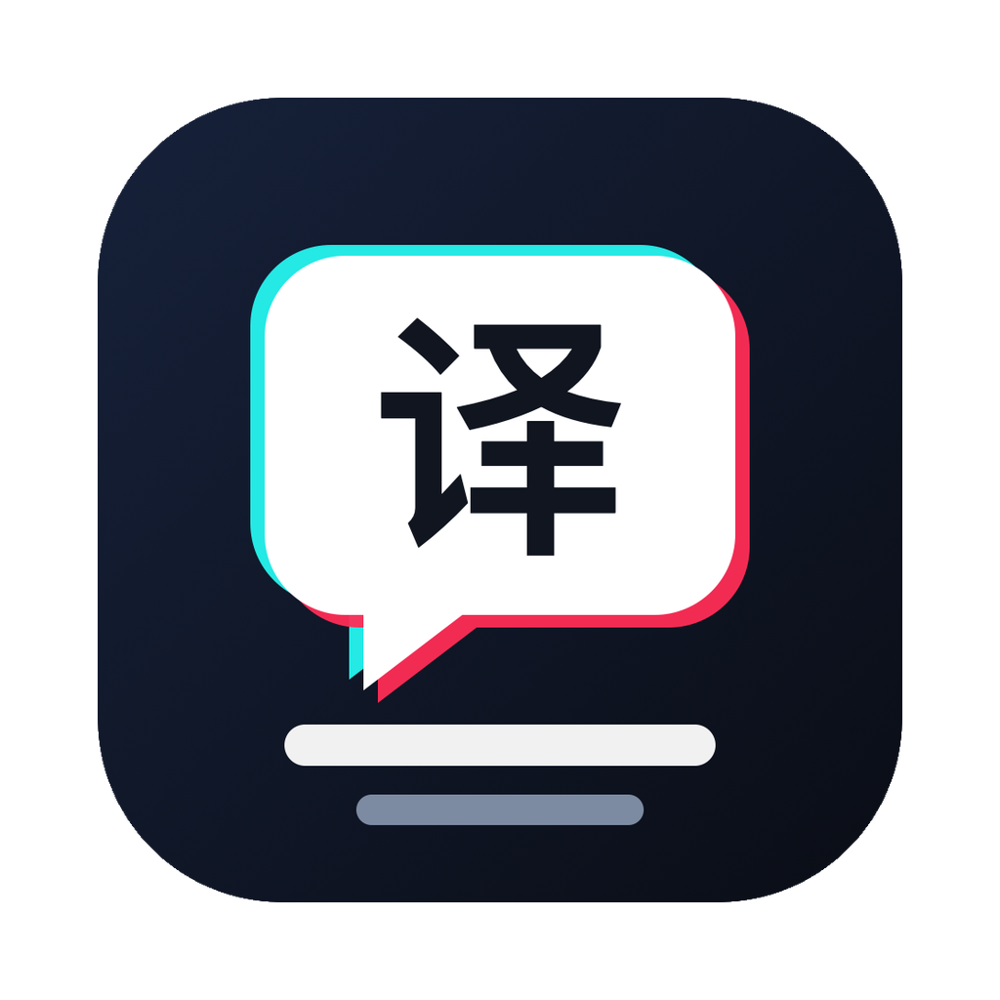
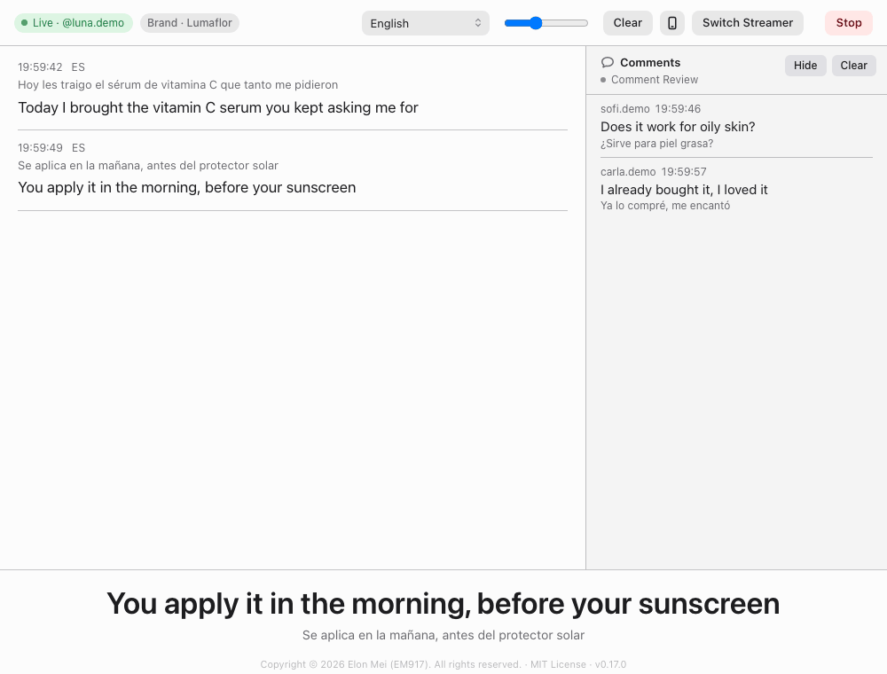
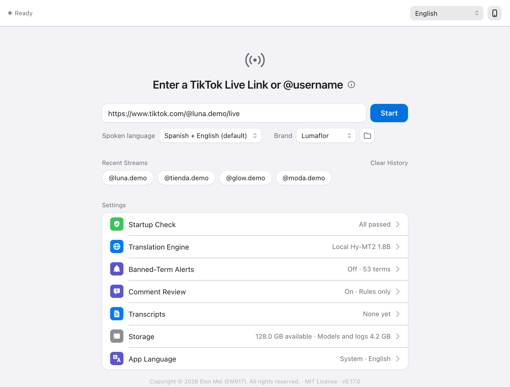
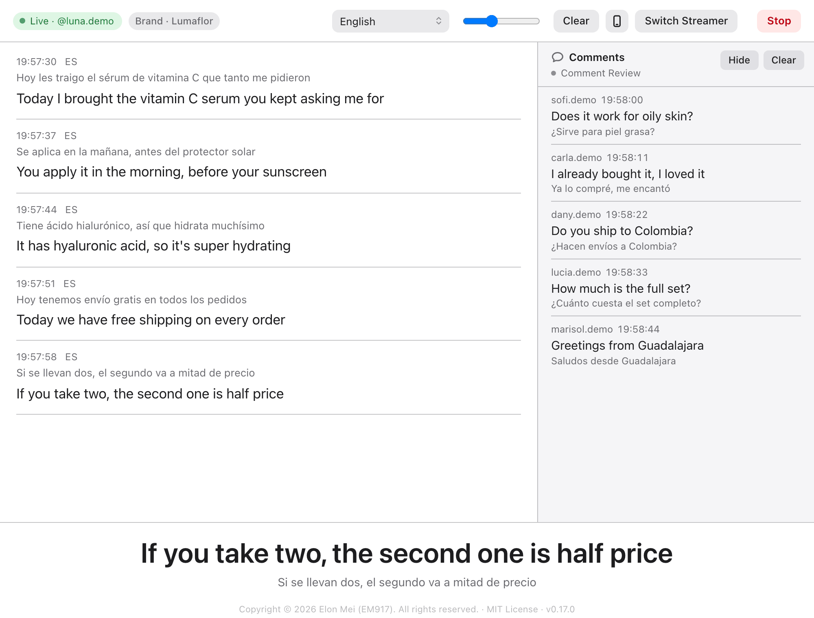
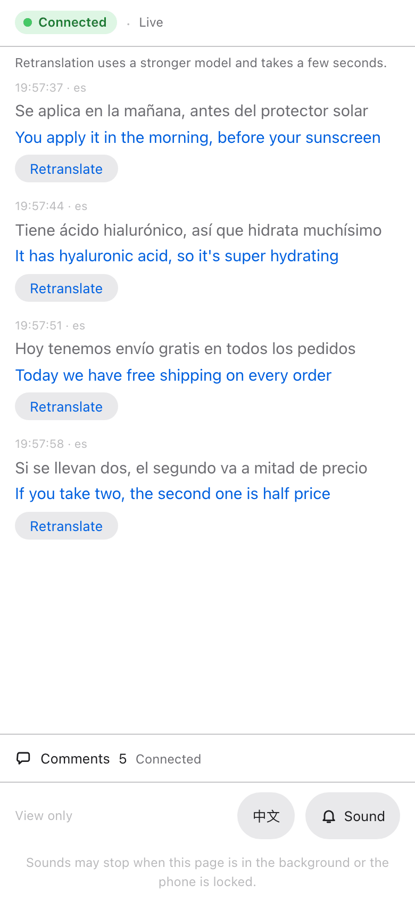
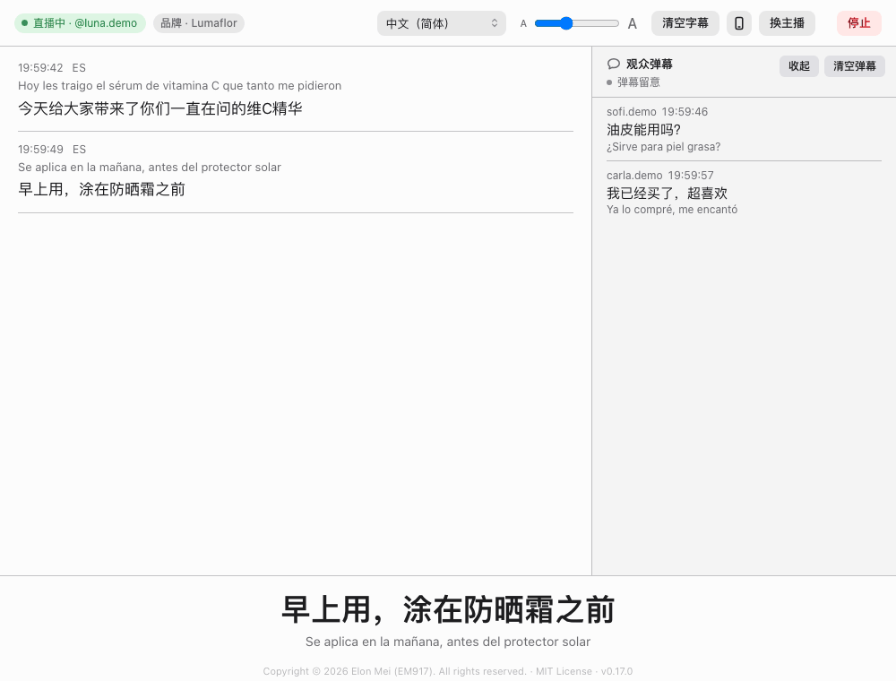
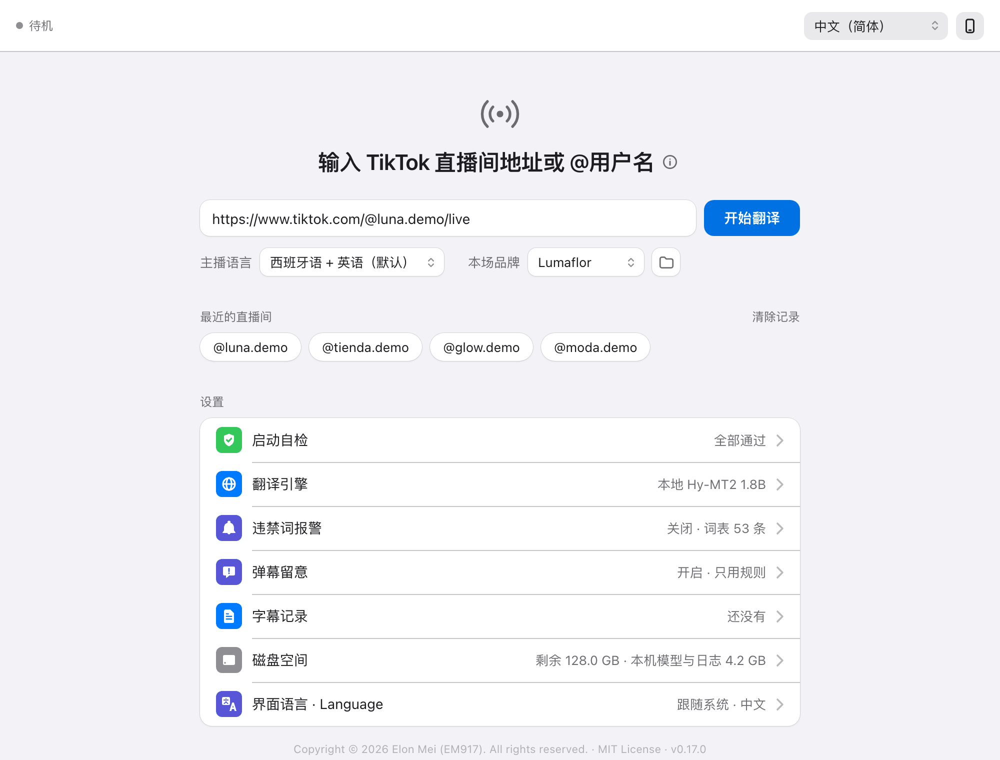
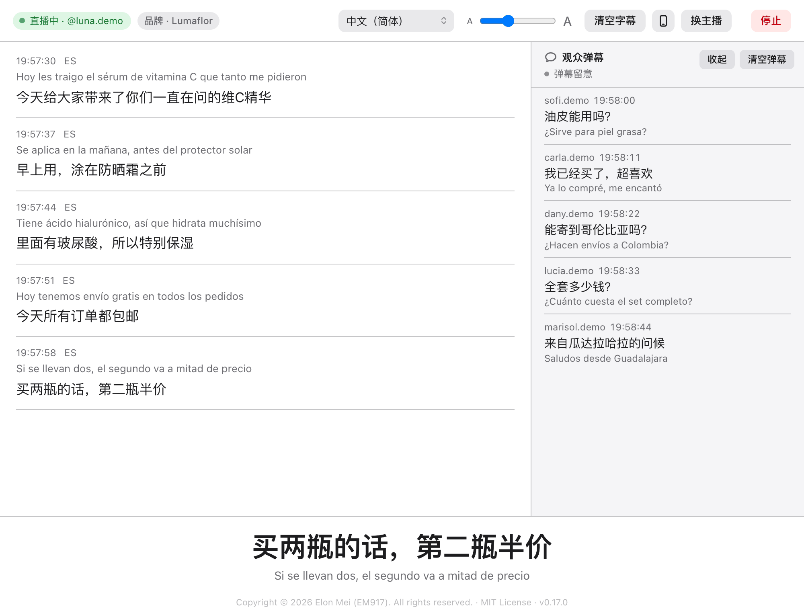
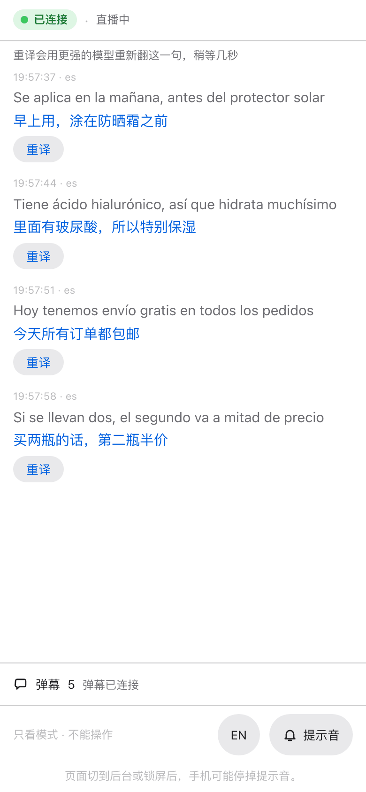

<a id="en"></a>

# TikTok Live Translator

<p align="center"></p>

<p align="center">
  <a href="https://github.com/EM917/tiktok-live-translator/releases/latest"></a>
  <a href="https://github.com/EM917/tiktok-live-translator/actions/workflows/ci.yml"></a>
  
  <a href="LICENSE"></a>
</p>

<p align="center"></p>

**Language / 语言：English | [中文](#zh)**

---

Live captions for Spanish TikTok streams, with the translation under each line. Viewer comments are translated too. Paste a live link and click Start.

It is for teams who follow Spanish live selling without speaking Spanish. One person runs the app on a computer, and colleagues watch on their phones. The Spanish appears as soon as it is recognized and the translation fills in a moment later, so a slow translation never holds a caption back. Speech recognition runs on your computer, and translation can too once Ollama is installed. You need no account and no API key, and nothing to pay.

It does not work for every stream. For some, TikTok gives the app no stream URL, and then there is nothing to caption. See [Limits](#en-limits).

<a id="en-features"></a>

## Features

<sub>[中文](#zh-features)</sub>

- Captions in real time, with the translation under each line and the viewer comments in a panel beside them.
- Translation through a local model in Ollama. DeepL, Google, Claude and OpenAI-compatible APIs are optional.
- Glossaries for each streamer and each brand keep product names consistent.
- Switch Streamer moves to another live stream without stopping first.
- Phone Viewing: colleagues on the same Wi-Fi scan a QR code and watch on their phones. They cannot change anything.
- Comment Review marks insults and threats, fake-product claims, flooding, and comments that pull viewers to another stream or shop. It never deletes or mutes.
- If the stream drops, the app reconnects and keeps the audio it has not recognized yet in a queue.
- Banned-term alerts are available and off by default.

<a id="en-screenshots"></a>

## Screenshots

<sub>[中文](#zh-screenshots)</sub>

<table>
  <tr>
    <td width="50%"><br><sub>Home: paste a live link and click Start. Settings are below, one line each.</sub></td>
    <td width="50%"><br><sub>Live: the original first, the translation under it, comments beside.</sub></td>
  </tr>
  <tr>
    <td colspan="2" align="center"><br><sub>Phone page: view only, in the phone's own language.</sub></td>
  </tr>
</table>

<sub>The screenshots and the demo show made-up streams.</sub>

<a id="en-quick-start"></a>

## Quick start

<sub>[中文](#zh-quick-start)</sub>

You need macOS 12.3 or later, or Windows, and about 6 GB of free disk space. The first launch downloads software and models from PyPI, Hugging Face, ollama.com and GitHub. A work network that cannot reach those sites stops the install.

1. Download `TikTok-Live-Translator-vX.Y.Z.zip` from the [latest release](https://github.com/EM917/tiktok-live-translator/releases/latest) and unzip it anywhere.

2. Install Python 3.10 or newer from [python.org](https://www.python.org/downloads/) with the default options. Python 3.9 also runs the app, but without viewer comments. If Python is missing, the launcher opens the download page.

3. Install [Ollama](https://ollama.com/download), a free app that runs models on your computer, and open it once. On Windows the installer is about 1.5 GB and needs administrator rights. When the app starts, it downloads the Hy-MT2 1.8B translation model (about 1 GB). Without Ollama, the app translates through Google's free endpoint, which sends caption text to Google.

4. Start the app.

   - On macOS, double-click `TikTok Live Translator.app` and keep it inside its folder. If macOS says it cannot be opened, go to System Settings → Privacy & Security and click Open Anyway. On macOS 14 and earlier, right-click the app and choose Open instead. `Start.command` starts the app from a Terminal window instead.
   - On Windows, double-click `Start.bat`. If a warning names an unknown publisher, click Run.

   `Start.bat` opens a black text window and `Start.command` opens a Terminal window. Each one is the app itself, so closing it quits the app.

5. Paste a live link or `@username`, check Spoken language (Spanish + English by default), and click Start. Next time, Recent Streams under the box lists the streamers you opened lately, and one click starts one.

The first launch takes a few minutes. The app sets up its own Python environment and installs what it needs, including ffmpeg and the noise-reduction model. The speech model (up to 3 GB) downloads the first time you click Start, with the progress shown on the page.

Choose the language to translate into from the menu in the top bar. It offers 13: Simplified and Traditional Chinese, English, Japanese, Korean, Spanish, French, German, Russian, Portuguese, Vietnamese, Thai and Indonesian. It starts on Chinese, or on English for a new install with an English interface.

The interface is in English or Chinese. A new install follows your system language. An install that was already in use before the English interface existed stays in Chinese after updating. Settings → App Language changes it.

During a session, Switch Streamer moves to another streamer. Stop returns to the home page and keeps that session's captions under Previous Session.

### From a terminal

```bash
git clone https://github.com/EM917/tiktok-live-translator.git
cd tiktok-live-translator && python3 main.py     # python main.py on Windows
```

```bash
python3 main.py --demo        # preview the window without a stream
python3 main.py --doctor      # print the hardware check
python3 main.py --ui-lang en  # English interface for this launch only
```

Flags need a terminal: the `.app` does not take them, while `Start.command` and `Start.bat` pass them on. Add `--browser` to use a browser tab instead of the app window. More: [all flags](docs/command-line.md), [disk space and hardware](docs/hardware.md), [interface language](docs/interface-language.md).

### Updating

The app checks GitHub for a new version when it starts. A banner at the top of the window then shows an Update Now button if you installed with git, or a download link if you installed from the zip.

<a id="en-translation-engines"></a>

## Translation engines

<sub>[中文](#zh-translation-engines)</sub>

Choose the engine in Settings → Translation Engine on the home page. API keys go there too and are saved in `settings.json` on your computer.

| Engine | Runs | Key |
|---|---|---|
| Automatic (default) | On your computer if a local model is installed, otherwise on Google's servers | No |
| Local Hy-MT2 1.8B | On your computer, through Ollama | No |
| Local Hy-MT2 7B | On your computer, through Ollama. Needs a separate download and about 16 GB of RAM | No |
| DeepL | DeepL's servers | Yes |
| Claude | Anthropic's servers | Yes |
| OpenAI-compatible API | The provider's servers, or your own such as LM Studio | Yes |
| Google (free) | Google's servers | No |
| Don't Translate | Nothing runs: captions stay in the original language | No |

Automatic uses Hy-MT2 1.8B if it is installed, then TranslateGemma, then Google's free endpoint. It never picks the 7B model.

Glossaries keep product names right. There are three files:

- `profiles/<username>.txt`: one streamer's wording
- `brands/<brand>.txt`: one brand's products, picked in the Brand menu
- `glossary.txt`: terms for everyone

Changes apply after Stop and Start. These files stay on your computer. With DeepL, the app also keeps a glossary in your DeepL account.

To translate one caption again with the strongest model you have, hover over it and click Retranslate. [docs/engine-benchmarks.md](docs/engine-benchmarks.md) compares four engines on captions from a real session. For glossaries, DeepL and Retranslate in detail, see [docs/translation-engines.md](docs/translation-engines.md).

<a id="en-phone-viewing"></a>

## Phone Viewing

<sub>[中文](#zh-phone-viewing)</sub>

Colleagues can follow the captions on their phones. Click the phone icon in the top bar, then Start Sharing. A phone on the same Wi-Fi scans the QR code or types the address shown. Allow incoming connections if macOS or Windows asks.

A phone shows captions and alerts. It can ask for one line to be retranslated, and it cannot start, stop or change anything. Each page uses the phone's own language, and up to 12 phones can watch at once.

The link contains a key, so treat it like a password. New Link disconnects every phone. Sharing is off until you turn it on, and the phone must be on the same network.

<a id="en-comment-review"></a>

## Comment Review

<sub>[中文](#zh-comment-review)</sub>

The app marks viewer comments that:

- insult or threaten
- call products fake or a scam, or call for reports or for people not to buy
- flood the chat: one viewer posting in bursts or repeating one sentence
- pull people to another stream or shop

Different accounts sending the same sentence are not flagged, because that is usually a giveaway chant the streamer asked for. The app only counts it in the audit log.

During a session, a line at the top of the window counts what you have not looked at yet, for example "2 items to review · 1 unclear".

A flagged comment gets a bar on its left edge: red when a rule matched clearly, orange when the rules are not sure. A rule you have not confirmed makes an orange bar at most, even on a clear match. The threat and report rules that come with the app are mostly confirmed. The rest, insults for example, stay orange until you confirm them.

Comment Review only reads: it cannot delete comments or mute anyone, and phones do not show it. It is on by default, and its rules run on your computer without any model. To turn it off, go to Settings → Comment Review. For confirming rules, marking viewers, the optional Claude review and the rules folder, see [docs/comment-review.md](docs/comment-review.md).

<a id="en-banned-term-alerts"></a>

## Banned-Term Alerts

<sub>[中文](#zh-banned-term-alerts)</sub>

Alerts are off by default. Turn them on in Settings → Banned-Term Alerts with Show alert on match.

Matching runs on the recognized Spanish text, so an alert does not wait for the translation. A match opens a red Possible Banned Terms panel at the top of the window. The list is `banned_terms.txt` in the app folder, one word or phrase per line. Save it, then click Stop and Start. With alerts off, matches are still written to the audit log. The shipped list is a starting point, so review it before you rely on it. Details: [docs/banned-terms.md](docs/banned-terms.md).

<a id="en-when-something-goes-wrong"></a>

## When something goes wrong

<sub>[中文](#zh-when-something-goes-wrong)</sub>

**The app says TikTok didn't provide a stream URL for this live stream (code 4003110).** TikTok's interface gave the app no stream URL for this live link, and it does not say why. Click Start again a little later. If the stream plays in your browser, you can copy its `.flv` address from there and paste it after the live link, separated by a space ([details](docs/fault-tolerance.md)). To check your own logs for this streamer, run `python3 tools/diagnose_room.py @streamer --history-only` in a terminal. It sends no requests.

**A Startup Check row is red.** Open Settings → Startup Check. Each row shows its fix underneath, and a failing check stays in a banner at the top of the window until a later check passes. A common cause is an incomplete noise-reduction model: delete `models/bd.rnnn` and start again.

**Browser Login says macOS did not allow access.** Only streams where TikTok gives the stream URL to signed-in viewers need this step. macOS wants Full Disk Access for the Python interpreter, not for the app, and the Browser Login row shows the path to add.

1. Open System Settings → Privacy & Security → Full Disk Access and click +.
2. In the file window press ⌘⇧G, paste the path, press Return, click Open, and turn the entry on. It is listed as `python3.x`, not under the app's name.
3. Repeat for each path shown, then quit the app completely and reopen it.

If you start with `Start.command`, add Terminal as well. If the audit log shows `cannot_decrypt`, click Start again. If a Keychain dialog then asks for "Chrome Safe Storage", enter your Mac login password and choose Always Allow.

**Update Now does not start or finish.** The message says what went wrong and shows a command with a Copy button. Run it in Terminal. If the message lists app files you changed, the command discards those changes, so skip it if the changes were on purpose.

**Captions fall behind and the window warns about a backlog.** In a terminal, run `ollama ps`. If more than one model is loaded, unload the extra one with `ollama stop <model>`. If that does not help, use a smaller speech model, which is a flag, so start the app from a terminal: `python3 main.py --model small`. On a Mac with 8 GB of RAM, `--model large-v3-turbo` or `--model small` fits better than the default.

**The status says Live but no captions appear.** The app skips silent or low-confidence audio on purpose, for example while the streamer plays music or is not speaking. If someone is clearly speaking and nothing appears, start from a terminal with `python3 main.py --denoise off`, or try a different `--model` size.

**The Comments panel is empty or shows the original text without a translation.** Check these:

- Comments are translated by Hy-MT2 1.8B, TranslateGemma or Claude, and by no other engine.
- Comments need Python 3.10 or newer.
- A stream URL pasted on its own has no comments. Use the live link or `@username`.

**A phone cannot open the Phone Viewing link.** Check in this order:

- The phone is on the same Wi-Fi as the computer.
- Another address from the list in the panel works.
- The same link opens in a browser on the computer.

If WeChat shows a warning, open the link in a browser from its top-right menu.

**The app quit when the black window on Windows closed.** Closing that window quits the app. Start it again with `Start.bat`.

For a stuck download, a busy port and other problems, see [docs/faq.md](docs/faq.md).

<a id="en-limits"></a>

## Limits

<sub>[中文](#zh-limits)</sub>

- TikTok's interfaces are unofficial and may change. For some live streams TikTok does not provide a stream URL, and the app cannot get one.
- Translations can be wrong, most often on product names and slang.
- On a computer without Apple Silicon or an NVIDIA GPU, recognition can fall behind. Audio more than 60 seconds behind is dropped, oldest first, and the window shows how much.
- Viewer comments need Python 3.10 or newer. Hy-MT2 1.8B, TranslateGemma and Claude translate them; the other engines show the original.
- Phone Viewing needs the phone to be on the same network. It uses plain http, so phones get no system notifications, and sound may stop when a phone locks.
- There is no export. Select and copy text from the window. It keeps the last 300 captions and 100 comments, and a reload shows the same ones again. Clear removes them from the app too, so they do not come back after a reload. A phone that connects later sees the last 100 of each.
- The terminal, the logs and the audit log are always in Chinese, whatever the interface language.
- Follow TikTok's Terms of Service and local laws. Do not rebroadcast or redistribute other people's content.

<a id="en-privacy"></a>

## Privacy

<sub>[中文](#zh-privacy)</sub>

Speech recognition always runs on your computer. So do Hy-MT2 and TranslateGemma, and Don't Translate sends nothing out. Automatic stays on your computer when a local model is installed. With none installed it sends caption text to Google.

With DeepL, Google or Claude, caption text goes to that provider. With an OpenAI-compatible API it goes to the server you set up, which can be your own. If your DeepL quota runs out, the app switches to a local model, or to Google when there is none, and the Translation Engine row says so. With Claude, viewer comments and Retranslate requests go to Anthropic too.

Viewer comments come from TikTok through TikTokLive, which signs its connection through the third-party Euler Stream service. The app also contacts TikTok for the stream and GitHub to check for updates. It downloads software and models from PyPI, Hugging Face, ollama.com and GitHub.

Comment Review's rules run on your computer. If you choose the Claude review, comments the rules are unsure about go to Anthropic, up to 8 in one call and each with the same viewer's previous comment from the last 2 minutes. Phone numbers, strings of 7 or more digits, links, emails and `@handles` are masked first.

Phone Viewing opens a port on your network while sharing is on and closes it when sharing is off. Phones see captions, not settings, file paths, cookies or the stream address. The app's own window, where you start and stop and change settings, opens from this computer only.

<a id="en-how-it-works"></a>

## How it works

<sub>[中文](#zh-how-it-works)</sub>

<p align="center">
  
</p>

The app finds the stream URL, pulls the audio with ffmpeg, quiets background music, and cuts it into short segments. Whisper turns each segment into text. The text goes to the window at once. Translation and banned-term matching start from the same text and never hold it up.

When the app starts, Startup Check runs each part once (noise reduction, translation, the audit log) and shows a fix next to anything that fails. A readout at the bottom of the window shows how long a spoken word takes to be recognized and how much the translation adds.

Each session also writes an audit log in `logs/`, one record per segment: the accepted text, the candidates the quality filter rejected, banned-term matches and the translation.

[Open the interactive diagram](https://em917.github.io/tiktok-live-translator/architecture/audio-chain.en.html) to search components, trace a route and step through the chapters. The same chain as editable text is in [docs/architecture/mermaid.md](docs/architecture/mermaid.md), and [docs/fault-tolerance.md](docs/fault-tolerance.md) explains how the app keeps a stream alive.

<a id="en-credits-and-license"></a>

## Credits and license

<sub>[中文](#zh-credits-and-license)</sub>

- [faster-whisper](https://github.com/SYSTRAN/faster-whisper) and [mlx-whisper](https://github.com/ml-explore/mlx-examples): speech recognition
- [TikTokLive](https://github.com/isaackogan/TikTokLive): viewer comments
- [yt-dlp](https://github.com/yt-dlp/yt-dlp): stream lookup
- [FFmpeg](https://ffmpeg.org/): audio processing, including its RNNoise filter
- [rnnoise-models](https://github.com/GregorR/rnnoise-models): the noise-reduction model (beguiling-drafter)
- [Ollama](https://github.com/ollama/ollama), [Hy-MT2](https://github.com/Tencent-Hunyuan/Hy-MT2) and [TranslateGemma](https://ollama.com/library/translategemma): local translation

Copyright © 2026 [Elon Mei (EM917)](https://github.com/EM917). Released under the [MIT License](LICENSE).

---

<a id="zh"></a>

# TikTok 直播同传

<p align="center"></p>

<p align="center"></p>

**Language / 语言：[English](#en) | 中文**

---

给 TikTok 西语直播加实时字幕，每句话下面是译文，观众弹幕也一起翻。粘贴直播间地址，点「开始翻译」就行。

给不懂西语、又要看西语带货直播的团队用：中控在电脑上开程序，同事用手机跟着看。字幕不等译文，识别出来先上屏，译文过一会儿补上。语音识别在你的电脑上跑，装了 Ollama 之后翻译也在本机，不用注册，不用 API Key，也不用花钱。

不是每个直播间都能用：有些直播间 TikTok 不把流地址给程序，程序拿不到声音，就出不了字幕。见[已知限制](#zh-limits)。

<a id="zh-features"></a>

## 特性

<sub>[English](#en-features)</sub>

- 实时字幕：西语一识别出来就上屏，译文稍后补在下面，观众弹幕在旁边的面板里。
- 翻译可以用本机的模型，通过 Ollama 运行。DeepL、Google、Claude 和 OpenAI 兼容 API 也能选。
- 按主播、按品牌配词表，商品名翻得前后一致。
- 「换主播」不用先停止，直接改听另一个直播间。
- 手机同看：同事在同一个 Wi-Fi 下扫二维码，就能用手机看。只能看，不能操作。
- 弹幕留意：标出辱骂、威胁、说商品是假货、刷屏和引流的弹幕。它只读，不会删弹幕，也不会禁言。
- 直播流断了会自动重连，还没识别的音频在队列里等着。
- 违禁词报警：有，默认关闭。

<a id="zh-screenshots"></a>

## 界面截图

<sub>[English](#en-screenshots)</sub>

<table>
  <tr>
    <td width="50%"><br><sub>首页：粘贴直播间地址，点「开始翻译」。「设置」在下面，每项一行。</sub></td>
    <td width="50%"><br><sub>直播中：原文在上，译文在下，弹幕在旁边。</sub></td>
  </tr>
  <tr>
    <td colspan="2" align="center"><br><sub>手机页：只能看，按手机自己的语言显示。</sub></td>
  </tr>
</table>

<sub>截图和演示动图里的直播都是虚构的。</sub>

<a id="zh-quick-start"></a>

## 快速开始

<sub>[English](#en-quick-start)</sub>

需要 macOS 12.3 或更新的系统，或者 Windows，另外留出约 6 GB 的磁盘空间。第一次启动要从 PyPI、Hugging Face、ollama.com 和 GitHub 下载组件和模型。公司网络连不上这几个网站，就装不下去。

1. 到[最新 Release](https://github.com/EM917/tiktok-live-translator/releases/latest) 下载 `TikTok-Live-Translator-vX.Y.Z.zip`，解压到任意位置。

2. 从 [python.org](https://www.python.org/downloads/) 装 Python 3.10 或更新的版本，安装选项保持默认。Python 3.9 也能运行程序，但没有观众弹幕。没装 Python 的话，启动程序时会自动打开下载页。

3. 装 [Ollama](https://ollama.com/download)（免费的，在你电脑上运行模型的软件），装完打开一次。Windows 上安装包约 1.5 GB，需要管理员权限。程序启动后会下载翻译模型 Hy-MT2 1.8B（约 1 GB）。不装 Ollama 也能用，翻译会改走 Google 的免费接口，字幕文本会发给 Google。

4. 启动程序。

   - macOS：双击 `TikTok Live Translator.app`，别把它拖出所在的文件夹。如果提示打不开，到「系统设置 → 隐私与安全性」点「仍要打开」；macOS 14 及更早的系统，改成右键点程序，选「打开」。`Start.command` 是另一种启动方式，会在「终端」窗口里启动。
   - Windows：双击 `Start.bat`。如果弹出「发布者未知」的警告，点「运行」。

   `Start.bat` 会多开一个黑色的文字窗口，`Start.command` 会多开一个「终端」窗口。它们就是程序本身，关掉它们程序就退出。

5. 粘贴直播间地址或 `@用户名`，确认「主播语言」（默认西语 + 英语），点「开始翻译」。下次可以直接点输入框下面的「最近的直播间」，列出的是你最近打开过的主播，点一下就开始。

第一次启动要几分钟：程序会建好自己的 Python 环境，装上需要的组件，包括 ffmpeg 和降噪模型。语音模型最多约 3 GB，在第一次点「开始翻译」时下载，页面上有进度。

字幕译成哪种语言，在顶栏的菜单里选，共 13 种：简体中文、繁体中文、英语、日语、韩语、西班牙语、法语、德语、俄语、葡萄牙语、越南语、泰语、印尼语。默认是中文，新装且界面是英文时默认是英文。

界面有中文和英文两种。新装的程序跟着系统语言走；英文界面出现之前就在用的安装，升级后仍是中文。想改就到「设置 → 界面语言 · Language」。

直播中点「换主播」，可以改听另一个主播。点「停止」回到首页，这一场的字幕留在「上一场字幕」里。

### 从命令行启动

```bash
git clone https://github.com/EM917/tiktok-live-translator.git
cd tiktok-live-translator && python3 main.py     # Windows 用 python main.py
```

```bash
python3 main.py --demo        # 不连直播，预览界面
python3 main.py --doctor      # 打印硬件检测结果
python3 main.py --ui-lang zh  # 只这一次用中文界面
```

启动参数只能在终端里加：`.app` 不接受参数，`Start.command` 和 `Start.bat` 会把参数传给程序。加上 `--browser`，界面就在浏览器标签页里打开，不用应用窗口。更多内容：[全部命令行参数](docs/command-line.zh-CN.md)、[磁盘空间和硬件](docs/hardware.zh-CN.md)、[界面语言](docs/interface-language.zh-CN.md)。

### 更新

程序每次启动都会去 GitHub 查有没有新版本。有的话，窗口顶部出现一条横幅：用 git 装的，横幅上是「一键更新」按钮；用 zip 装的，是下载链接。

<a id="zh-translation-engines"></a>

## 翻译引擎

<sub>[English](#en-translation-engines)</sub>

引擎在首页的「设置 → 翻译引擎」里选，API 密钥也填在那里，保存在你电脑上的 `settings.json` 里。

| 引擎 | 在哪里跑 | 要密钥吗 |
|---|---|---|
| 自动（默认） | 装了本地模型就在本机，没装就走 Google 的服务器 | 不要 |
| 本地 Hy-MT2 1.8B | 本机，通过 Ollama | 不要 |
| 本地 Hy-MT2 7B | 本机，通过 Ollama。要另外下载，需要约 16 GB 内存 | 不要 |
| DeepL | DeepL 的服务器 | 要 |
| Claude | Anthropic 的服务器 | 要 |
| OpenAI 兼容 API | 服务商的服务器，也可以是你自己的，比如 LM Studio | 要 |
| Google 免费接口 | Google 的服务器 | 不要 |
| 不翻译，只显示原文 | 什么都不跑，字幕只有原文 | 不要 |

「自动」先用 Hy-MT2 1.8B，没装就用 TranslateGemma，再没有就用 Google 的免费接口。它不会自动选 7B。

词表帮你把商品名翻对，有三份文件：

- `profiles/<用户名>.txt`：某个主播的写法
- `brands/<品牌>.txt`：某个品牌的商品，在「本场品牌」菜单里选
- `glossary.txt`：通用的词

改完要点「停止」再点「开始翻译」才生效。这些文件只在你的电脑上。用 DeepL 时，程序还会在你的 DeepL 账号里建一份术语表。

想用手头最强的模型重翻某一句，把鼠标移到字幕上，点「重译」。[docs/engine-benchmarks.zh-CN.md](docs/engine-benchmarks.zh-CN.md) 在一场真实直播的字幕上比较了四个引擎。词表、DeepL 和重译的细节，见 [docs/translation-engines.zh-CN.md](docs/translation-engines.zh-CN.md)。

<a id="zh-phone-viewing"></a>

## 手机同看

<sub>[English](#en-phone-viewing)</sub>

同事可以用手机跟着看字幕。点顶栏的手机图标，再点「开始同看」。手机连上同一个 Wi-Fi，扫二维码，或者输入面板里显示的地址。第一次打开时，macOS 可能问是否允许接受网络连接，Windows 可能弹出防火墙提示，都选允许。

手机上能看字幕和报警，也能请求重译某一句，不能开始、停止或改设置。每台手机按自己的语言显示，最多 12 台一起看。

链接里带着密钥，要像密码一样保管。点「换一个链接」，所有手机都会断开。同看默认关闭，只能在同一个局域网里用。

<a id="zh-comment-review"></a>

## 弹幕留意

<sub>[English](#en-comment-review)</sub>

程序会标出这几类弹幕：

- 辱骂和威胁
- 说商品是假货、骗局，或者号召举报、号召别买
- 刷屏：同一个人连发，或反复发同一句
- 把观众引到别的直播间或店铺

不同账号发同一句话不会标出来，因为这通常是主播要求的抽奖口令。程序只在审计日志里给它计数。

直播时，窗口顶部有一行提示，汇总还没看的标记，比如「需要留意 2 件 · 拿不准 1 件」。

命中的弹幕左边会有一条色条：红条表示规则明确命中，橙色表示规则拿不准。没确认过的词条，命中了也只显示橙色。出厂词表里，威胁类和举报类的词条大多已经确认，辱骂等其他类别还没有，要你逐条确认。

弹幕留意只读，不能删弹幕，也不能禁言，手机页上看不到它。它默认开着，规则在你的电脑上跑，不用模型。要关掉，到「设置 → 弹幕留意」。怎么确认词条，以及关注名单、可选的 Claude 复核和规则文件夹，见 [docs/comment-review.zh-CN.md](docs/comment-review.zh-CN.md)。

<a id="zh-banned-term-alerts"></a>

## 违禁词报警

<sub>[English](#en-banned-term-alerts)</sub>

报警默认关闭。要用的话，到「设置 → 违禁词报警」，打开「命中时弹出报警」。

匹配跑在识别出的西语原文上，不用等译文。命中后，窗口顶部会出现红色的「疑似违禁词」面板。词表是程序文件夹里的 `banned_terms.txt`，一行一个词或短语。保存后点「停止」再点「开始翻译」才生效。报警关着的时候，命中照样写进审计日志。出厂词表只是个起点，用之前请自己过一遍。详见 [docs/banned-terms.zh-CN.md](docs/banned-terms.zh-CN.md)。

<a id="zh-when-something-goes-wrong"></a>

## 遇到问题

<sub>[English](#en-when-something-goes-wrong)</sub>

**TikTok 不把这个直播间的流地址给程序（代码 4003110）。** TikTok 的接口没有给这个直播间返回流地址，也不说明原因。过一会儿再点「开始翻译」。如果这场直播在浏览器里能播放，也可以从浏览器里复制它的 `.flv` 地址，接在直播间地址后面粘进来，中间用空格隔开（[做法说明](docs/fault-tolerance.zh-CN.md)）。想看你自己的日志里这个主播的记录，在终端里运行 `python3 tools/diagnose_room.py @主播用户名 --history-only`，它不发任何请求。

**「启动自检」有一行是红的。** 打开「设置 → 启动自检」，每一行下面写着怎么处理。没处理好的项会一直在窗口顶部显示提示，直到下一次自检通过。常见的原因是降噪模型没下载完整：删掉 `models/bd.rnnn`，再启动一次。

**「浏览器登录态」说 macOS 没有放行。** 只有 TikTok 要登录才给流地址的直播间需要这一步。要加进「完全磁盘访问权限」的是 Python 解释器，不是程序本身，这一行会显示要加的路径。

1. 打开「系统设置 → 隐私与安全性 → 完全磁盘访问权限」，点「+」。
2. 在选文件的窗口里按 ⌘⇧G，粘贴路径，按回车，点「打开」，再打开这一项的开关。列表里它叫 `python3.x`。
3. 每个路径都这样加一遍，然后完全退出程序，重新打开。

用 `Start.command` 启动的话，也要把「终端」加进去。审计日志里出现 `cannot_decrypt` 的话，再点一次「开始翻译」；如果这时弹出「钥匙串」对话框，要访问「Chrome Safe Storage」，输入这台电脑的登录密码，点「始终允许」。

**「一键更新」启动不了，或者没做完。** 提示里写着哪里出了问题，下面有一条带「复制」按钮的命令，复制后在终端里运行。如果提示列出了你改过的程序文件，这条命令会丢掉这些改动，改动是有意的就别运行。

**字幕越来越落后，窗口提示有积压。** 在终端里运行 `ollama ps`。如果载入了不止一个模型，用 `ollama stop <模型名>` 卸掉多余的那个。还不行就换小一点的语音模型，这要加启动参数，所以得从终端启动：`python3 main.py --model small`。8 GB 内存的 Mac 上，用 `--model large-v3-turbo` 或 `--model small` 比默认的更合适。

**状态是「直播中」，却没有字幕。** 没声音、或者识别没把握的片段，程序会故意略过，比如主播在放音乐或没说话的时候。明明有人在说话却一直没字幕，试试从终端运行 `python3 main.py --denoise off`，或者用 `--model` 换一个尺寸的语音模型。

**「观众弹幕」面板是空的，或者只有原文。** 按这几条查：

- 只有用 Hy-MT2 1.8B、TranslateGemma 或 Claude 时，弹幕才会翻译。
- 弹幕要 Python 3.10 或更新的版本。
- 只粘贴流地址的话没有弹幕，要粘贴直播间地址或 `@用户名`。

**手机打不开「手机同看」的链接。** 按顺序查：

- 手机和电脑是不是连着同一个 Wi-Fi。
- 换面板里列出的另一个地址试试。
- 在电脑的浏览器里能不能打开同一个链接。

微信里如果出现警告，点右上角的菜单，用浏览器打开。

**Windows 上关掉黑色窗口，程序也退出了。** 关掉那个窗口就会退出程序。用 `Start.bat` 重新启动就行。

下载卡住、端口被占用等其他问题，见 [docs/faq.zh-CN.md](docs/faq.zh-CN.md)。

<a id="zh-limits"></a>

## 已知限制

<sub>[English](#en-limits)</sub>

- TikTok 的接口是非官方的，可能会变。有些直播间 TikTok 不给流地址，程序也拿不到。
- 译文可能出错，商品名和俚语最容易错。
- 没有 Apple 芯片或 NVIDIA 显卡的电脑，识别可能跟不上。
- 音频积压超过 60 秒，才会开始丢最旧的，窗口会显示丢了多少。
- 观众弹幕要 Python 3.10 或更新的版本，而且只有用 Hy-MT2 1.8B、TranslateGemma 或 Claude 时才翻译。
- 手机同看只能在同一个局域网里用。它走的是普通 http，所以手机收不到系统通知，锁屏后声音可能会断。
- 没有导出功能。可以在窗口里选中文字复制。窗口保留最近 300 条字幕和 100 条弹幕，刷新后原样放回来；点「清空」会连程序里存着的一起清掉，刷新后不会再回来。之后才连上的手机，每类只看到最近 100 条。
- 终端、日志和审计日志一直是中文，不随界面语言变。
- 请遵守 TikTok 的服务条款和当地法律，不要转播或分发别人的内容。

<a id="zh-privacy"></a>

## 隐私

<sub>[English](#en-privacy)</sub>

语音识别一直在你的电脑上跑。Hy-MT2 和 TranslateGemma 也在本机，和「不翻译」一样，不会往外发任何东西。「自动」在装了本地模型时同样留在本机，一个本地模型都没装就会把字幕文本发给 Google。

用 DeepL、Google 或 Claude 时，字幕文本会发给对应的服务商。用 OpenAI 兼容 API 时，发给你设置的那个服务器，可以是你自己的。DeepL 的额度用完后，程序会改用本地模型，没有本地模型就改用 Google，「翻译引擎」那一行会写明。用 Claude 时，观众弹幕和「重译」请求也会发给 Anthropic。

观众弹幕通过 TikTokLive 从 TikTok 获取，它的连接签名要经过第三方的 Euler Stream 服务。另外，程序会联系 TikTok 取直播流，联系 GitHub 查更新。组件和模型从 PyPI、Hugging Face、ollama.com 和 GitHub 下载。

弹幕留意只用规则，在本机完成。如果你选了 Claude 复核，规则拿不准的弹幕会发给 Anthropic，一次最多 8 条，每条带上同一个人 2 分钟内的前一条弹幕。电话、连续 7 位以上的数字、链接、邮箱和 `@账号` 会先打码。

手机同看只在打开期间才在你的网络上开一个端口。手机看到的是字幕，看不到设置、文件路径、Cookie 和流地址。你用来开始、停止和改设置的程序窗口，只能在这台电脑上打开。

<a id="zh-how-it-works"></a>

## 工作原理

<sub>[English](#en-how-it-works)</sub>

<p align="center">
  
</p>

程序先找到流地址，用 ffmpeg 拉出音频，压低背景音乐，切成短段。Whisper 把每一段转成文字，文字立刻上屏。翻译和违禁词匹配用的是同一份文字，不会拖慢上屏。

启动时，「启动自检」把每个环节（降噪、翻译、审计日志）各跑一遍，哪项出了问题，旁边就给出处理办法。窗口底部有一个读数，显示一个词说出口到识别出来要多久，翻译又多花多久。

每一场还会在 `logs/` 里写一份审计日志，每段一条记录：采用的文字、被质量过滤丢掉的候选、违禁词命中和译文。

[打开可交互的架构图](https://em917.github.io/tiktok-live-translator/architecture/audio-chain.zh.html)，可以搜索组件、追踪一条路径、按章节播放。同一条链路的可编辑文字版在 [docs/architecture/mermaid.zh-CN.md](docs/architecture/mermaid.zh-CN.md)，程序怎么保住直播流见 [docs/fault-tolerance.zh-CN.md](docs/fault-tolerance.zh-CN.md)。

<a id="zh-credits-and-license"></a>

## 致谢与许可

<sub>[English](#en-credits-and-license)</sub>

- [faster-whisper](https://github.com/SYSTRAN/faster-whisper) 和 [mlx-whisper](https://github.com/ml-explore/mlx-examples)：语音识别
- [TikTokLive](https://github.com/isaackogan/TikTokLive)：观众弹幕
- [yt-dlp](https://github.com/yt-dlp/yt-dlp)：查找直播流地址
- [FFmpeg](https://ffmpeg.org/)：音频处理，内置 RNNoise 降噪滤镜
- [rnnoise-models](https://github.com/GregorR/rnnoise-models)：降噪模型（beguiling-drafter）
- [Ollama](https://github.com/ollama/ollama)、[Hy-MT2](https://github.com/Tencent-Hunyuan/Hy-MT2) 和 [TranslateGemma](https://ollama.com/library/translategemma)：本地翻译

Copyright © 2026 [Elon Mei (EM917)](https://github.com/EM917)，以 [MIT 许可](LICENSE) 发布。
