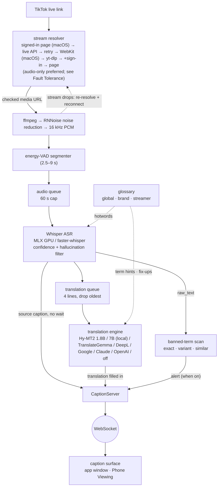

# The audio chain as Mermaid

*Moved from the README (Architecture). The text is unchanged except for relative links.*

Drawn from the source at [`430fe06`](https://github.com/EM917/tiktok-live-translator/tree/430fe06c139bb3cadc423221b6f4091702a4d51b), with every component checked against where it lives in the code. The typed source and regeneration steps are in [`docs/architecture/`](./).

The same topology as Mermaid — editable without any tooling

