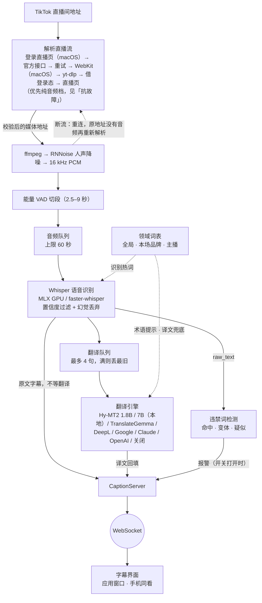

# 音频链路的 Mermaid 版本

*本文从 README（架构）移来。正文没有改动，只调整了相对链接。*

图按 [`430fe06`](https://github.com/EM917/tiktok-live-translator/tree/430fe06c139bb3cadc423221b6f4091702a4d51b) 的源码画出，每个组件都核对过实际位置。Typed 源与重新生成的方法见 [`docs/architecture/`](./)。

同一份拓扑的 Mermaid 版本——不装任何工具也能改

